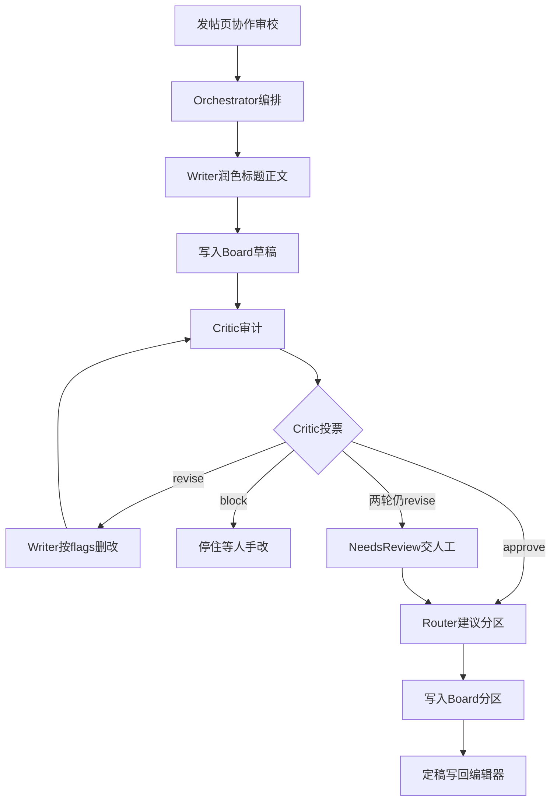

# SVQuant 多 Agent 交互设计（Skills 优先 · 相互影响）

> 落地位置：`WebApp`
> 状态：已实现社区发帖 crew
> 对齐：INIT-003 `AgentTask` 语义（goal / plan / steps / status）

**多个有角色的 Agent 围绕同一块共享黑板协作**——Writer 改文案、Critic 查虚报、Router 建议分区，彼此能 **驳回 / 回写 / 要求对方重跑**。对外仍叫 SVQuant Agent；对内是 **Skills 注册表 + 编排器**。

---

## 与「单 Agent 调 Tool」的区别

| | 快速润色（single） | 协作审校（multi） |
|--|--|--|
| 角色 | 仅 Writer | Writer + Critic + Router |
| 相互影响 | 无 | Critic 写 flags → Orchestrator 回流 Writer 删改 |
| Skills | `polish_*` | + `audit_claims` / `strip_unverifiable` / `suggest_section` |
| UI | 润色标题/正文/一并 | **协作审校** 按钮 + 异议列表 |

---

## 架构

> 下图按**真实执行顺序**画；Critic 只审计、不改稿；删改由 Writer 完成。



### 三个 Agent 分别是什么

| Agent | 一句话 | 职责 | 会用的 Skills | 不会做什么 |
|-------|--------|------|---------------|------------|
| **Writer** | 写手 / 改稿编辑 | 把口语草稿改成可读帖；被 Critic 打回后按异议删改 | `polish_title`、`polish_body`、`strip_unverifiable` | 不审能不能发、不决定分区 |
| **Critic** | 审稿 / 风控 | 找夸大、无出处数字、承诺收益；只写 flags 并投票 | `audit_claims` | 不直接改正文 |
| **Router** | 分诊台 | 看标题正文代码，建议社区分区 | `suggest_section` | 不润色、不审计 |

另有 **Orchestrator（编排器）**：不是第四个「聊天 Agent」，只负责调度顺序、看投票、决定要不要回流 Writer、最后把 Board 定稿交回前端。

### 怎么协同（相互影响）

1. Writer 先润色，结果写入 Board.draft  
2. Critic 读 Board，写 flags，投票 approve / revise / block  
3. 若 revise：Writer 跑 `strip_unverifiable`（按 flags 删改）→ Critic 再审；最多约 2 轮  
4. 两轮仍 `revise`：状态 `needs_review`，**保留 flags**，仍可建议分区并把草稿写回编辑器，**不代发帖**，等人手改  
5. `approve` 后（或 needs_review 仍走分区建议）Router 写回 Board → 定稿回编辑器  

关键：Critic 的异议改变 Writer 下一轮输入，这才是相互影响。

### Skill（能力原子）

实现：[`backend/services/agent_skills.py`](../backend/services/agent_skills.py)

| skill_id | 作用 |
|----------|------|
| `polish_title` / `polish_body` | 润色 |
| `audit_claims` | 检查夸大/无出处数字/承诺收益 |
| `strip_unverifiable` | 按 flags 删改 |
| `suggest_section` | 建议分区 |

### Board（相互影响的介质）

`draft` / `flags` / `votes` / `artifacts` / `revision` / `max_revisions`

### Agents（社区 crew）

| Agent | 目标 | Skills |
|-------|------|--------|
| Writer | 可读、可结构 | polish_* , strip_unverifiable |
| Critic | 不编造、不夸大 | audit_claims（只列问题、不改稿） |
| Router | 分区合适 | suggest_section |

编排：[`backend/services/agent_orchestrator.py`](../backend/services/agent_orchestrator.py)

---

## API

```http
POST /api/agent/runs
```

```json
{
  "mode": "multi",
  "crew": "community_post",
  "goal": "把草稿整理成可发社区帖",
  "context": { "title": "...", "body": "...", "section": "hotspot", "code_snippet": "" }
}
```

- `mode=single`（默认）：兼容原快速润色  
- 响应含：`steps[]`（含 agent）、`agents_trace[]`、`board`（flags/votes）、`outputs`

---

## 发帖页怎么用

1. 填草稿（可用 [`community-agent-polish-examples.md`](./community-agent-polish-examples.md)）  
2. **一并润色** = 单 Writer  
3. **协作审校** = 多 Agent；侧栏显示各 Agent 步骤与 Critic 异议  
4. Agent **不代发帖**；`blocked` / `needs_review` 时需按异议人工改后再发  

---

## 状态机

`Planning → Executing → Revising → completed | blocked | needs_review`

- Revising：Critic `revise` 且未超 `max_revisions`（默认 2）  
- blocked：Critic `block`（如承诺收益）— 不跑 Router，等人手改  
- needs_review：修订轮次用尽仍有异议 — 保留 flags，可带草稿回编辑器，需人工处理后再发


