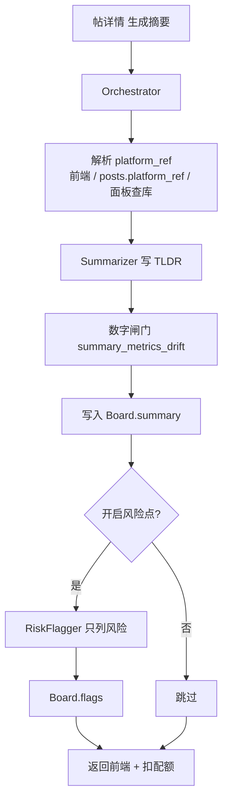

# SVQuant 读帖 TL;DR · Agent 协调设计

> 落地位置：`WebApp`  
> 状态：**MVP 已验收过关**（2026-07-28）  
> 对齐：[`AI发帖助手三Agent协调.md`](./AI发帖助手三Agent协调.md) 同一套 Skills / Board / `POST /api/agent/runs` / 日配额  

**读帖一键摘要**：把长帖压成可读要点（可选风险提示），**不改原文、不代发、不改回测真值**。对外仍是 SVQuant Agent；对内是 **读帖 crew + 编排器**，与发帖 crew 并列。

---

## 和「发帖多 Agent」像什么 / 不像什么

| | 发帖协作审校 `community_post` | 读帖 TL;DR `community_read`（本设计） |
|--|--|--|
| 目标 | 改成可发帖 | 读懂已发帖 |
| 角色 | Writer + Critic + Router | **Summarizer** + **RiskFlagger**（可选） |
| 相互影响 | Critic 打回 → Writer 删改多轮 | RiskFlagger **只加 flags**，**不回流改摘要**（MVP） |
| 输出 | 写回编辑器草稿 | 帖详情右侧栏展示摘要 |
| 配额 | 日配额 | **同一日配额** |
| 平台真源 | `platform_ref` + `metrics_trust` | 同引用落库 + 读帖注入 + 数字闸门 |

要点：**复用框架，不复刻 Writer↔Critic 改稿环。** 摘要是抽取/归纳；发帖助手是改稿+风控闭环。

---

## 架构（已落地）



### 两个 Agent 分别是什么

| Agent | 一句话 | 职责 | Skills | 不会做什么 |
|-------|--------|------|--------|------------|
| **Summarizer** | 读帖摘要员 | 按标题/正文/代码 + `platform_ref` 压出结构化要点 | `summarize_post` | 不改正文、不建议分区、不编造未在引用/正文中的回测数字 |
| **RiskFlagger** | 风险标注（轻量） | 标出承诺收益/无出处夸张等阅读风险 | `flag_read_risks` | 不改摘要正文；**无 revise 回流** |

**Orchestrator**：调度、拼 context、从帖表补 `platform_ref`、缺指标时 `lookup_panel_metric`、写 Board、计费。

---

## 平台真源（防幻觉，已落地）

| 层 | 做法 |
|----|------|
| **落库** | `posts.platform_ref`（JSONB）；面板/检测/策略分享发帖写入 |
| **注入** | 读帖 context 优先前端传入 → 否则按 `post_id` 读库 → 有因子键缺指标则查面板缓存 |
| **知识包** | `PLATFORM_KNOWLEDGE`：本机不存 bars、面板=RE 缓存、禁止外源行情验证本平台数 |
| **闸门** | `summary_number_flags`：摘要中的小数/% 须落在引用允许集合 |

分享链路：`buildFactorPanelShareDraft` 带 `universe_code` / `period_code` / `filter_limit_up`，便于回查 SQLite。

---

## Skill（能力原子）

实现：[`backend/services/agent_skills.py`](../backend/services/agent_skills.py)

| skill_id | 作用 | 输入要点 | 输出要点 |
|----------|------|----------|----------|
| `summarize_post` | TL;DR 正文 | title, body[, code] + `platform_ref` | `summary_md`（`## 背景` 等）+ 可选闸门 flags |
| `flag_read_risks` | 风险点列表 | 同上 + summary | `flags[]`（合并保留闸门 flags） |
| `lookup_panel_metrics` | 查面板真源 | factor_name, universe_code, period_code | 写回 `artifacts.platform_ref` |

截断：默认**不截断**（`AGENT_READ_BODY_MAX` / `AGENT_READ_CODE_MAX` = `0`）。摘要硬性约 **250 字**；侧栏 Markdown 强制 `forceMarkdown`。

---

## Board（读帖 crew）

| 字段 | 含义 |
|------|------|
| `summary_md` | 展示给用户的 Markdown 摘要 |
| `flags` | 阅读提示 / 闸门警告 |
| `source_post_id` | 来源帖 |
| `truncated` | 是否截断原文 |
| `artifacts.platform_ref` | 平台真源引用 |
| `artifacts.data_trust` | verified / unverified / casual |

摘要**不写回** `posts`（刷新可再生成；二期可做缓存）。

---

## API

```http
POST /api/agent/runs
```

```json
{
  "mode": "multi",
  "crew": "community_read",
  "goal": "为社区帖生成 TL;DR 摘要",
  "context": {
    "post_id": 60,
    "title": "...",
    "body": "...",
    "code_snippet": "",
    "with_risks": true,
    "platform_ref": { "source": "factor_panel", "metrics_display": {} }
  }
}
```

约定：

- `mode=multi` + `crew=community_read`：Summarizer →（可选）RiskFlagger。  
- `platform_ref` 可省略：服务端按 `post_id` 从 `posts.platform_ref` 补。  
- **必须登录**；与发帖助手共用日配额。  
- 发帖/更新帖：`POST|PUT /api/community/posts` 可带 `platform_ref`。

---

## 帖详情 UI（知乎式）

1. 主栏宽度不变（约 1120），整栏略偏左；右侧约 300 给摘要。  
2. 仅 **「生成摘要」** 按钮（下移留白）；未生成时一句功能介绍，生成后覆盖。  
3. 摘要 Markdown 分区展示；阅读提示弱样式在卡底。  
4. Agent **绝不**修改帖正文或代码块。

---

## MVP 范围 vs 二期

| MVP（已过关） | 二期 |
|-----------------|------|
| Summarizer + RiskFlagger | 摘要缓存、按帖共享 |
| `platform_ref` 落库 + 注入 + 闸门 | 风险点点进正文高亮 |
| 面板查库 Skill | 检测/策略报告一键回查对齐 |
| 知乎式侧栏 | 独立读帖配额 / 缓存命中不扣 |

---

## 验收清单

- [x] `crew=community_read` 跑通（skills + orchestrator + runtime）  
- [x] 帖详情侧栏生成摘要；与发帖共用日配额  
- [x] 有 `platform_ref` 的帖不改指标数字（面板验证帖 + 策略回测帖抽检）  
- [x] 负向面板样本如实写局限，不美化  
- [x] `posts.platform_ref` 落库；分享发帖写入；读帖可回查面板  
- [x] 文档：本文件已与实现同步  

验证发帖脚本：[`backend/scripts/seed_platform_ref_posts.py`](../backend/scripts/seed_platform_ref_posts.py)（admin 五条面板真源样例，如 post 57～61）。

---

## 相关文件

| 路径 | 作用 |
|------|------|
| `backend/services/agent_orchestrator.py` | `new_read_board` / `run_community_read_crew` |
| `backend/services/agent_skills.py` | summarize / flag / lookup |
| `backend/services/agent_metrics_trust.py` | 引用规范化、知识包、数字闸门 |
| `backend/services/community_store.py` | `posts.platform_ref` |
| `backend/services/dashboard_store.py` | `lookup_panel_metric` |
| `frontend/src/pages/CommunityPostPage.tsx` | 侧栏 UI + 传入 `platform_ref` |
