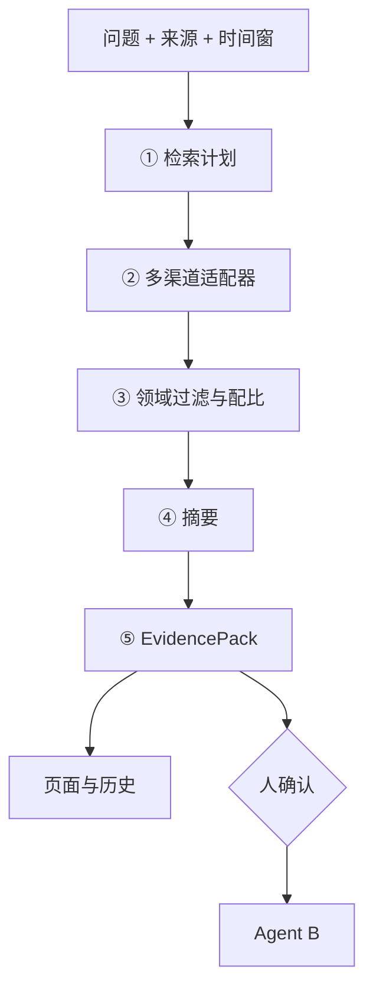

# Agent A · 信息搜集 — 需求与设计

> 版本：v0.4 · 2026-08-18 · 评审稿  
> 上游：[`挖因子工作流-需求与设计.md`](./挖因子工作流-需求与设计.md)  
> 下游：Agent B 研究假设  
> 实现：`backend/ai/crews/gather_idea/` · 页面 `/ai/gather` · `POST /api/agent/gather`

---

## 1. 文档说明

### 1.1 本文写什么

说明挖因子链路中 **Agent A（信息搜集）** 的定位、输入输出合同、内部架构拆分、各流程模块怎么干，以及如何把结果交给 Agent B。读完应能回答：A 搜什么、不搜什么、包里有什么、B 能靠什么。

### 1.2 和总流程的关系

```text
用户问题（或以后自主选题）
  → A 信息搜集 → EvidencePack（证据包）
  →（人确认）→ B 研究假设 → … → C/D/E
```

A 是整条链路的**材料入口**。包质量直接决定 B 能不能提出可转因子的假设。

### 1.3 演进口径

| 阶段 | A 怎么用 |
|------|----------|
| 现在（人闸） | 人写问题（可很宽）→ 出包 → 人看完再点进 B |
| 下一步 | 多渠道铺开；可补搜；渠道可配置 |
| 以后（自动） | 可无用户问题，按关注域自选题再搜集；**EvidencePack 字段合同不变** |

### 1.4 渠道总原则

在「能量化挖因子」的领域里，**来源越多越好**：

- 资讯 / 研报 / 论文 / 帖子是**大类标签**，不是「每类只接一个网站」。  
- 每类下应多平台、多形态都试；以后还可扩「代码说明、制度文件、会议纪要」等。  
- **领域外不要**（娱乐、旅游攻略等）；公开可访、能溯源；不破解付费墙。

### 1.5 本文不写什么

不写某一网站的接口字段表、反爬脚本、代理配置清单。那些放实现/适配器说明。本文把「要接哪些类型、模块怎么分工」写具体。

---

## 2. 背景

### 2.1 为什么要有 A

量化里可检验的想法，很少凭空出现，多半来自：

- 时效资讯里的风格/制度变化讨论；  
- 卖方金工与策略研报里的机制叙述；  
- 学术论文里的异象定义与样本；  
- 聚宽、BigQuant 等社区里的复现与踩坑。

研究者自己四处搜、复制、粘贴，成本高且难复盘。A 负责**按问题（或选题）把相关公开材料收成一份可追溯的包**。

### 2.2 现在常见的问题

1. **源太窄**：只扫一两个栏目/API，宽问题（如「经典异象还有效吗」）容易全空。  
2. **源太噪**：股吧喊单、行业「反转」标题与因子异象无关，却占满结果。  
3. **不可引用**：只有一段模型空话，没有可点开的原文，B 无法挂依据。  
4. **和下游抢活**：若 A 直接输出「假设/代码」，B/C 边界混乱，也难做人闸。

### 2.3 A 明确不做什么

| 不做 | 原因 |
|------|------|
| 买卖建议、仓位、收益承诺 | 合规 |
| 编造未检索到的事实、数字、论文结论 | 幻觉 |
| 拉行情、算 IC、跑回测 | 属平台回测与下游 Agent |
| 写出完整因子 `.py` | 属 Agent C |
| 决定是否入库 | 属 Agent E + 人批 |
| 把领域外网页当材料 | 与挖因子无关 |

---

## 3. 目标

### 3.1 一句话

**把研究问题（或自主选题）变成一份可点开、可引用、面向因子方向的证据包；在投研领域内渠道尽量铺开。**

### 3.2 具体目标

1. **宽问题可用**：用户不必先写清因子公式；「量价选股在讨论什么」「异象是否衰减」这类问题也应尽量出非空混合包。  
2. **渠道铺开**：同一大类多平台试取（例：论文不止一个库；帖子优先量化社区且不限一家）。产品不设「最多 N 个网站」天花板；实现可分批挂载。  
3. **可溯源**：每条证据有标题 + 链接 + 来源标签；摘要要点能点回条目。  
4. **面向检验**：汇总尽量写出机制、时期/样本、可能用日频量价检验的线索，而不是股评口号。  
5. **可降级**：单渠道失败不拖垮整次；`gaps` 写明哪类/哪边空了。  
6. **合同稳定**：输出形态固定为 EvidencePack，保证 B 只消费包、不重新满网检索。

### 3.3 成功时大概长什么样

- 一次搜集后，页面上能看到摘要、若干要点、多条来自不同大类或不同站点的条目。  
- 点条目能打开原文或站内详情。  
- 人确认后一键进入 B；B 生成的假设能挂上包内 id。

---

## 4. 整体输入与输出

### 4.1 输入（请求侧）

| 字段/项 | 是否必填 | 说明 |
|---------|----------|------|
| `topic` 研究问题 | 现网必填 | 自然语言；宜支持宽问题。后期自选题时可由系统生成等价 topic |
| 来源大类开关 | 可选，默认多开 | 资讯 / 研报 / 论文 / 帖子；以后可增多类 |
| `time_window` | 可选 | 如近 7 天 / 30 天 / 90 天 / 1 年；或起止日 |
| `max_items` | 可选 | 最终进包条数上限（有硬顶） |
| `use_llm` | 可选，默认开 | 是否用模型写摘要；失败回退规则摘要 |
| 题材等过滤 | 可选 | 仅用户显式选择时启用，不从问题里瞎猜题材硬过滤 |
| 用户身份 / 配额 | 系统侧 | 鉴权；按次扣搜集配额 |

**输入约束（产品级）**

- 问题过长截断；空问题拒收（自选题模式除外）。  
- 关闭所有来源时提示至少开一类。  
- 时间窗对**资讯/研报/帖子**默认生效；对**论文**建议放宽或豁免过短窗（经典文献往往早于「近一年」）。

### 4.2 输出：EvidencePack（证据包）

一次成功调用返回一个包，至少包含：

| 块 | 内容 |
|----|------|
| 身份 | `pack_id`；关联的查询摘要（问题、时间窗、启用了哪些大类） |
| `items[]` | 证据条目列表（见下） |
| `digest` | 中文总述，面向后续因子假设 |
| `digest_bullets[]` | 若干要点；每条带 `item_ids`，且必须 ⊆ 本包 items |
| `citations[]` | 便于展示的引用列表（id、短标题、url） |
| `gaps[]` | 本轮缺口：某大类无命中、某通道失败等 |
| `stats` | 检索量、返回量、耗时、各 `source_type` 计数、摘要模式等 |

### 4.3 单条证据 `item` 应有字段

| 字段 | 说明 |
|------|------|
| `id` | 包内唯一，供 B 引用（如 `web_news:…` / `sv_news:123`） |
| `source_type` | 大类：`news` / `report` / `paper` / `post`，以后可扩展 |
| `source_label` | 给人看的来源名（如「东方财富·资讯」「OpenAlex」） |
| `title` | 标题 |
| `snippet` | 摘要或摘录 |
| `url` | 可打开链接；站内资讯可用站内详情代替 |
| `published_at` | 发布时间（有则填） |
| 可选 | 相关标的、题材、适配器 id、相关度分 |

### 4.4 两种消费者

| 消费者 | 看到什么 | 约束 |
|--------|----------|------|
| 用户 | 摘要、要点、条目卡片、缺口、历史 | 文案不暴露实现细节（端口、内部任务名等） |
| Agent B | 整包 JSON 合同 | 不得把包外新闻当「已检索事实」；引用必须用 item id |

### 4.5 空包与失败

- **业务空包**：各源都无命中 → `ok` 仍可返回，但 `items` 空、`gaps` 写满；**不应**强行进入 B。  
- **系统失败**：鉴权/配额/服务异常 → 按 API 错误返回，不假装搜过。

---

## 5. 整体架构

### 5.1 流水线总览

```text
输入（问题 + 开关 + 时间窗）
    │
    ▼
① 检索计划     抽概念词、定大类、生成各通道查询
    │
    ▼
② 渠道适配器池  大类 × 多平台并行/快速串行拉取
    │
    ▼
③ 过滤成包     领域过滤 → 时间窗 → 去重 → 排序 → 来源配比 → TopN
    │
    ▼
④ 摘要概括     LLM 或规则 → digest + bullets
    │
    ▼
⑤ 落盘展示     EvidencePack → 页面 / 历史 / 交给 B
```



### 5.2 逻辑分层

| 层 | 职责 |
|----|------|
| 接入层 | HTTP API、鉴权、配额、`normalize` 请求 |
| 计划层 | 分词/概念映射、大类启用、查询改写（中→英论文词等） |
| 适配器层 | 每平台一个适配器：成功条目 / 空 / 失败三态 |
| 治理层 | 领域分、时间窗、去重、权威加权、配比截断 |
| 摘要层 | LLM 摘要或规则回退 |
| 产品层 | 前端展示、本机历史、跳转 B |

### 5.3 渠道架构：大类 × 平台

**大类（可扩展）**

| 大类 | 含义 | 对挖因子的价值 |
|------|------|----------------|
| 资讯 | 财经新闻、快讯、深度报道 | 近期风格、制度、衰减讨论线索 |
| 研报 | 卖方/买方研究报告 | 机制、框架、金工专题 |
| 论文 | 期刊、工作论文、预印本 | 异象定义、样本、可复制构造 |
| 帖子 | 论坛、量化社区、讨论帖 | 实务构造、是否还有效的草根观察 |
| 扩展（后期） | 开源代码说明、监管规则、公开路演、数据手册；**个股财报/公告不作为第五大类**（见下） | 构造线索、有效期、字段口径 |

**「财报」要不要单独成源（2026-08-18）**

现阶段 **不加第五大类**。理由：

- 产品上的「研报」是金工/策略研究报告；「财报」是公司定期报告与公告，量级和用途都不同。  
- Agent A 的目标是给挖因子找**机制线索**，不是拉全市场三大表。质量/盈利因子真正计算仍走 ResearchEngine 的基本面字段，不该在 A 里存财报面板。  
- 问「盈利质量衰减」时，现有研报 + 论文 + 社区帖已经覆盖讨论；再挂巨潮/东财 F10 会变成个股公告轰炸。  
- 以后若做「针对某家公司的制度/事件假设」，可以再加 `filing` 适配器，合同扩展 `source_type`，不提前占 UI 开关。

**「越多越好」在架构上的含义**

- UI 可先按大类勾选；底层是 **适配器列表**（一站一个）。  
- 同一大类下应挂多个平台（例：资讯不只东财；论文 OpenAlex + Crossref + SSRN/arXiv 等逐步加；帖子优先聚宽、BigQuant，再加其它）。  
- 新平台 = 新适配器注册，**不改 EvidencePack 合同**。  
- 单适配器超时/失败 → 记 gaps，其余继续。

### 5.4 领域边界（架构约束）

**倾向保留**：因子、异象、溢价、动量/反转、价值/质量/低波/流动性、量价、资产定价、IC/分层/衰减、风格、量化复现与回测方法讨论等。

**默认丢掉或强降权**：纯娱乐与无关消费内容；无机制的荐股喊单；无法打开的空壳结果。

过滤发生在：检索词（正向概念）+ 入库前标题/摘要打分 + 可选站点白名单。

### 5.5 与现网的对应（便于落地）

| 架构块 | 现网大致位置 |
|--------|----------------|
| 计划 + 成包 + 摘要 | `gather_agent.py` |
| 外网适配器 | `web_sources.py`（东财/必应/论文库/帖子等） |
| 页面 | `/ai/gather` |

现网**不再**检索站内 `news_items`；资讯/研报/论文/帖全部外网。帖子检索计划用本题短语，搜索入口以 360 为主（必应对若干中文专有词会整页跑偏）。架构上按「适配器池」演进。

---

## 6. 流程模块展开

### 6.1 检索计划

**输入**：用户问题、启用大类、时间窗。  
**输出**：短概念词列表、各通道查询串、拟调用的大类/适配器集合。

**具体规则**

1. 从问题中抽取 2～8 字级概念词（如「反转」「动量」「换手」「衰减」），映射同义词/英文（论文用）。  
2. **禁止**把整句问句当作唯一检索词去撞标题。  
3. 宽问题可生成多组查询（主查询 + 收窄查询，如「反转」→「短期反转 因子」）。  
4. 论文通道：中文题 → 英文检索模板（动量/反转/流动性等可走经典关键词）。  
5. 后期自选题：本模块先产出「本轮 topic + 选题理由」，再走同一套计划逻辑。

**失败**：抽不出任何概念词时，用问题截断作弱查询，并在 gaps 提示「问题过泛，建议补充因子相关词」。

### 6.2 渠道搜集

**输入**：检索计划。  
**输出**：原始条目列表（尚未最终截断）+ 分通道成功/空/失败状态。

**执行方式**

- 按启用大类调用多个适配器；能并行则并行，否则快速串行。  
- 每适配器：限条数、限超时；返回统一 item 雏形。  
- 多源资讯合并时再去重（无站内库）。

**各大类要搜什么（具体）**

| 大类 | 形态尽量覆盖 | 平台方向（示例，可持续加） |
|------|----------------|----------------------------|
| 资讯 | 快讯、要闻、深度、政策、基金/市场 | 东财搜索与多栏目；见闻/财联社/新浪/同花顺/证时等（必应+DDG 聚合） |
| 研报 | 金工、策略、行业、公司深度、宏观策略 | 东财/同花顺/新浪等研报中心；券商金工公开页；聚合站公开部分；金工/因子相关加权，纯荐股一页纸降权 |
| 论文 | 期刊、SSRN 类工作论文、预印本、中文元数据 | OpenAlex、Crossref；逐步加 SSRN、arXiv q-fin、Semantic Scholar、NBER 公开页、中文库公开元数据等 |
| 帖子 | 研究分享、因子复现、问答踩坑 | **优先**聚宽、BigQuant、米筐/优矿等；其次雪球/知乎（须命中本题短语）。发现通道：360 搜索优先，必应兜底；不按主题写关键词补丁 |
| 扩展 | README/公式页、交易规则、路演公开稿、数据字典 | 有明确因子价值再挂，避免无关膨胀 |

**原则落地**：同类多源都试；某一源长期空，健康度降权，但目录可保留。

### 6.3 过滤与成包

**输入**：原始条目。  
**输出**：截断后的 `items[]`（≤ max_items）+ 过滤统计。

**步骤（按顺序）**

1. **领域过滤**：标题+摘要打领域分；低于阈值丢弃或进噪音桶（默认不进包）。  
2. **时间窗**：资讯/研报/帖按窗裁剪；无时间戳的条目可保留但降权；论文对短窗豁免或放宽。  
3. **去重**：同一 URL、高度相似标题、同一 DOI，保留权威更高或更新者。  
4. **排序**：相关度（概念命中）+ 权威（金工研报/高引论文/量化社区研究帖 > 普通股吧）+ 轻微。  
5. **来源配比**：避免单一资讯站占满 TopN；在材料足够时尽量让论文/研报/社区也有席位。  
6. **截断**：取 TopN；写入 `stats.source_counts`。

**硬条件**：进包条目必须能打开 url 或能跳转站内详情；否则丢弃。

### 6.4 摘要概括

**输入**：成包后的 `items` + 原问题。  
**输出**：`digest`、`digest_bullets`（含合法 `item_ids`）。

**LLM 开且成功时**

- 只根据给定 items 写，禁止包外事实。  
- 文风面向下游：机制、时期/样本、哪些量可能用日频 close/open/high/low/volume 检验。  
- 经典论文即使没有 A 股新闻数字，也要概括可检验机制，而不是写「完全没有相关内容」。  
- 每条 bullet 的 item_ids 必须落在包内；3～8 条为宜。

**LLM 关或失败时**

- 用条目标题拼规则摘要与要点，并标记回退。  
- 不阻塞出包；用户仍可进 B（材料质量可能变差，gaps/警告中说明）。

### 6.5 展示、历史与人闸

**页面（左）**：问题、来源大类、时间窗、条数、开始搜集、本机历史列表。  
**页面（右）**：状态、摘要、要点、条目列表（按来源区分展示）、缺口、按钮「基于此生成研究假设」。

**历史**：本机会话可回看历史包；切到资讯详情再返回应能恢复（与现网 gather 历史一致）。

**人闸（当前）**：只有人点确认才带 `pack` 进入 B；空包按钮禁用或明确提示先换问题/放宽来源。

**补搜（下一步）**：允许在当前包上「扩大渠道再搜」合并新条目，生成新 `pack_id` 或明确版本，避免 B 引用旧 id 错乱。

---

## 7. 与下一个 Agent（B）的协调

### 7.1 交接合同

| 项 | 约定 |
|----|------|
| 唯一交接物 | EvidencePack |
| B 的主输入 | 整包（至少 `items` + `digest`；有 bullets 更好） |
| B 禁止 | 为写「新闻事实」而重新满网检索；引用不存在的 item id |
| A 禁止 | 输出研究假设列表、因子代码、回测结论，代替 B/C/D |

```text
A：材料与汇总（EvidencePack）
        │
        │  人确认（当前）/ 质检后自动（以后）
        ▼
B：研究假设（可转标记、factor_prompt、建议回测窗、citation_ids）
```

### 7.2 引用与可转线索

- B 每条假设的 `citation_ids` ⊆ 本包 `items[].id`。  
- A 的摘要质量影响 B 是否标得出 `convertible` 与 `factor_prompt`，但 **可转判定是 B 的职责**；A 只通过材料与摘要「面向检验」来帮忙。  
- 包内若只有叙事资讯、没有机制/论文，B 应更多标「暂不转」——这是协调下的预期结果，不是 A 的 bug。

### 7.3 人闸与自动怎么切

| 模式 | A→B |
|------|-----|
| 当前人闸 | 用户看包 → 点「生成研究假设」→ B |
| 只要情报 | 停在 A，不调用 B |
| 以后自动 | 包非空且过基础质检（如最少条数、至少一类来源）→ 自动调 B；合同字段不变 |
| 空包 | 不调用 B；提示放宽时间窗/来源或换问题 |

### 7.4 质量与缺口怎么传给 B

- `gaps` 应原样或摘要传给 B（或 B 只读包内 gaps），避免 B 以为「四类都搜过且都丰富」。  
- `stats.source_counts` 帮助 B 判断偏资讯还是偏论文，从而调整假设口吻（实务 vs 经典机制）。  
- 若摘要是规则回退，B 侧可降置信或少造细节（实现时可传 `digest_mode`）。

### 7.5 版本与一致性

- 一次 B 调用绑定一个 `pack_id`。  
- 用户改问题重新搜集 = 新包；旧包历史仍可查，但默认带最新包进 B。  
- 补搜合并后应使用新 pack_id，避免 B 引用已删除条目。

### 7.6 分工一句话

**A 负责「世界上（领域内）有什么相关材料」；B 负责「据此能提出什么可检验的因子方向」。** 两者用 EvidencePack 对接，不互相越权。

---

*仅用于量化研究资料汇总，不构成投资建议。*
