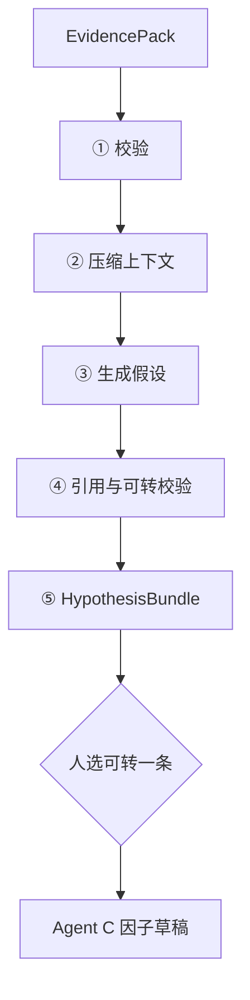

# Agent B · 研究假设 — 需求与设计

> 版本：v0.1 · 2026-08-18 · 评审稿  
> 上游：[`Agent设计-A-信息搜集.md`](./Agent设计-A-信息搜集.md)（EvidencePack）  
> 下游：Agent C 因子草稿  
> 总流程：[`挖因子工作流-需求与设计.md`](./挖因子工作流-需求与设计.md)  
> 实现：`backend/ai/crews/gather_idea/idea_agent.py` · 页面 `/ai/idea` · `POST /api/agent/idea`  
> 技术说明：[`AgentB-研究假设-技术实现说明.md`](./AgentB-研究假设-技术实现说明.md)  
> 产品名：研究假设（原称 Idea 生成，对外文案统一用「研究假设」）

---

## 1. 文档说明

### 1.1 本文写什么

说明挖因子链路中 **Agent B（研究假设）** 的定位、输入输出合同、内部怎么拆、各模块怎么干，以及如何交给 Agent C。读完应能回答：B 吃什么、吐什么、什么叫「可转因子」、回测窗怎么跟假设走。

### 1.2 和总流程的关系

```text
A 证据包 EvidencePack
  →（人确认）→ B 研究假设 HypothesisBundle
  →（人选可转一条）→ C 因子草稿 → D 回测 → E 评价
```

B 是整条链路的**收口与定向**：把杂乱材料收成若干条可检验、可溯源的假设，并标出哪些能写成日频量价因子。

### 1.3 演进口径

| 阶段 | B 怎么用 |
|------|----------|
| 现在（人闸） | 人带着 A 的包进来 → 生成多条假设 → 人选「可转」的一条进 C |
| 下一步 | 串跑时可按规则自动挑一条可转假设；人仍可改选 |
| 以后（自动） | 可一次派生多条草稿（受候选数预算约束）；合同字段尽量不变 |

### 1.4 命名约定

| 对外（页面/产品） | 对内（代码/API，可暂留） |
|-------------------|--------------------------|
| 研究假设 | `idea` / `IdeaBundle` / `/api/agent/idea` |
| 生成研究假设 | `run_idea` |
| 可转因子草稿 | `convertible=true` |

实现改名可分期；**产品文案以「研究假设」为准**。

### 1.5 本文不写什么

不写 LLM 供应商选型、完整 prompt 全文、C 的 AST 白名单细节。那些放实现与 C 文档。

---

## 2. 背景

### 2.1 为什么要有 B

A 给出的是「材料包」：资讯、研报、论文、帖子混在一起。研究者还要自己问：

- 这里面有没有**可检验的机制**？  
- 能不能只用日频开高低收成交量写出来？  
- 该在什么区间回测、样本外从哪切？  

B 负责把这些问题答成结构化假设列表，让人（或以后的自动编排）能选一条交给 C，而不是对着一堆链接空想。

### 2.2 现在常见的问题

1. **材料有了、方向没有**：只有摘要，没有「下一条可干的事」。  
2. **叙事和因子搅在一起**：IPO、会议、题材炒作被当成可回测因子。  
3. **没有有效期**：同一逻辑换区间结论天差地别，却不给建议窗。  
4. **和下文抢活**：B 若直接吐完整 `.py` 或直接开回测，人闸和 C/D 职责会乱。

### 2.3 B 明确不做什么

| 不做 | 原因 |
|------|------|
| 重新满网检索 | 那是 A；B 只消费证据包 |
| 编造包外新闻事实、公司事件、数字 | 幻觉 |
| 输出完整因子代码 / 策略代码 | 属 Agent C |
| 调用平台回测、编造夏普年化 | 属 Agent D |
| 决定是否入库 | 属 Agent E + 人批 |
| 买卖建议、仓位、收益承诺 | 合规 |
| 把不可转假设静默改成可转 | 必须诚实标 `convertible` |

---

## 3. 目标

### 3.1 一句话

**在证据包之上，生成若干条可溯源、尽量可转成日频因子的研究假设，并带上建议回测窗；供人挑选后交给因子草稿 Agent。**

### 3.2 具体目标

1. **可溯源**：每条假设的依据 id 必须落在本包 `items` 内。  
2. **可分流**：明确「可转因子」与「暂不转」（事件/纯叙事）。  
3. **可交接**：可转假设带 `factor_prompt`（给 C 当说明书）和 `validity`（建议起止、样本外切分）。  
4. **可审阅**：标题、逻辑、风险提示、置信度给人看懂；几秒～几十秒出结果。  
5. **不越权**：不写码、不回测、不入库；空包或材料过弱时说清楚缺口，而不是硬编。

### 3.3 成功时大概长什么样

- 从 A 点「基于此生成研究假设」进入 B，载入同一证据包。  
- 得到 3～8 条假设；至少部分在资料足够时可转为因子。  
- 可转条目能展开因子提示与建议回测窗；点「转成因子草稿」进入 C。  
- 不可转条目按钮禁用，并说明原因倾向（风险提示里体现）。

---

## 4. 整体输入与输出

### 4.1 输入

| 字段/项 | 是否必填 | 说明 |
|---------|----------|------|
| `pack` / EvidencePack | 必填 | 来自 A；至少应有 `pack_id`；`items` 建议 ≥1 |
| `preference` | 可选 | 偏好：偏因子 / 偏题材 / 偏风险 / 综合；补充约束 note |
| `max_ideas` | 可选 | 条数上限（如默认 5，硬顶约 8） |
| 用户身份 / 配额 | 系统侧 | 鉴权；`skill=idea`（或研究假设配额名） |

**输入约束**

- 无 pack 或 items 为空：拒收或返回明确缺口，提示先去 A。  
- 偏好只影响排序与侧重点，**不能**授权编造包外事实。

### 4.2 输出：HypothesisBundle（研究假设包）

对内类型名可仍叫 `IdeaBundle`，产品含义如下：

| 块 | 内容 |
|----|------|
| 身份 | `bundle_id`；关联 `pack_id` |
| `ideas[]` / 假设列表 | 见下表单条结构 |
| `gaps[]` | 材料不足、无可转方向等 |
| `warnings[]` | 摘要模式弱、引用被过滤等 |
| `stats` | 耗时、token、生成模式、返回条数等 |

### 4.3 单条研究假设应有字段

| 字段 | 说明 |
|------|------|
| `id` | 本束内唯一 |
| `title` | 短标题 |
| `thesis` | 一句话～一小段逻辑（可检验的说法） |
| `citation_ids[]` | ⊆ 证据包 `items[].id` |
| `confidence` | low / mid / high |
| `convertible` | 是否适合写成日频量价因子 |
| `factor_prompt` | 可转时必填倾向：给 C 的中文说明书（字段、方向、构造要点） |
| `factor_spec` | 可选：股票池、频率、字段、建议函数名、多空方向等 |
| `validity` | 建议回测窗与样本外（见下） |
| `risk_notes[]` | 风险与局限 |
| `suggested_next` | 建议下一步（如交给因子草稿、或仅跟踪事件） |

### 4.4 `validity`（建议可能更好的时段）

| 子字段 | 说明 |
|--------|------|
| `regime` | 如 persistent（持续异象）/ event（事件）/ structural（制度突变） |
| `suggested_start` / `suggested_end` | 可选；仅当机制能推出具体年（如科创板 2019 后） |
| `oos_split` | 可选样本外参考点 |
| `why_window` | **必填倾向**：为何这段可能更好（机制分析） |
| `decay_notes` | 衰减、拥挤、换窗风险；并声明下游可不采用 |

**原则**：这是 B 用 LLM 做的**分析建议**，不是下游必跑回测窗。检测页 / 因子草稿常由人设（如近十年）。禁止把文献出版年（如 1991）扫成样本起点。

### 4.5 两种消费者

| 消费者 | 看到什么 | 约束 |
|--------|----------|------|
| 用户 | 假设卡片、可转标记、引用可点回、历史 | 文案用「研究假设」，不堆实现细节 |
| Agent C | 人选中的一条（含 `factor_prompt` + `factor_spec`） | 仅处理 `convertible=true`；回测窗以人设为准，可不采用 B 的 validity |

### 4.6 空结果与失败

- 包太弱、无法提出像样假设：返回 gaps，可 0～少量弱假设，但可转应为 false 或明确不足。  
- 系统/LLM 失败：规则弱回退（基于 digest/bullets 扩写）或 API 错误；弱回退须标模式，且引用仍须合法。

---

## 5. 整体架构

### 5.1 流水线总览

```text
EvidencePack
    │
    ▼
① 校验与规范化     pack、偏好、条数上限
    │
    ▼
② 压缩上下文       digest + bullets + items 摘要（限长）
    │
    ▼
③ 生成假设         LLM（失败则规则回退）
    │
    ▼
④ 校验与标注       引用合法性、可转/提示/有效期补全或降级
    │
    ▼
⑤ 落盘展示         HypothesisBundle → 页面 / 历史 / 交给 C
```



### 5.2 逻辑分层

| 层 | 职责 |
|----|------|
| 接入层 | API、鉴权、配额 |
| 上下文层 | 把证据包压到模型可消化的篇幅，保留 id |
| 生成层 | 产出假设 JSON |
| 治理层 | 滤非法引用；可转但无 prompt 则降为不可转；补默认 validity |
| 产品层 | 页面展示、历史、跳转 C |

### 5.3 可转判定（产品规则）

**倾向 `convertible=true`**

- 机制可用日频 `open/high/low/close/volume`（及有限滚动/收益类变换）表达；  
- 经典资产定价/异象（动量、反转、换手、非流动性、低波等），即使证据主要是论文而非 A 股快讯；  
- 能写出足够具体的 `factor_prompt`（不是一句空话）。

**必须 `convertible=false`**

- 主题炒作、IPO、会议、个股事件驱动、无法落到日频截面量价；  
- 只有「市场在讨论 XXX」、没有可操作的截面定义；  
- `factor_prompt` 过短或空。

### 5.4 与现网对应

| 架构块 | 现网大致位置 |
|--------|----------------|
| 生成 + 校验 | `idea_agent.py` |
| API | `POST /api/agent/idea` |
| 页面 | `/ai/idea`；文案已多用「研究假设」 |
| 交接 C | `saveChainIdea` → `/ai/factor` |

---

## 6. 流程模块展开

### 6.1 校验与规范化

- 检查 pack 存在、`items` 情况；规范化 `preference`、`max_ideas`。  
- 记录 `pack_id` 写入输出束，保证 A/B 可追溯。  
- 空包：不进入生成，或直接 gaps 返回。

### 6.2 压缩上下文

- 送入模型：`topic`（来自 pack.query）、`digest`、要点、每条 item 的 id/类型/来源名/标题/摘要/url。摘要长度需够用（现网约 900 字，避免把 A 补抓的正文砍光）。  
- 硬约束写入系统说明：**不得引用未出现的 id**；不得编造包外新闻事实。  
- 控制条数与字数，避免超长；重要论文/研报条目优先保留。

### 6.3 生成假设

- LLM 按 JSON 约定输出多条假设（标题、逻辑、citations、可转、prompt、spec、validity、风险、下一步、置信）。  
- 偏好 `focus=factor` 时，更多尝试可转方向；`theme` 时可多出叙事类但须标不可转。  
- 失败：基于 bullets/digest 做规则弱回退；`focus=theme` 时不可转。弱回退须声明，并挂真实 citation。

### 6.4 校验与标注

1. **引用**：丢掉或不在包内的 id；一条假设若引用被删光，整条降权或剔除。  
2. **可转一致性**：`convertible=true` 但 prompt 过短 → 改为 false，并改 `suggested_next`。  
3. **validity**：LLM 写「哪段可能更好」；缺省不补 2018～今天假窗；下游可不采用。  
4. **事件类**：`regime=event` 时通常不可转，或提示勿当终身有效因子。  
5. **条数**：截断到 max；尽量保证「有可转则至少一条可转」（材料允许时）。

### 6.5 展示、历史与人闸

**页面（左）**：当前证据包摘要、补充约束、生成按钮、本机假设历史（focus 写死偏因子，无开关）。  
**页面（右）**：假设卡片列表——可转徽章、置信度、逻辑、引用链接、时段建议、factor_prompt、风险、「转成因子草稿」。

**人闸（当前）**

- 生成：人点「生成研究假设」。  
- 进 C：仅可转卡片可点；把该条假设写入链路缓存后跳转 C。  

**历史**：离开去看资讯再返回，应能恢复最近假设束（与现网一致）。

---

## 7. 与下一个 Agent（C）的协调

### 7.1 交接合同

| 项 | 约定 |
|----|------|
| 交接物 | **一条**研究假设（含 meta：`pack_id` / `bundle_id`） |
| C 的主输入 | `factor_prompt`（或退回 thesis）+ `factor_spec` + `validity` |
| C 禁止 | 处理 `convertible=false`；自行发明与假设无关的另一套逻辑却不提示 |
| B 禁止 | 输出完整 `def` 代码代替 C；自动调用回测 |

```text
B：多条研究假设（可转 / 暂不转）
        │
        │  人选一条可转（当前）/ 规则挑一条（以后）
        ▼
C：平台可回测的日频因子草稿 + 继承 validity 的回测参数
```

### 7.2 字段怎么用

| B 字段 | C 怎么用 |
|--------|----------|
| `factor_prompt` | 生成代码的主说明书 |
| `factor_spec.universe` 等 | 默认股票池、字段、函数名偏好 |
| `validity.*` | 写入 `backtest_hint` 的 start/end/oos |
| `title` / `thesis` | 展示与描述，不强制进代码 |
| `citation_ids` | C 可不消费；链路追溯保留即可 |

### 7.3 人闸与自动怎么切

| 模式 | B→C |
|------|-----|
| 当前人闸 | 人选可转假设 → 「转成因子草稿」 |
| 只要假设 | 停在 B，不进 C |
| 以后自动 | 按置信度+可转+引用完整度挑一条进 C；人可在任务里改选 |
| 无可转 | 不调用 C；提示换包或放宽搜集 |

### 7.4 与 A 的边界（再强调）

- B **不**重新检索；材料不够就写 gaps，让用户回 A 补搜或换问题。  
- A 的 `gaps` / 来源构成会影响 B 的可转比例——这是预期，不是互相甩锅。

### 7.5 分工一句话

**A 负责「领域内有哪些相关材料」；B 负责「据此能提出哪些可检验的研究假设、哪些能交给因子草稿」；C 负责「写成平台能跑的代码」。**

---

## 附：相对 Agent A，本文刻意对齐的结构

1. 文档说明 → 2. 背景 → 3. 目标 → 4. 整体输入与输出 → 5. 整体架构 → 6. 流程模块展开 → 7. 与下一 Agent 协调。

---

## 8. 现网实现注意（2026-08-18）

B **要优化，而且问题不在关键词表**。A 帖子空时 B 不该自己再搜；该修的是「吃包」是否吃全：

1. 必须把用户原问题 `topic` 传给模型，否则假设会跟着包内热门条跑偏。  
2. 不要把 A 的长摘要截成一两百字再送给 B。  
3. 规则弱回退不得一律标可转。  
4. 偏好 `focus` 要真正改变可转倾向。

细节见技术说明。旧稿 [`Agent设计-B-Idea生成.md`](./Agent设计-B-Idea生成.md) 仅作历史对照，产品以本文为准。

---

*仅用于量化研究假设整理，不构成投资建议。*
