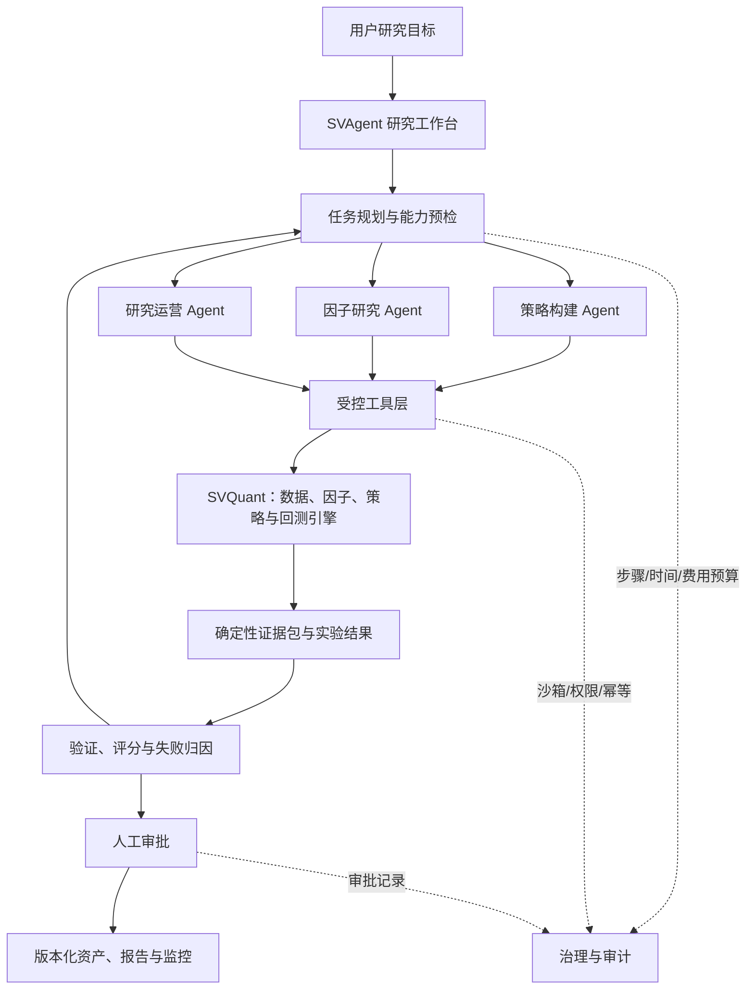

# SVAgent 产品需求文档（PRD）

> 文档版本：v0.1  
> 最后更新：2026-08-17  
> 文档状态：评审稿  
> 产品范围：自然语言策略构建、因子与 Alpha 自动挖掘、量化研究运营  
> 依赖系统：SVQuant ResearchEngine、QuantCore、MarketData

---

## 0. 文档说明

本文档定义 SVAgent 首期产品范围、用户流程、功能要求、业务规则和验收标准。SVAgent 定位为 SVQuant 之上的 AI 研究编排与治理层，复用 SVQuant 已有的数据、因子、策略、回测和结果解读能力。

优先级约定：

- `P0`：MVP 必须具备，缺失时无法形成完整用户价值。
- `P1`：首个正式版本的重要能力，可在 MVP 稳定后补齐。
- `P2`：后续增强能力，不进入首期交付承诺。

## 1. 产品概述

### 1.1 一句话定位

**SVAgent 是面向量化研究者和投研团队的 AI 量化研究工作台，将自然语言研究想法转化为可验证、可复现、可审批的因子与策略实验。**

### 1.2 背景与问题

传统量化研究需要用户在数据处理、代码编写、因子实现、回测配置、结果分析和报告整理之间反复切换，存在以下问题：

1. 研究想法到可运行代码的转换成本高，非专业开发者难以完成。
2. 因子研究依赖大量重复试验，研究者需要手工生成候选、运行回测并比较结果。
3. 回测结果容易受到未来函数、数据泄露、过拟合和成本假设不完整的影响。
4. 研究过程缺少统一记录，数据版本、代码版本、参数和结论难以复现。
5. 团队研究依赖人工沟通，候选晋级、风险检查和报告审批缺少标准流程。

### 1.3 产品目标

SVAgent 首期聚焦三个目标：

- **G1：自然语言策略构建。** 用户通过自然语言表达策略逻辑，系统生成可审阅代码并完成回测验证。
- **G2：因子与 Alpha 自动挖掘。** Agent 在受控预算内完成候选因子生成、验证、评分、失败归因和迭代。
- **G3：量化研究运营。** 系统统一管理数据质检、研究任务、实验记录、风险检查、审批、报告和监控。

### 1.4 产品原则

1. **证据先于结论**：所有收益、风险和稳定性结论必须引用确定性计算结果。
2. **能力边界透明**：系统不得用能力范围内的近似方案冒充用户要求的策略。
3. **受控自动化**：Agent 可以自主规划和运行研究，但必须受步骤、时间、算力和费用预算约束。
4. **默认可复现**：每次研究必须固定数据、代码、参数、模型和规则版本。
5. **样本外优先**：候选晋级必须经过独立样本外或 Walk-forward 验证。
6. **人工拥有最终决定权**：候选发布、进入共享资产库或进入后续模拟/生产流程前必须人工审批。

## 2. 产品边界

### 2.1 本期范围

- 自然语言生成日频向量化策略草稿。
- 自然语言生成候选因子草稿。
- 因子和策略代码静态校验与沙箱执行。
- 因子回测、策略回测及确定性指标计算。
- 候选因子批量实验、评分、排序和失败归因。
- 样本内、验证集、样本外及 Walk-forward 管理。
- 研究任务、运行记录、数据快照、代码版本和证据包管理。
- 人工审批、报告生成和研究过程审计。

### 2.2 本期非目标

- 不直接接管真实资金或自动下单。
- 不提供荐股、收益承诺或个性化投资建议。
- 不支持高频、Tick 级或超低延迟策略。
- 不允许 Agent 无限循环、自主提高权限或修改核心风控规则。
- 不允许大模型自行计算或编造回测指标。
- 不在 SVAgent 内重复实现行情存储、因子引擎和回测引擎。
- 首期不承诺新闻、研报和政策等非结构化另类数据的全自动接入。

## 3. 目标用户与角色

### 3.1 目标用户

| 用户类型 | 特征 | 核心诉求 |
|---|---|---|
| 量化研究者 | 熟悉因子和回测，具备一定 Python 能力 | 提高研究效率，减少重复实验，获得可复现结果 |
| 投研人员 | 有投资逻辑，但编程能力有限 | 用自然语言构建和验证策略 |
| 研究团队负责人 | 负责研究质量、资源和候选晋级 | 统一流程、审批、风险检查和团队知识沉淀 |
| 平台管理员 | 管理模型、工具、数据和权限 | 控制成本、安全、能力目录和系统稳定性 |

### 3.2 产品角色

| 角色 | 关键权限 |
|---|---|
| 研究员 | 创建任务、运行实验、查看结果、提交候选 |
| 复核人 | 审阅代码、证据和报告，批准或驳回候选 |
| 团队管理员 | 管理成员、研究空间、预算和共享资产 |
| 平台管理员 | 管理模型供应商、工具白名单、数据源和全局策略 |

单用户 MVP 可以由同一用户同时承担研究员和复核人，但系统仍需保留两个动作和对应记录。

## 4. 产品总体架构



### 4.1 SVAgent 职责

- 理解用户目标并生成结构化研究计划。
- 选择和调用经过授权的 SVQuant 工具。
- 管理长时间运行的研究任务和候选迭代。
- 管理数据快照、代码、配置、证据和报告之间的关联。
- 执行预算、审批、审计和终止规则。
- 用自然语言解释确定性结果，不生成未经计算的量化事实。

### 4.2 SVQuant 职责

- 提供版本化市场数据和证券池、基准快照。
- 提供因子库、策略库及代码契约。
- 运行因子和策略回测。
- 计算收益、风险、IC、分层、换手和执行相关指标。
- 输出可复算的回测结果和证据。
- 执行代码安全校验和底层数据规则。

## 5. 核心用户流程

### 5.1 自然语言策略构建

```text
输入策略想法
→ 识别标的、频率、信号、调仓和风险规则
→ 能力预检
→ 生成结构化策略规格
→ 生成并静态校验代码
→ 用户审阅或按授权自动进入沙箱
→ 回测
→ 证据化解读
→ 保存版本或返回修改
```

关键要求：

- 若用户要求当前不支持的字段、事件订单、多空或外部库，必须在生成前明确拒绝或拆分为待支持能力。
- 生成结果必须同时包含结构化策略规格、代码、假设和警告。
- 代码和回测必须分为两个独立步骤，任何生成成功都不能被表述为策略有效。

### 5.2 因子与 Alpha 自动挖掘

```text
输入研究假设或研究材料
→ 形成候选因子族与实验计划
→ 批量生成候选因子
→ 静态校验与最小计算验证
→ 样本内回测
→ 验证集筛选
→ 稳健性、成本和敏感性测试
→ 失败归因
→ 在预算内继续迭代
→ 锁定候选
→ 样本外验证
→ 人工审批
```

关键要求：

- Agent 在迭代期间不得看到封存样本外结果。
- 候选修改后必须生成新版本，不得覆盖历史结果。
- 每次迭代必须说明修改依据，不允许仅通过随机参数搜索追求最高收益。
- 达到预算、连续无改进、无合法候选或用户取消时必须停止。

### 5.3 量化研究运营

```text
创建研究任务
→ 数据质检和版本锁定
→ 研究计划
→ 执行实验
→ 记录证据和异常
→ 风险与稳健性检查
→ 人工审批
→ 生成报告
→ 定期复核或监控
```

关键要求：

- 任务、实验、审批和报告必须在同一条研究时间线中可追溯。
- 数据质量不合格、数据版本缺失或关键成本假设未知时，不得将候选标记为“已验证”。
- 报告只能引用已保存的证据和审批结论。

## 6. 功能需求

### 6.1 研究工作台与任务管理

| ID | 优先级 | 功能要求 |
|---|---|---|
| TASK-001 | P0 | 用户可以通过自然语言创建策略研究、因子研究或综合研究任务。 |
| TASK-002 | P0 | 系统将自然语言目标转换为可编辑的结构化任务，包括目标、市场、股票池、频率、时间范围、成本和验证方式。 |
| TASK-003 | P0 | 任务必须具有唯一 ID、创建人、状态、预算、当前步骤和完整事件时间线。 |
| TASK-004 | P0 | 用户可以暂停、恢复、取消和复制任务；取消后不得继续产生模型和计算费用。 |
| TASK-005 | P0 | 长任务中断后可以从最近一个已完成步骤恢复，不重复执行已有幂等结果。 |
| TASK-006 | P1 | 用户可以从历史任务、模板或已保存资产创建新研究任务。 |
| TASK-007 | P1 | 支持任务标签、收藏、搜索、归档和团队共享。 |

任务状态：

`draft → planned → running → needs_review → approved/rejected/failed/canceled`

### 6.2 自然语言策略构建

| ID | 优先级 | 功能要求 |
|---|---|---|
| STR-001 | P0 | 从自然语言中提取股票池、信号、排序方向、持仓数量、调仓周期、成本和回测区间。 |
| STR-002 | P0 | 在调用模型前执行能力预检，并展示支持、降级和不支持项。 |
| STR-003 | P0 | 生成结构化策略规格、策略代码、假设、警告和能力目录版本。 |
| STR-004 | P0 | 对代码执行语法、AST、字段、方法、导入和未来数据风险校验。 |
| STR-005 | P0 | 用户可以查看和编辑生成代码，并查看每次修改的版本差异。 |
| STR-006 | P0 | 通过 SVQuant 策略回测接口运行回测，保存完整输入、结果和内容指纹。 |
| STR-007 | P0 | 回测结果显示收益、基准、回撤、风险指标、年度收益、持仓和成本假设。 |
| STR-008 | P0 | Agent 基于证据包给出结果解读、限制和下一步实验，不得创造新数值。 |
| STR-009 | P0 | 用户可以将通过审阅的策略保存为版本化策略资产。 |
| STR-010 | P1 | 支持基于回测诊断一键创建后续实验，例如延长样本、成本压力测试和降低调仓频率。 |
| STR-011 | P1 | 支持向量化与事件驱动策略的能力目录和路由；生成能力按引擎分别开放。 |

首期策略生成边界与 SVQuant 当前能力保持一致：日频、基于 `close`、纯多头、向量化目标权重。事件驱动、多空、基本面和成交量策略在能力目录扩展后开放，不得静默近似。

### 6.3 因子与 Alpha 自动挖掘

| ID | 优先级 | 功能要求 |
|---|---|---|
| FAC-001 | P0 | 用户可以输入研究假设、目标现象、允许字段、股票池和研究周期。 |
| FAC-002 | P0 | Agent 将研究目标拆分为因子族、候选方向、验证指标和停止条件。 |
| FAC-003 | P0 | 批量生成候选因子，每个候选包含名称、代码、经济含义、字段、假设、警告和来源。 |
| FAC-004 | P0 | 候选代码必须通过静态安全校验和最小数据形状、有限值及未来数据检查。 |
| FAC-005 | P0 | 对合法候选运行统一配置的因子回测，输出 IC/IR、分层、收益风险、换手和成本相关指标。 |
| FAC-006 | P0 | 支持训练期、验证期和封存样本外区间；封存区间在候选确定前不得向 Agent 暴露。 |
| FAC-007 | P0 | 使用版本化评分卡比较候选，评分至少覆盖信号质量、稳定性、风险、成本、可实现性和复杂度。 |
| FAC-008 | P0 | 对失败候选给出结构化失败类型、证据和下一步处理建议。 |
| FAC-009 | P0 | Agent 可以在预算内根据失败原因生成下一代候选，并保留父子关系。 |
| FAC-010 | P0 | 支持最大候选数、最大迭代轮数、最大 Token、最大回测次数、最大时间和最大费用限制。 |
| FAC-011 | P0 | 达到停止条件时生成候选排行榜、淘汰原因、剩余风险和推荐结论。 |
| FAC-012 | P0 | 仅通过最终样本外验证和人工审批的候选可以进入共享因子资产库。 |
| FAC-013 | P1 | 支持 Walk-forward、跨股票池、跨市场阶段和参数敏感性测试。 |
| FAC-014 | P1 | 支持因子相关性、冗余检测、多因子合成和增量贡献分析。 |
| FAC-015 | P2 | 支持从论文、研报和另类数据描述中提取可验证研究假设。 |

### 6.4 候选评分与失败归因

候选评分卡由确定性引擎计算，Agent 只能解释和排序。

| 评分维度 | 参考指标 |
|---|---|
| 信号质量 | IC、Rank IC、IR、分层单调性 |
| 收益风险 | 年化收益、Sharpe、最大回撤、超额收益 |
| 稳定性 | 分阶段表现、正 IC 比例、跨股票池一致性 |
| 可实现性 | 换手率、成本敏感性、持仓集中度、容量风险 |
| 鲁棒性 | Walk-forward、参数敏感性、压力场景 |
| 复杂度 | 字段数量、参数数量、表达式复杂度、与已有因子相关性 |

首期必须支持以下失败分类：

- `CAPABILITY_UNSUPPORTED`：超出当前能力目录。
- `GENERATION_INVALID`：模型输出格式或代码不合法。
- `SECURITY_REJECTED`：违反代码安全策略。
- `DATA_QUALITY_FAILED`：数据缺失、版本或质量检查失败。
- `BACKTEST_FAILED`：回测运行异常。
- `SIGNAL_WEAK`：IC、分层或预测方向不足。
- `ROBUSTNESS_FAILED`：跨时期、样本外或敏感性测试失败。
- `COST_SENSITIVE`：加入合理成本后失效。
- `RISK_UNACCEPTABLE`：回撤、集中度或暴露超限。
- `DUPLICATE_FACTOR`：与已有候选或因子高度重复。
- `BUDGET_EXHAUSTED`：达到研究预算上限。

### 6.5 量化研究运营

| ID | 优先级 | 功能要求 |
|---|---|---|
| OPS-001 | P0 | 每个研究任务必须记录数据快照、股票池、基准、代码、参数、模型、提示词、能力目录和规则版本。 |
| OPS-002 | P0 | 运行前检查数据清单、交易日历、关键字段、日期范围和质量报告。 |
| OPS-003 | P0 | 每次生成、验证、回测、解释、审批和导出都写入不可静默覆盖的事件记录。 |
| OPS-004 | P0 | 用户可以在实验矩阵中比较候选和不同配置，并查看唯一变化变量。 |
| OPS-005 | P0 | 支持将候选提交审批；审批人可以批准、驳回或要求补充实验。 |
| OPS-006 | P0 | 审批必须记录审批人、时间、意见、关联证据和当时版本。 |
| OPS-007 | P0 | 系统基于已审批结果生成 Markdown 研究报告，报告中的数值可回链至证据。 |
| OPS-008 | P0 | 任一历史运行可以使用原始版本重新执行，并比较结果指纹。 |
| OPS-009 | P1 | 支持日报、周报和阶段报告模板。 |
| OPS-010 | P1 | 支持定时重跑已批准研究并监测 IC、收益、回撤、换手和数据漂移。 |
| OPS-011 | P1 | 指标越过阈值时创建复核任务，不自动修改或替换已批准资产。 |
| OPS-012 | P1 | 支持团队研究空间、评论、指派和审批队列。 |

### 6.6 报告与解释

| ID | 优先级 | 功能要求 |
|---|---|---|
| REP-001 | P0 | 报告包含研究目标、数据范围、候选方法、验证过程、核心指标、风险、限制和结论。 |
| REP-002 | P0 | 每项关键结论必须关联至少一个证据 ID。 |
| REP-003 | P0 | 未知成本、缺少样本外、样本过短等情况必须在报告顶部显著提示。 |
| REP-004 | P0 | 报告必须包含“仅用于量化研究，不构成投资建议或收益承诺”的声明。 |
| REP-005 | P1 | 支持 Markdown、HTML 和 PDF 导出。 |
| REP-006 | P1 | 支持管理层摘要、研究员详版和审计版三种视图。 |

### 6.7 Agent 治理与预算

| ID | 优先级 | 功能要求 |
|---|---|---|
| GOV-001 | P0 | 每个任务必须设置默认预算，用户可以在权限范围内调整。 |
| GOV-002 | P0 | Agent 只能调用任务授权范围内的工具、数据和资产。 |
| GOV-003 | P0 | 代码只允许在隔离沙箱运行，默认禁止网络、文件系统写入和非白名单依赖。 |
| GOV-004 | P0 | 风控、预算、权限和审批规则拥有高于 Agent 的优先级，Agent 无权修改。 |
| GOV-005 | P0 | 模型调用和回测调用必须支持幂等键，防止重试导致重复费用或重复实验。 |
| GOV-006 | P0 | 连续失败、无改进、供应商异常和预算耗尽必须触发明确终止状态。 |
| GOV-007 | P0 | 用户可以查看每一步调用的工具、输入摘要、输出摘要、耗时和费用。 |
| GOV-008 | P1 | 支持按团队、用户、任务类型和模型设置预算策略。 |

## 7. 研究数据模型

### 7.1 核心实体

| 实体 | 说明 |
|---|---|
| `ResearchWorkspace` | 用户或团队的研究空间和权限边界 |
| `ResearchTask` | 一次完整研究目标及其状态、预算和计划 |
| `ResearchPlan` | Agent 生成并由用户确认的步骤和验证方案 |
| `Hypothesis` | 可被数据验证的研究假设 |
| `Candidate` | 某一版本的因子或策略候选 |
| `ExperimentRun` | 使用固定输入执行的一次回测或验证 |
| `DataSnapshot` | 数据、股票池、基准和质量报告的不可变引用 |
| `EvidencePackage` | 由确定性引擎生成的指标、来源和限制 |
| `AgentEvent` | Agent 计划、工具调用、观察、决策和异常记录 |
| `Approval` | 候选晋级、发布或共享的人工决定 |
| `ResearchReport` | 基于证据和审批生成的版本化报告 |

### 7.2 可复现指纹

每次 `ExperimentRun` 必须生成内容指纹，至少覆盖：

- 数据版本和内容哈希；
- 股票池与基准快照；
- 因子或策略代码哈希；
- 参数和成本假设；
- 回测引擎及版本；
- 能力目录和验证规则版本；
- 随机种子；
- 运行环境版本。

## 8. 页面与交互需求

### 8.1 研究工作台

- 左侧显示任务对话和研究计划。
- 中部显示代码、配置、实验矩阵和回测结果。
- 右侧显示当前步骤、预算、证据、风险和待审批项。
- 用户可以在对话中要求解释、修改计划、运行实验或生成报告。

### 8.2 任务详情页

- 显示任务状态、目标、计划、预算消耗和时间线。
- 显示候选父子关系和每轮修改依据。
- 显示失败步骤、错误分类和可执行的恢复动作。

### 8.3 候选比较页

- 支持按综合评分或单项指标排序。
- 支持并排比较代码差异、参数差异和实验结果。
- 明确区分样本内、验证集和样本外结果。
- 已污染或重复使用的样本外结果必须标记。

### 8.4 审批中心

- 展示待审批候选、关键证据、风险和未完成检查。
- 支持批准、驳回和要求补充实验。
- 任何审批动作必须二次确认并记录意见。

### 8.5 报告中心

- 查看研究报告、版本和关联资产。
- 从报告结论回跳至具体证据和运行记录。
- 支持导出和生成不可变报告快照。

## 9. 与 SVQuant 的能力映射

### 9.1 可直接复用的现有能力

| SVQuant 能力 | 当前接口或实现 | SVAgent 用法 |
|---|---|---|
| AI 因子草稿生成 | `POST /api/ai/factor-generations` | 生成候选因子并获得静态校验结果 |
| AI 策略草稿生成 | `POST /api/ai/strategy-generations` | 生成受控向量化策略草稿 |
| 因子回测 | `POST /api/backtest/factor` | 执行候选因子实验 |
| 策略回测 | `POST /api/backtest/strategy` | 验证生成策略 |
| AI 回测解读 | `POST /api/ai/backtest-interpretations` | 获取证据先行的诊断和后续实验建议 |
| 因子目录 | `GET /api/factor-libraries`、`GET /api/factors/{library}` | 查询可用因子和能力 |
| 策略目录 | SVQuant 策略目录接口 | 查询和运行版本化策略资产 |
| 数据与资产快照 | ResearchEngine 与 MarketData 现有快照能力 | 固定股票池、基准和数据版本 |

### 9.2 SVAgent 需要新增的能力

- 长任务编排、暂停、恢复、取消和重试。
- 研究计划和能力预检服务。
- 候选批量生成、父子关系和自动迭代。
- 数据集拆分、样本外封存和污染标记。
- 评分卡、候选排行榜和结构化失败归因。
- 研究任务、实验、证据、审批和报告持久化。
- 团队权限、预算、审批和审计。
- 定时复核和研究指标监控。

## 10. 接口需求

以下为产品级概念接口，具体路径和字段在技术设计阶段确定。

| 接口域 | 关键操作 |
|---|---|
| 研究任务 | 创建、查询、暂停、恢复、取消、复制 |
| 研究计划 | 生成、编辑、确认、版本查询 |
| 候选资产 | 创建、比较、淘汰、提交审批、发布 |
| 实验运行 | 启动、查询进度、取消、重跑、对比 |
| 证据包 | 查询证据、来源和限制 |
| 审批 | 提交、批准、驳回、要求补充实验 |
| 报告 | 生成、查询版本、导出 |
| 预算 | 查询消耗、调整限额、查看费用明细 |
| 事件流 | 实时获取任务步骤、工具调用和异常 |

所有写接口必须支持幂等；长任务必须返回任务 ID，不保持同步请求直至全部研究完成。

## 11. 业务规则与边界条件

### 11.1 样本外治理

1. 研究计划确认后锁定训练、验证和样本外区间。
2. Agent 迭代期间只能使用训练和验证结果。
3. 样本外只对最终候选执行，并记录解封时间和使用者。
4. 查看样本外结果后继续修改候选，必须创建新研究代次，并将原样本外标记为已污染。
5. 未经过独立样本外或 Walk-forward 验证的候选不能进入“已验证”状态。

### 11.2 变量控制

- 每个对照实验应尽量只改变一个主要变量。
- 参数优化必须记录搜索空间和尝试次数。
- Agent 不得在未披露的情况下同时修改因子逻辑、股票池、成本和时间区间。

### 11.3 候选停止条件

满足任一条件时停止自动迭代：

- 达到最大候选数、轮数、时间、费用或回测次数。
- 连续若干轮综合评分无显著改善。
- 没有候选通过安全或数据质量检查。
- 所有剩余方向均超出能力目录。
- 用户取消或管理员终止。

### 11.4 异常处理

- 模型供应商失败：保留已完成步骤，支持更换模型或稍后重试。
- 回测失败：区分数据、代码、配置和基础设施错误。
- 数据质量失败：阻断正式验证，但允许用户查看质量报告。
- 解释服务失败：回退为确定性证据报告，不影响原始回测结果。
- 任务恢复：复用已完成且输入指纹一致的步骤。

## 12. 非功能要求

| 类别 | P0 要求 |
|---|---|
| 可复现性 | 100% 正式实验具备完整输入指纹和版本记录 |
| 安全 | 生成代码在隔离沙箱运行，禁止默认网络和非授权写入 |
| 权限 | 用户只能访问所在研究空间授权的数据、代码和结果 |
| 审计 | 生成、调用、回测、审批和导出均保留不可静默覆盖的记录 |
| 可用性 | 单个 AI 供应商失败不影响历史结果查看和确定性报告 |
| 可恢复性 | 长任务中断后可从最近成功步骤恢复 |
| 可观测性 | 记录步骤耗时、Token、费用、回测耗时、错误分类和重试次数 |
| 性能 | 任务创建响应不超过 2 秒；进度更新延迟不超过 5 秒 |
| 成本控制 | 每个任务有预算上限，达到 80% 时预警，达到 100% 时停止新增调用 |
| 合规 | 所有研究输出显示非投资建议声明，不输出收益承诺 |

## 13. 成功指标

### 13.1 北极星指标

**每周完成的可复现、通过基础验证并产生明确结论的研究任务数。**

### 13.2 MVP 指标

| 指标 | 目标 |
|---|---|
| 支持范围内自然语言策略生成成功率 | ≥ 90% 通过静态校验 |
| 策略生成到首次有效回测转化率 | ≥ 80% |
| 首次可复现回测中位耗时 | ≤ 10 分钟，不含排队 |
| 正式候选样本外覆盖率 | 100% |
| 正式实验可复现记录完整率 | 100% |
| 报告关键结论证据引用率 | 100% |
| 因重复调用造成的重复计费 | 0 |
| 超预算后继续产生新增调用 | 0 |
| 用户手工整理实验记录时间下降 | ≥ 50%，通过试点用户调研确认 |

## 14. MVP 验收标准

### 场景 A：自然语言策略构建闭环

给定一个当前能力支持的日频纯多头动量策略描述，用户能够：

1. 查看系统提取的结构化策略规格。
2. 获得通过静态校验的策略代码。
3. 使用指定股票池、区间、基准和成本完成回测。
4. 查看证据化结果解读和风险提示。
5. 将策略、配置、结果和报告保存为一个可复现版本。

### 场景 B：能力边界拒绝

给定包含事件订单、做空或当前未支持字段的策略描述，系统必须：

1. 在能力预检阶段指出不支持项。
2. 不调用模型生成一个不等价的替代策略。
3. 允许用户删除不支持条件、保存为需求草稿或等待能力扩展。

### 场景 C：因子自动研究闭环

给定一个明确研究假设和固定研究预算，系统能够：

1. 生成多个合法候选并记录候选关系。
2. 完成样本内和验证集回测、评分和失败归因。
3. 在预算内迭代，并在停止条件满足时停止。
4. 对最终候选执行封存样本外验证。
5. 输出候选排行榜、淘汰原因、剩余风险和推荐结论。

### 场景 D：数据质量阻断

当数据快照缺失、日期不完整或质量报告不通过时，系统必须阻断正式验证，显示具体问题，不得生成“已验证”结论。

### 场景 E：审批与报告

研究员提交候选后，复核人能够查看代码、证据、样本外结果和风险，完成批准或驳回。批准后系统生成带版本和证据引用的研究报告。

### 场景 F：任务恢复与预算

任务中途发生供应商异常或服务重启后，可以从已完成步骤恢复；输入未变化的步骤不重复调用。达到预算上限后任务停止并输出已完成结果。

## 15. 发布范围建议

### MVP：可复现研究闭环

- 研究工作台和任务状态机。
- 自然语言策略构建完整流程。
- 候选因子批量生成和统一回测。
- 基础评分、失败归因和有界迭代。
- 数据快照、实验记录、样本外治理。
- 人工审批和 Markdown 报告。

### Phase 2：稳健性与团队运营

- Walk-forward、跨股票池和参数敏感性。
- 多因子合成与冗余分析。
- 团队空间、审批队列和报告模板。
- 定时重跑与指标监控。

### Phase 3：研究知识与多源假设

- 论文、研报、财务数据和另类数据假设提取。
- 研究知识库和历史实验检索。
- 多 Agent 专业分工与团队级研究计划。
- 与模拟盘、组合管理和风控系统的受控连接。

## 16. 风险与缓解措施

| 风险 | 影响 | 缓解措施 |
|---|---|---|
| 自动迭代导致过拟合 | 高 | 封存样本外、限制搜索预算、复杂度惩罚、记录全部尝试 |
| AI 生成不安全代码 | 高 | AST 白名单、沙箱、最小权限、禁止网络和动态执行 |
| AI 编造指标或因果 | 高 | 证据先行，模型只能引用证据，不自行生成数值 |
| 数据质量或口径不一致 | 高 | 数据快照、质量门禁、字段和版本追踪 |
| 长任务成本不可控 | 中高 | 多维预算、80% 预警、硬停止、幂等和缓存 |
| 自动研究循环无法收敛 | 中 | 明确停止条件、无改进检测、人工暂停和恢复 |
| 研究结果无法复现 | 高 | 不可变输入、内容指纹、环境版本和随机种子 |
| 用户误将结果视为投资建议 | 中 | 产品定位、免责声明、禁止收益承诺和直接下单 |

## 17. 未决问题

- [ ] MVP 是否只支持单用户研究空间，还是首期即支持团队和审批角色？
- [ ] 候选评分卡各维度权重和最低晋级阈值如何确定？
- [ ] 样本外区间由用户指定、系统建议还是平台统一规则生成？
- [ ] 首期每个任务的默认候选数、迭代轮数、费用和时间预算是多少？
- [ ] 研究报告是否首期只支持 Markdown，PDF/HTML 是否进入 P1？
- [ ] Agent 生成候选时是否允许复用内置因子库方法，允许范围如何版本化？
- [ ] 因子和策略晋级后写入 SVQuant 资产库，还是先保存在 SVAgent 独立资产库？
- [ ] Phase 2 的监控频率和失效阈值由谁配置和审批？

## 18. 现有实现基线

截至本文档日期，SVQuant 已具备以下基础：

- 受控 AI 因子生成，支持 `open/high/low/close/volume/amount` 白名单字段及 AST 静态校验。
- 受控 AI 策略生成，当前限于基于 `close` 的日频纯多头向量化策略。
- 因子回测和策略回测接口，支持成本参数、证券池、基准及结果序列化。
- 证据先行的回测解读，可识别样本不足、缺少样本外、成本假设、换手、回撤和弱因子等问题。
- 因子和策略目录、版本化研究资产以及部分数据质量检查能力。

SVAgent 的首要建设重点不是再次生成单次代码，而是把这些能力组织为**可持续运行、受预算约束、可验证、可恢复、可审批的研究闭环**。

---

*本产品仅用于量化研究和软件工具服务，不构成投资建议、荐股或收益承诺。*
