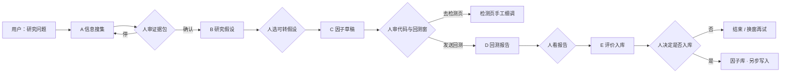
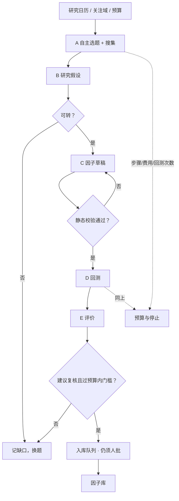
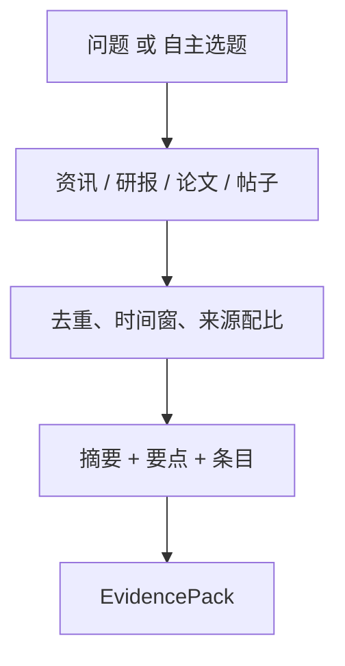
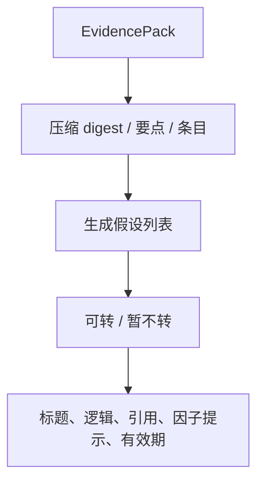
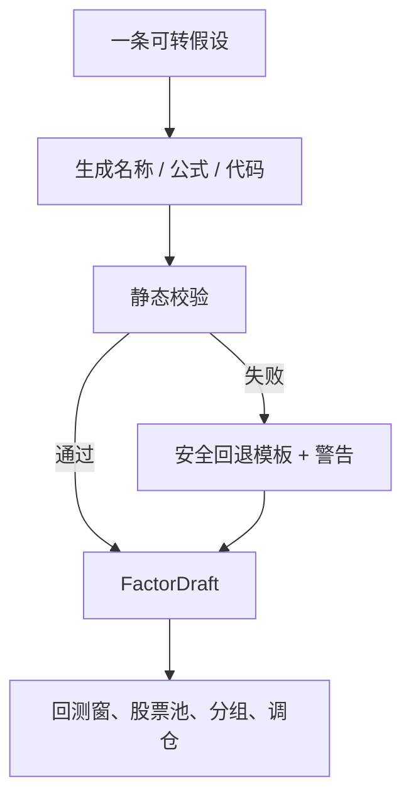
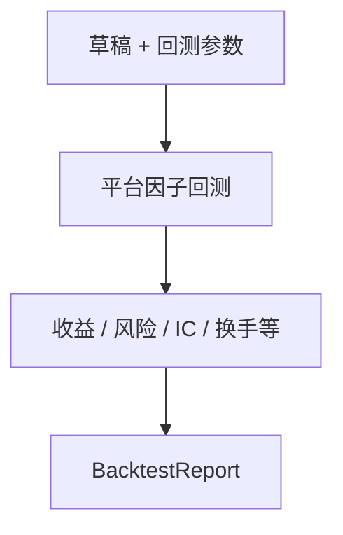
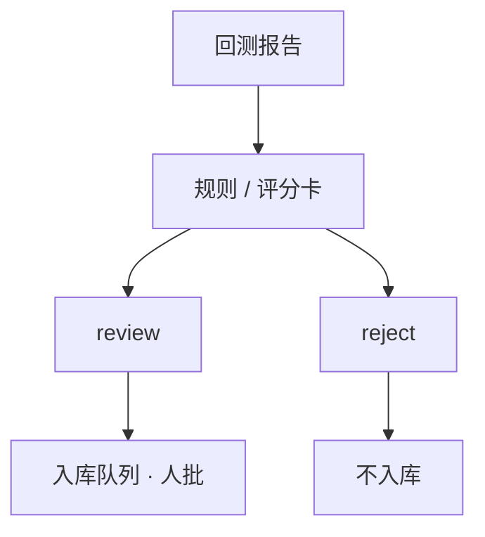

# 挖因子工作流 — 需求与设计

> 文档版本：v0.1  
> 最后更新：2026-08-18  
> 文档状态：评审稿  
> 产品范围：SVQuant WebApp 上的因子挖掘链路（搜集 → 假设 → 草稿 → 回测 → 评价）  
> 单模块细稿（实现对照，非本文展开）：[`Agent设计-A-信息搜集.md`](./Agent设计-A-信息搜集.md)、[`Agent设计-B-研究假设.md`](./Agent设计-B-研究假设.md)、[`Agent设计-CDE-雏形.md`](./Agent设计-CDE-雏形.md)

---

## 0. 文档说明

本文档定义 **挖因子（Factor Mining）** 这条工作流的产品范围、总流程、各 Agent 模块职责、人闸规则，以及向全面自动化演进的目标。它是总 PRD 中「因子与 Alpha 自动挖掘」在 WebApp 上的落地切片，**不**覆盖自然语言策略构建、团队审批中心和定时监控。

优先级约定与总 PRD 相同：

- `P0`：当前人闸版必须能走通，缺失则无法形成「想法 → 可回测因子 → 结论」闭环。
- `P1`：人闸稳定后，允许一条任务自动串跑，人只在关键节点介入。
- `P2`：全面自动化：无需用户先写自然语言问题，Agent 自主选题、搜集、迭代；入库仍须人工最终确认。

原则继承总 PRD：证据先于结论；受控自动化；样本外优先；**人工拥有最终决定权**（入库、共享、进入后续流程）。

---

## 1. 产品概述

### 1.1 一句话定位

**挖因子工作流把公开资料和研究假设，变成平台可回测的日频因子草稿、回测报告，以及是否建议入库的评价；当前逐步人工确认，目标是同一条链路可无人值守跑完。**

### 1.2 背景与问题

1. 研究者要从资讯、研报、论文里自己提炼可检验假设，再手写因子、配回测、看报告，环节碎、难复盘。
2. 同一套逻辑换回测窗，结论可以完全不同；若不把有效期跟着假设走，容易把一段行情当成因子终身有效。
3. 事件驱动、题材叙事不能直接写成日频量价因子，需要明确「可转 / 暂不转」。
4. 现在必须人点每一步，适合纠偏；后面要泛化，入口不该是已经写好的因子说明书，更不该每次都靠用户想一个很细的问题。

### 1.3 产品目标

| ID | 目标 | 对应阶段 |
|---|---|---|
| G1 | 宽问题也能搜到可溯源资料，并收成证据包 | P0 |
| G2 | 从证据包生成可转因子的研究假设（含建议回测窗） | P0 |
| G3 | 假设变成平台可回测的日频因子代码，人审后再回测 | P0 |
| G4 | 用平台回测产出报告，评价只给建议、不自动写库 | P0 |
| G5 | 整条链路可配置为人闸或自动串跑 | P1 |
| G6 | 无用户问题也能自主选题搜集，并在预算内迭代 | P2 |

### 1.4 产品原则（本链路特化）

1. **资料可点开**：摘要不得编造检索外事实；要点必须能回到条目。
2. **假设可检验**：优先日频 `open/high/low/close/volume`；不能写的标成不可转。
3. **窗口跟着假设走**：建议回测窗、样本外切分随假设传到草稿和回测。
4. **代码与回测分步**：生成成功 ≠ 因子有效。
5. **评价不写库**：评价 Agent 只输出建议；入库是独立动作，必须人批。
6. **人闸可卸、闸门仍在**：自动化后仍保留暂停、驳回、预算打满即停。

---

## 2. 产品边界

### 2.1 本期范围（P0 人闸版）

- 信息搜集：自然语言问题 + 资讯 / 研报 / 论文 / 帖子，产出证据包。
- 研究假设：消费证据包，产出若干条假设（可转标记、因子提示、有效期）。
- 因子草稿：一条可转假设 → 一个 `def` 日频因子 + 建议回测参数。
- 回测报告：把草稿参数发给平台因子回测，整理指标摘要。
- 评价入库：根据报告给出复核 / 不建议入库；**不写入因子库**。
- 各步本机历史回看；步与步之间由人点确认。

### 2.2 本期非目标

- 不自动下单、不荐股、不承诺收益。
- 不把事件/IPO/政策博弈静默改成量价因子。
- 不在本机存行情；因子计算与回测走平台已有能力。
- 不自动把候选写入官方或个人因子库。
- 不在本链路实现完整策略构建（属总 PRD 另一条）。
- P0 不要求无问题自主巡航搜集。

### 2.3 与总 PRD 的关系

总 PRD 的「因子与 Alpha 自动挖掘」包含批量候选、封存样本外、评分卡、失败归因和有界迭代。本工作流是 **单条假设走通** 的骨架：先 A→E 人闸闭环，再把批量迭代和封存样本外套在 C/D/E 之外，而不是先上完整挖掘工厂。

---

## 3. 目标用户与角色

与总 PRD 一致。单用户 MVP 同一人可兼任研究员和复核人，但 **确认、回测、入库建议、真正入库** 仍是不同动作、分别留痕。

| 角色 | 在本链路中的动作 |
|---|---|
| 研究员 | 提问或启动巡航、挑选假设、确认草稿、发起回测、查看报告 |
| 复核人 | 决定是否入库；可驳回并要求换窗或改代码 |
| 自动化运行器（P1/P2） | 按计划串跑 A–E，遇闸门或预算停止 |

---

## 4. 总体架构与总流程

### 4.1 当前：人闸版（P0）

用户带着问题进来，每跨一个 Agent 都要人点一次。适合纠偏、看资料、改假设。



### 4.2 目标：全面自动化（P2）

第一块甚至没有自然语言问题：系统按研究日历 / 关注域自己选题、自己搜、自己往下传。人只看仪表盘、预算和最终入库。



P1 是两者之间：用户仍可给问题，也可一键「自动跑到评价」；闸门默认开在「入库前」。

### 4.3 模块一览

| 模块 | 页面（P0） | 一句话 | 输入 | 输出 |
|---|---|---|---|---|
| A 信息搜集 | `/ai/gather` | 把问题或自主选题变成可溯源证据包 | 问题 / 关注域 + 来源与时间窗 | EvidencePack |
| B 研究假设 | `/ai/idea` | 把证据收成可检验假设 | EvidencePack | Hypothesis[]（含可转、提示、有效期） |
| C 因子草稿 | `/ai/factor` | 把一条可转假设写成平台因子代码 | 一条 Hypothesis | FactorDraft + 回测参数 |
| D 回测报告 | `/ai/factor-backtest` | 调平台回测，收成报告 | FactorDraft 参数 | BacktestReport |
| E 评价入库 | `/ai/factor-eval` | 根据报告建议是否入库 | BacktestReport | 建议（review/reject），admit=否 |

相邻能力：SV 助手（`/ai/chat`）不在本链路内，只做问答，不产出入库结论。

---

## 5. 核心用户流程

### 5.1 P0 人闸走查

```text
输入研究问题（可很宽）
→ A 检索并汇总证据包 → 人看摘要/条目
→ B 生成研究假设 → 人挑选「可转因子」的一条
→ C 生成因子代码与公式 → 人看代码/窗口
→ 可选：去检测页细调
→ D 发送平台回测 → 人看指标
→ E 给出入库建议 → 人决定是否入库
```

关键要求：

- 宽问题必须能搜到材料，不能要求用户把因子公式写进问题里。
- `convertible=false` 的假设不得进入 C。
- C 成功不得自动开 D；D 成功不得自动入库。
- 回测窗必须来自假设的有效期，允许人改，改了要留痕。

### 5.2 P1 受控串跑

用户确认证据包或假设后，可选择「自动跑完 C→D→E」。系统按预算执行；任一步失败则停在该步并保留已完成产物。入库仍要人点。

### 5.3 P2 无问题巡航

```text
关注域（如：A 股量价异象）+ 预算
→ A 自己生成本轮选题并搜集
→ 后续同 5.2
→ 多题循环直到预算或无改进
→ 合格候选进入入库队列
```

关键要求：自主选题必须可复盘（记下「为何选这个题」）；不得为冲指标而偷看封存样本外（与总 PRD 样本外治理对齐，P1 起约束 D/E）。

---

## 6. 各模块功能概述

以下每节只写职责、主流程和分期，细节以单模块设计稿为准。

### 6.1 A · 信息搜集

**职责：** 从公开网页与站内资讯取出和问题相关的材料，做可引用汇总，供人看或交给 B。



| ID | 优先级 | 功能要求 |
|---|---|---|
| GAT-001 | P0 | 用户用自然语言提问；可选来源、时间窗、条数。 |
| GAT-002 | P0 | 按概念检索，而不是只扫最新栏目再用整句过滤。 |
| GAT-003 | P0 | 输出摘要、要点、条目、缺口；要点能点回条目。 |
| GAT-004 | P0 | 本机保留搜集历史，离开页面可回看。 |
| GAT-005 | P1 | 支持「用当前包继续补搜」而不丢掉已选条目。 |
| GAT-006 | P2 | 无用户问题：按关注域生成选题再搜集，并记录选题理由。 |

**不做：** 编造未检索事实；直接写因子代码；给出买卖建议。

**自动化含义：** P2 的 A 从「回答问题」变成「自己找值得检验的题」；证据包合同不变，B 仍只吃包。

---

### 6.2 B · 研究假设

**职责：** 只消费证据包，产出若干条可溯源、尽量可转因子的研究假设，并带上建议回测窗。



| ID | 优先级 | 功能要求 |
|---|---|---|
| HYP-001 | P0 | 每条假设必须引用包内条目 id，不得捏造包外新闻事实。 |
| HYP-002 | P0 | 给出 `convertible`：能量价日频检验的为可转，事件/纯叙事为否。 |
| HYP-003 | P0 | 可转假设带 `factor_prompt`、字段/股票池提示、建议起止日与样本外切分。 |
| HYP-004 | P0 | 人挑选一条再进 C；不可转的禁用「转成因子草稿」。 |
| HYP-005 | P0 | 本机假设历史可回看。 |
| HYP-006 | P1 | 串跑时可按规则自动挑一条可转假设（置信度、引用完整度）。 |
| HYP-007 | P2 | 一批假设可同时派生多条草稿（受候选数预算约束）。 |

**不做：** 重新检索；输出完整 `.py`；保证收益。

---

### 6.3 C · 因子草稿

**职责：** 把一条可转假设写成平台能回测的日频因子（一个 `def`，白名单字段），并带上从假设继承的回测参数。



| ID | 优先级 | 功能要求 |
|---|---|---|
| DFT-001 | P0 | 输入为 B 的一条假设；输出代码、中文公式、说明、字段、假设、警告。 |
| DFT-002 | P0 | 仅允许日频 `open/high/low/close/volume` 及有限序列方法；禁止 import / 动态执行。 |
| DFT-003 | P0 | 页面展示完整：公式、说明、字段、代码、窗口、样本外、分组，而不是只给代码块。 |
| DFT-004 | P0 | 人确认后再回测；可跳转检测页手工改。 |
| DFT-005 | P0 | 本机草稿历史可回看。 |
| DFT-006 | P1 | 校验失败自动再生成有限次，仍失败则停并展示原因。 |
| DFT-007 | P2 | 同一假设可出一族参数变体（窗口、确认条件），进入批量回测预算。 |

**不做：** 静默调用回测；写入因子库。

---

### 6.4 D · 回测报告

**职责：** 把草稿参数发给 **平台因子回测**，把确定性指标收成报告，供人看和给 E。模型不得自己算年化或夏普。



| ID | 优先级 | 功能要求 |
|---|---|---|
| BT-001 | P0 | 使用草稿中的代码、股票池、起止日；人可改窗后再发。 |
| BT-002 | P0 | 展示年化、夏普、回撤、IC 等摘要；注明换窗可能完全不同。 |
| BT-003 | P0 | 耗时长时页面明示；失败要可区分配置错误与引擎错误。 |
| BT-004 | P0 | 本机回测历史可回看。 |
| BT-005 | P1 | 同一草稿可跑样本内 / 验证 / 样本外多段，报告分段存放。 |
| BT-006 | P2 | 在预算内对参数族批量回测，产出可比较矩阵。 |

**不做：** 用大模型编造指标；自动入库。

---

### 6.5 E · 评价入库

**职责：** 只读回测报告，给出「建议人工复核」或「不建议入库」。`admit` 在自动写入开启前恒为否。



| ID | 优先级 | 功能要求 |
|---|---|---|
| EVL-001 | P0 | 输入为 D 的报告；输出结论、理由、注意（含单区间不可当终身有效）。 |
| EVL-002 | P0 | 不调用写库接口；页面写清「不自动入库」。 |
| EVL-003 | P0 | 本机评价历史可回看。 |
| EVL-004 | P1 | 接入总 PRD 评分卡维度（信号、风险、换手、复杂度），仍只建议不写入。 |
| EVL-005 | P2 | 过门槛的进入入库队列；**写入因子库必须人批一次**。 |

**不做：** 静默覆盖官方库；把评价当收益承诺。

---

## 7. 人闸与自动化对照

| 步骤 | P0 人闸 | P1 串跑 | P2 巡航 |
|---|---|---|---|
| 选题 | 用户写问题 | 用户写问题或选关注域 | Agent 自选题 |
| A→B | 人点「生成研究假设」 | 可自动 | 自动 |
| B→C | 人选可转假设 | 规则挑一条，人可改 | 可多候选 |
| C→D | 人点「发送回测」 | 校验通过即回测 | 批量回测 |
| D→E | 人点「给出建议」 | 回测完成后评价 | 自动评价 |
| 入库 | 人另步操作 | 人批队列 | 人批队列（不可取消） |
| 停止 | 用户离开即可 | 预算 / 失败 / 人暂停 | 预算 / 无改进 / 人终止 |

任何阶段用户都可以把某一步从自动改回「必须我点」。自动化增加的是默认策略，不是取消治理。

---

## 8. 分期建议

### MVP / P0（当前）

人闸闭环：宽问题搜集 → 假设 → 草稿展示完整 → 回测 → 评价不入库。历史可回看。A/B 为质量重点；CDE 可用。

### Phase 1

任务对象串起 A–E；可选自动跑到评价；预算与失败停机；评价接简单评分卡；仍无人批不入库。

### Phase 2

无问题巡航搜集；多候选迭代；封存样本外；入库队列；与总 PRD 挖掘工厂（失败归因、Walk-forward）对齐。

---

## 12. 成功标准（本链路）

| 指标 | P0 目标 |
|---|---|
| 宽问题搜集非空包 | 常见量价主题可返回混合来源条目 |
| 假设可转比例 | 每包至少 1 条可转（资料足够时） |
| 草稿静态校验通过率 | 可转假设生成后多数可直接回测 |
| 人闸完整性 | 无隐藏的自动回测、自动入库 |
| 产物可回看 | A–E 均有本机历史 |

P2 北极星与总 PRD 一致：每周完成的、可复现、有明确结论（含明确拒绝）的挖因子任务数。

