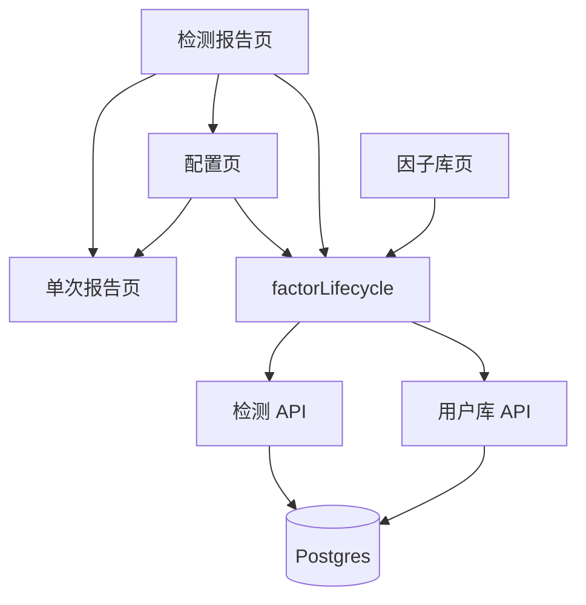
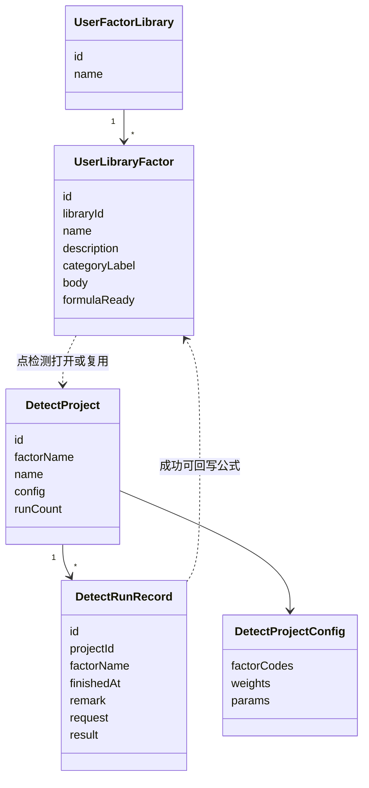
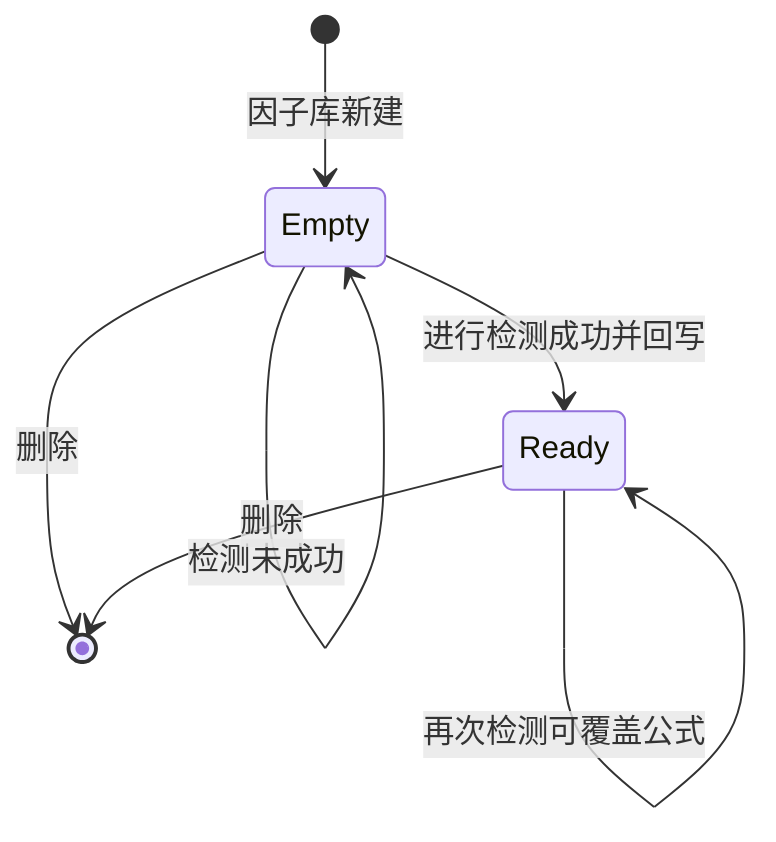
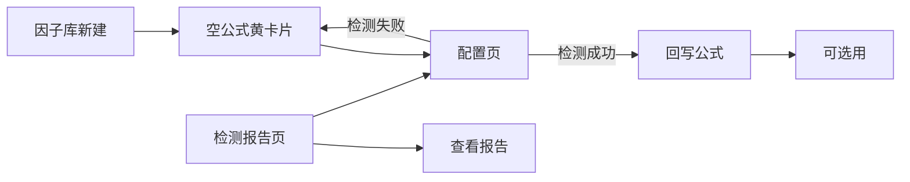

# 因子检测 / 因子库流程（改后）

## 架构

三层职责拆开：

| 层 | 职责 | 落点 |
|----|------|------|
| Domain | 实体与状态 | Postgres 表 + 前端类型 |
| Application | 建空因子、打开检测、成功回写、列报告 | `frontend/src/lib/factorLifecycle.ts` |
| UI | 页面编排 | 因子库 / 检测报告 / 配置页 / 单次报告 |

---

## 实体（类）

| 实体 | 含义 |
|------|------|
| UserFactorLibrary | 用户自建因子库（文件夹） |
| UserLibraryFactor | 库内因子；`formulaReady=false` 表示尚无公式（黄色） |
| DetectProject | 检测工作区（配置）；内部使用，不再做项目列表页 |
| DetectProjectConfig | 工作区配置（因子、权重、参数等） |
| DetectRunRecord | 一次检测运行结果（含备注 remark） |

### 用户库因子状态

| 状态 | 条件 | 表现 |
|------|------|------|
| Empty | `formulaReady=false` | 黄色「待写公式」 |
| Ready | `formulaReady=true` | 正常可选 |

内置因子不走该状态，始终可直接检测。

---

## 流程

### 主路径：新建 → 检测 → 回写

1. 在**因子库**点「新建因子」，填写代码名、中文解释、分类、所属用户库。
2. 入库时只有元数据，`formulaReady=false`，卡片为黄色。
3. 点「检测」打开配置页（内部创建/复用 `DetectProject`）。
4. 在配置页编写公式，点「进行检测」。
5. **仅成功时**把公式写回用户库，并设 `formulaReady=true`。
6. 跳转单次报告；侧栏「检测报告」可看全部运行记录。

### 页面与路由

| 路由 | 页面 |
|------|------|
| `/factor/library` | 因子库：新建因子、黄态、点检测 |
| `/factor/detect` | 检测报告：因子名、测试时间、备注、查看报告/配置、删除 |
| `/factor/detect/:projectId` | 配置与运行（无页内新建因子） |
| `/factor/detect/report/:runId` | 单次报告 |
| `/factor/detect/:id/history` | 重定向到全局检测报告 |

### 用例函数

| 函数 | 作用 |
|------|------|
| `createEmptyUserFactor` | 建空因子 |
| `openDetectForLibraryFactor` | 打开检测配置页 |
| `persistFormulaAfterDetect` | 成功后回写公式 |
| `listDetectReports` | 全局报告列表 |
| `setDetectReportRemark` / `removeDetectReport` | 备注与删除 |

---

## 与改前对比

| 改前 | 改后 |
|------|------|
| 黄 = 检测页临时草稿 | 黄 = 用户库空公式 |
| `/factor/detect` = 项目列表 | = 全局检测报告 |
| 报告页再入库 | 检测成功即回写 |
| 检测页可新建因子 | 只在因子库新建 |

---

## 关键文件

- `frontend/src/lib/factorLifecycle.ts`
- `frontend/src/lib/userFactorLibraries.ts`
- `frontend/src/lib/detectStore.ts`
- `frontend/src/pages/FactorLibraryPage.tsx`
- `frontend/src/pages/FactorDetectListPage.tsx`
- `frontend/src/pages/FactorDetectPage.tsx`
- `backend/services/factor/user_library_store.py`
- `backend/services/factor/detect_store.py`
