# SVQuant 社区 · 已实现功能说明

> 截至 **2026-07-24** 的上线能力快照（以内测可用为准）。  
> 对照目标态：[`社区-预期功能说明.md`](./社区-预期功能说明.md)  
> 截图目录：[`community-screenshots/`](./community-screenshots/)  
> 运行约定：前端 Vite（同事 `9530` / 本人 `9531`），API `8766`，社区数据在 **Postgres**。

---

## 0. 一句话现状

账号 + Feed + 发帖/草稿 + 两层评论/@ + 收藏/消息 + 报告/面板分享 + 克隆到检测/策略 + 管理员置顶/下架/管理仓 + **SVQuant Agent 发帖助手（润色 + 用量）** **已闭环**。  
**尚未做**：独立管理后台 SPA、完整关注图谱、举报表。

---

## 1. 页面与路由一览

| 路由 | 谁能进 | 作用 |
|------|--------|------|
| `/community` | 游客可读 | Feed：分区、搜索、排序、置顶区、热门侧栏 |
| `/community/post/:id` | 游客可读 | 详情：正文、克隆、评论；作者可编辑/删；admin 可审核 |
| `/community/new` · `/community/post/:id/edit` | 登录 | 发帖 / 编辑；可存草稿 |
| `/community/drafts` | 登录 | 草稿箱 |
| `/community/favorites` | 登录 | 我的收藏 |
| `/community/mine` | 登录 | 我的帖子 |
| `/community/messages` | 登录 | 消息（回复 / @我的 / 系统） |
| `/community/me` | 登录 | 个人中心入口 |
| `/community/mod` | admin | 管理仓：已下架 / 已置顶 |
| `/login` · `/register` | 全员 | JWT 登录；token 存 **sessionStorage** |

---

## 2. 主流程（已实现）

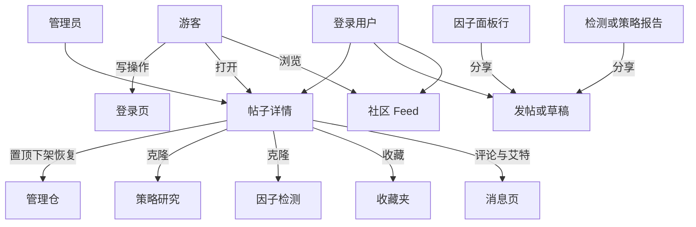

### 分享 → 发帖 → 克隆

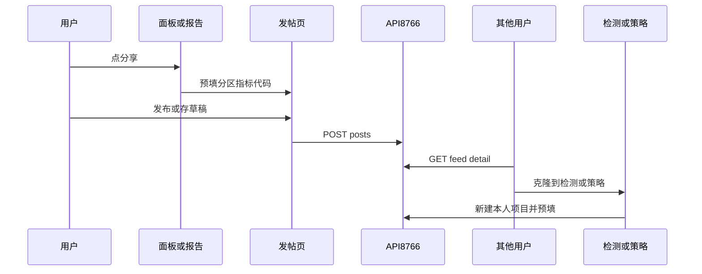

---

## 3. 功能清单（对照截图）

### 3.1 Feed（发现）

- 分区 Tab：全部 / 策略分享 / 因子笔记 / 问答 / 热点分析 / 官方  
- 搜索：`?q=`（标题 / 正文 / 代码）  
- 排序：浏览最多（默认）/ 收藏最多 / 最新  
- 真置顶区（`is_pinned`）+ 右侧热门榜  

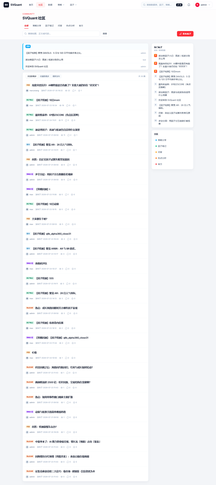

游客同页可浏览（无写权限）：

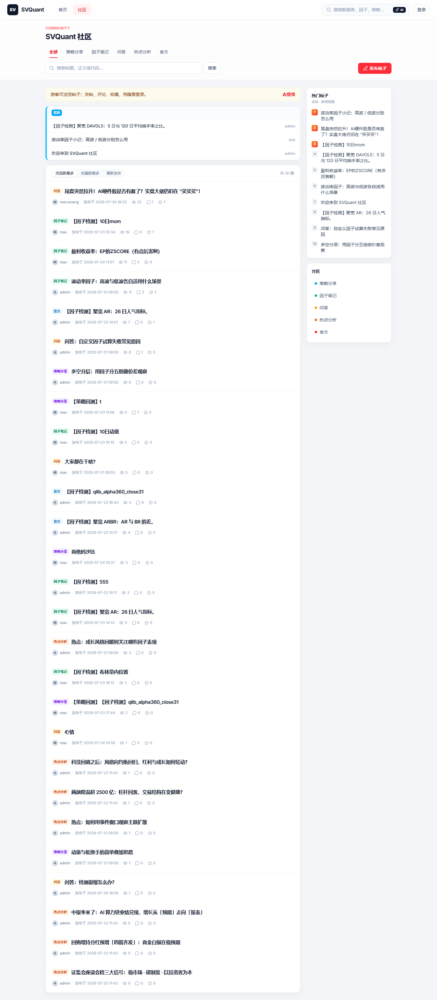

分区筛选示例：

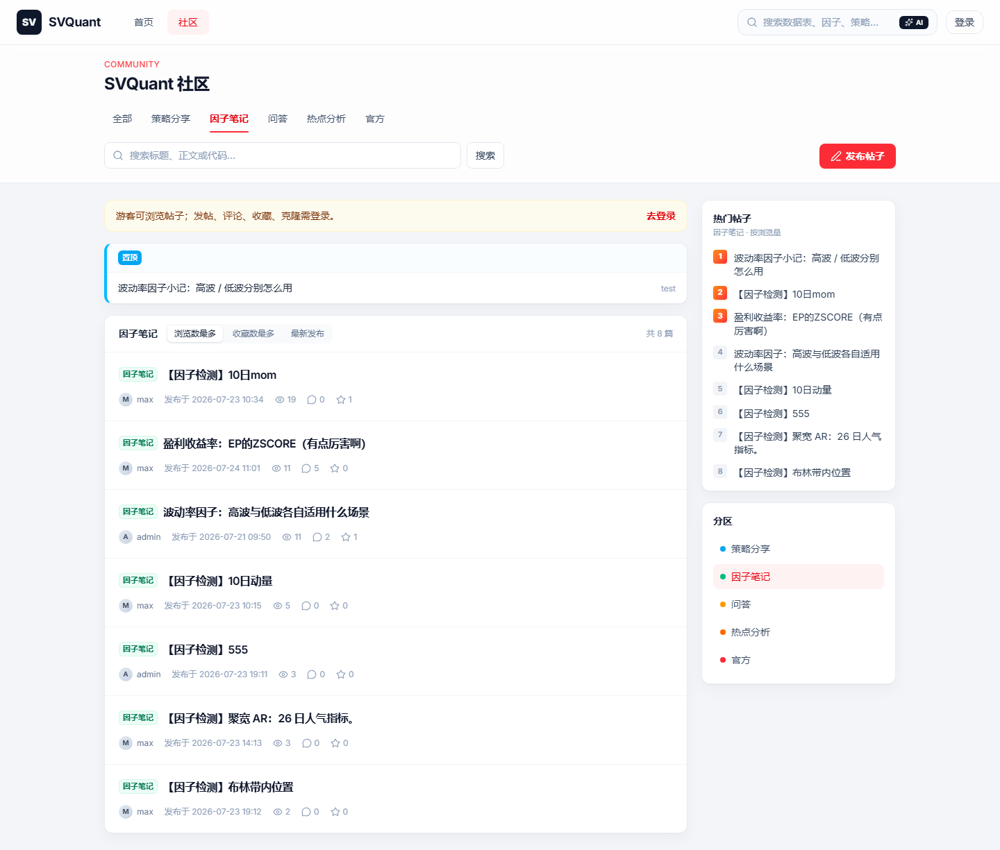

### 3.2 登录

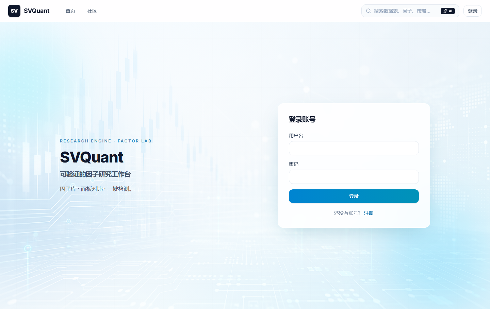

### 3.3 帖子详情 · 评论

- TipTap 富文本正文（分享链路不再露裸 Markdown 星号）  
- 作者：编辑 / 删除（软删 hidden）  
- Admin：置顶 / 下架 / 恢复  
- 克隆：因子检测（新建项目；库内因子可预选）/ 策略研究（存根可展开）  
- 禁止自收藏  

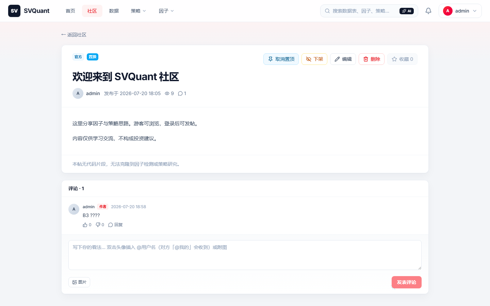

两层评论（赞踩 / 折叠 / 附图）；点「回复」只归 **回复我的**，不自动塞 `@`：

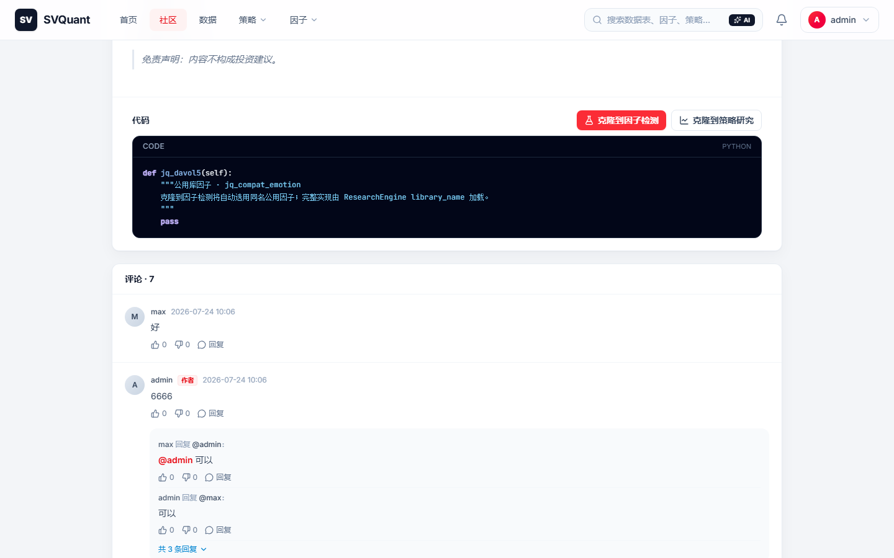

**@ 规则（已实现）：**

- 双击头像或昵称 → 插入 `@登录名`  
- 正文命中 `@用户名` → 通知类型 `mention`（「@我的」）  
- 同一用户既被回复又被 @ 时，**mention 优先于 reply**

### 3.4 发帖 · 草稿

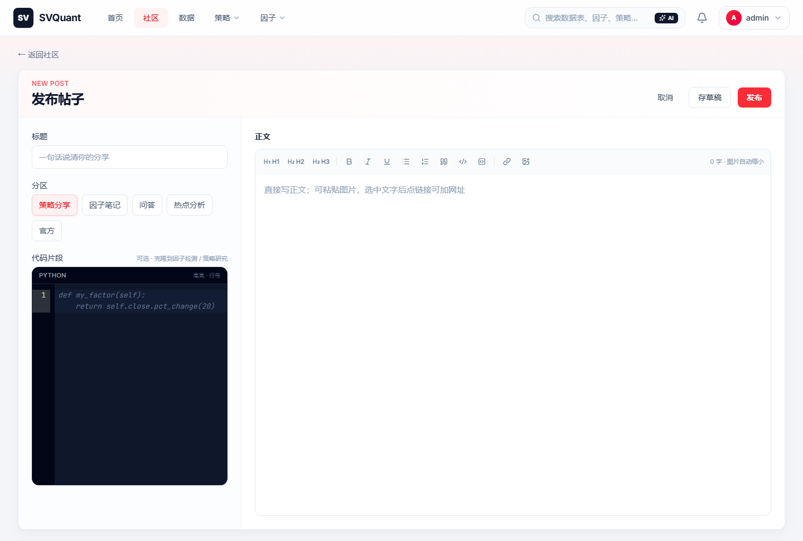

- `status=draft|published`；草稿作者可读；打开草稿详情会跳编辑  
- 草稿硬删；已发布帖删除为软删  

### 3.5 消息 · 个人中心 · 收藏 · 我的帖

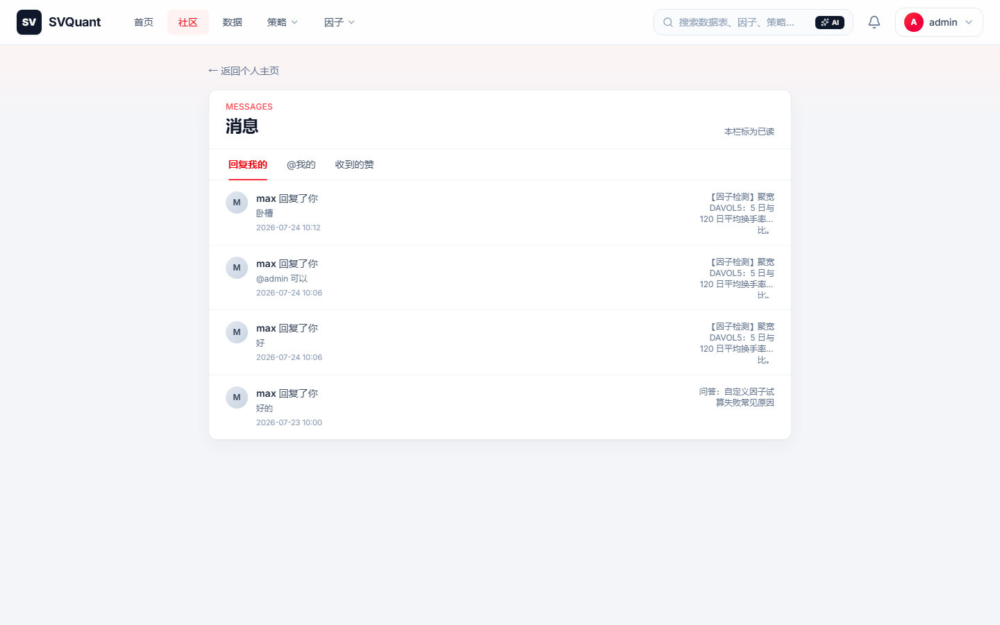

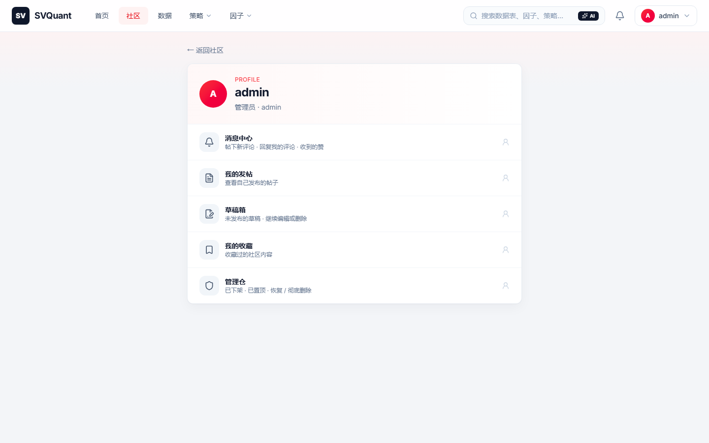

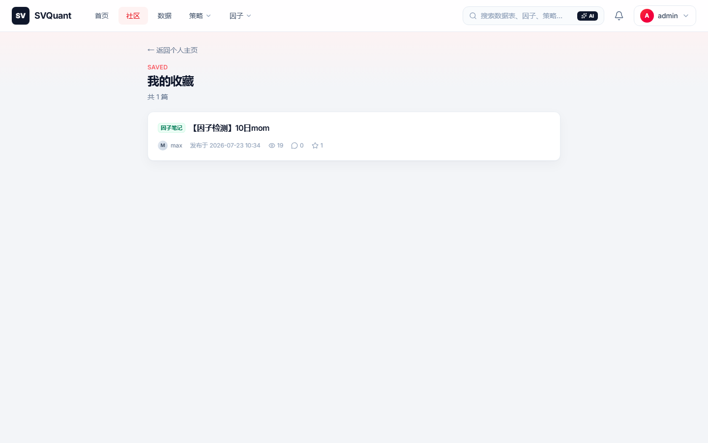

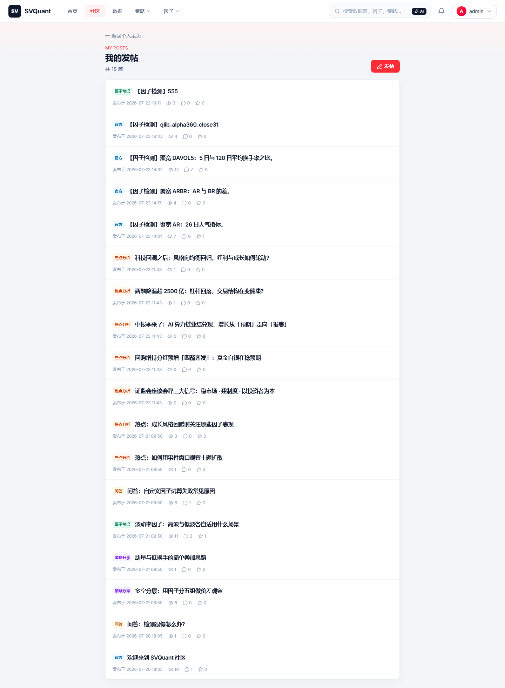

### 3.6 管理仓（admin）

路径 `/community/mod`：已下架 / 已置顶；恢复、彻底删除（purge）；详情页亦可操作。

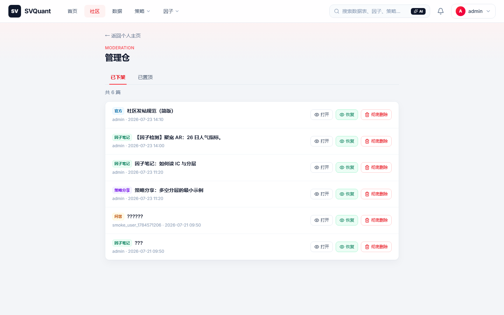

确认框为应用内 `ConfirmDialog`（不用浏览器原生 `confirm`）。

### 3.7 工作区入口：面板分享

因子面板行内 **分享 | 检测**；分享预填指标与代码到发帖页。

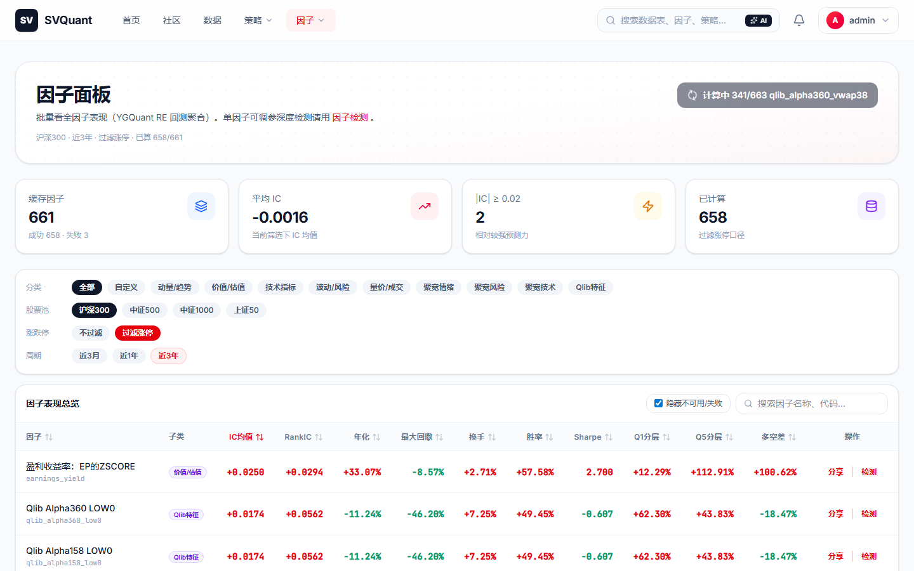

另已支持：检测报告 / 策略报告 →「分享到社区」。

---

## 4. 后端能力摘要

| 领域 | 要点 |
|------|------|
| 认证 | Postgres users；`POST /api/auth/login|register`；JWT |
| 帖子 | CRUD；分区；浏览计数；置顶字段；hidden / purge |
| 互动 | 评论两层；收藏；通知 reply / mention |
| 列表 | Feed、热门、收藏、我的帖、草稿、管理仓 |
| 隔离 | 自定义因子 / 检测项目按 `user_id`；社区公开内容除外 |

实现主要落在：`WebApp/backend/services/community_store.py`、`api_server.py`；前端 `Community*.tsx`、`CommentThread.tsx`、`lib/communityShare.ts`。

### Agent 发帖助手（2026-07-24）

- 发帖页侧栏 **SVQuant Agent · 发帖助手**：润色标题 / 正文 / 一并润色；展示步骤轨迹与日配额  
- `POST /api/agent/runs`：`goal` + `skills` + `context` → `steps` / `outputs` / `usage`  
- `ai_usage` 表 + `users.ai_quota_daily`；`GET /api/agent/usage/me`；admin `GET /api/agent/usage`（管理仓顶部汇总）  
- LLM：`LLM_BASE_URL` / `LLM_API_KEY` / `LLM_MODEL`（OpenAI 兼容）；未配置密钥时 **本地 mock**，联调不挡路  
- Agent **不代发帖**，只改草稿字段；`/strategy/ai`、`/factor/ai` 仍占位，后续接同一 Run API  
- TipTap 正文需同步外部 `value`（已修）：否则会出现「侧栏显示完成、正文仍是旧稿」  
- **试稿合集**（粘贴测润色）：[`community-agent-polish-examples.md`](./community-agent-polish-examples.md)  
- **多 Agent 协作审校**：Writer / Critic / Router + 共享黑板；发帖页「协作审校」；设计见 [`multi-agent-design.md`](./multi-agent-design.md)

---

## 5. 与预期的差距（下一周可选项）

| 预期项 | 状态 |
|--------|------|
| AI 发帖助手 / 用量看板 | **已做**（Agent 薄壳 + 多 Agent 协作审校） |
| 独立 `/admin` 后台 SPA | 未做（下周**非目标**；继续管理仓） |
| 关注作者 / 公开个人主页 | 未做（下周 §C 可选最小可用；完整图谱为非目标） |
| 举报表 + 审核队列 | 未做（下周 §C 可选举报 MVP；完整审核队列为非目标） |
| 读帖 TL;DR / 帖内 Bot | 未做 |
| 面板分享 / 管理仓 / 草稿 / 真 @ | **已做**（超出原 P0） |

---

## 6. 截图索引

| 文件 | 内容 |
|------|------|
| `01-feed.png` | Feed 游客 |
| `01-feed-authed.png` | Feed 登录 + 置顶 |
| `02-feed-section.png` | 分区筛选 |
| `03-login.png` | 登录页 |
| `04-post-detail.png` | 帖子详情 |
| `05-post-comments.png` | 评论区 |
| `06-new-post.png` | 发帖 |
| `07-messages.png` | 消息 |
| `08-me.png` | 个人中心 |
| `09-drafts.png` | 草稿箱 |
| `10-mod.png` | 管理仓 |
| `11-dashboard.png` | 面板分享入口 |
| `12-favorites.png` | 收藏 |
| `13-mine.png` | 我的帖 |

截图由本机 Playwright 对 `9530` + API `8766` 抓取；复抓时可自写短脚本注入 `sessionStorage` 的 `svquant_token` / `svquant_user`。
