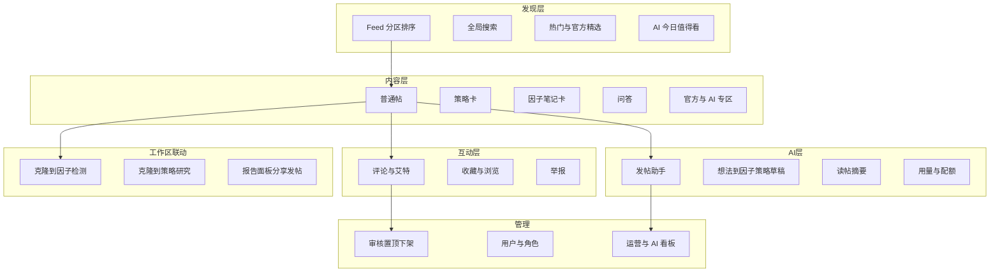
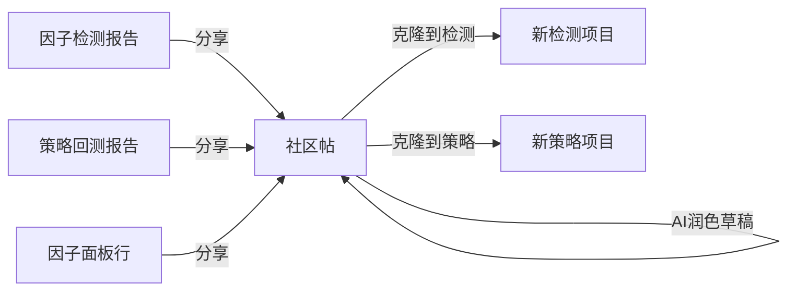

# SVQuant 社区 · 预期功能说明

> 产品目标态（设计口径），不等于当前已上线能力。  
> 对照已实现：[`社区-已实现功能说明.md`](./社区-已实现功能说明.md)  
> 设计原稿：[`COMMUNITY_DESIGN.md`](./COMMUNITY_DESIGN.md)  
> 更新日期：2026-07-24

---

## 1. 定位

不做「又一个论坛」，做 **AI 驱动的量化内容广场**：发帖可被 AI 辅助；帖子可一键落到因子检测 / 策略回测；官方与 AI 共同生产「可验证」的研究资产。

**内容可运行、可归因、可被 AI 二次加工。**

---

## 2. 角色与权限（目标）

| 角色 | 预期能力 |
|------|----------|
| **游客** | 浏览公开 Feed / 详情 / 热门；不可写、不可克隆到个人工作区 |
| **普通用户** | 发帖、评论、收藏、草稿、@、消息；克隆到本人检测/策略；有限 AI 配额 |
| **版主 / 运营** | 置顶、下架、恢复、分区调整、处理举报 |
| **Admin** | 用户封禁、角色、官方公告、AI 配置与用量、全站开关 |
| **系统 / AI Bot** | 以打标身份发帖或回帖（防冒充） |

---

## 3. 功能框架（目标架构）

---

## 4. 分期预期

### T0 — 账号地基（已作为前提）

- Postgres 用户表 + 注册/登录 + JWT
- 角色至少区分 `user` / `admin`
- 刷新不掉登录

### P0 — 内测可用社区

| 能力 | 预期 |
|------|------|
| Feed | 分区、排序（时间/热度/收藏）、游客可读 |
| 发帖 | 富文本/Markdown、分区、代码块、结构化摘要字段 |
| 互动 | 评论、收藏、浏览计数 |
| 克隆 | 因子卡 → 检测；策略卡 → 策略研究 |
| 管理 | 最小：置顶 / 下架 |
| AI | 至少「发帖助手」露脸 + 用量可计 |

### P1 — 运营可用

- 搜索、热门榜、个人主页、通知（回复 / @ / 系统）
- 检测报告 / 策略报告 / 面板 → 一键分享
- 读帖摘要、自动标签、举报与审核队列
- 运营看板：发帖量、互动、克隆转化、AI 调用

### P2+ — 差异化加深

- 关注图谱、个性化推荐
- 模拟盘/实盘外链（有闭环后再做）
- 独立管理后台 SPA、完整 RBAC
- 帖内 AI 问答（RAG）、官方 AI 周报 Bot

---

## 5. 与研究工具的衔接（预期闭环）

原则：

1. **计算仍走 YGQuant ResearchEngine**；社区不算本地行情。  
2. AI **不替代**回测真值：生成/分享的代码必须能在 SVQuant 再跑一遍。  
3. 私有工作区（自定义因子、检测项目）按用户隔离；社区只传播用户主动公开的内容。

---

## 6. 明确非目标（短期不做）

- 实盘跟单广场 / 无审核任意脚本执行
- 完整关注社交图谱（可先做个人公开帖列表）
- 把社区做成第二套因子计算引擎

---

## 7. 验收视角（产品成功长什么样）

内测用户能走通：

> 面板或检测出结果 →（可选 AI 帮写）发帖 → 他人浏览评论 @ → 一键克隆再跑 → 管理员可下架/置顶乱帖

老板侧能看到：社区内容量 + 克隆转化 +（后续）AI 日调用。
