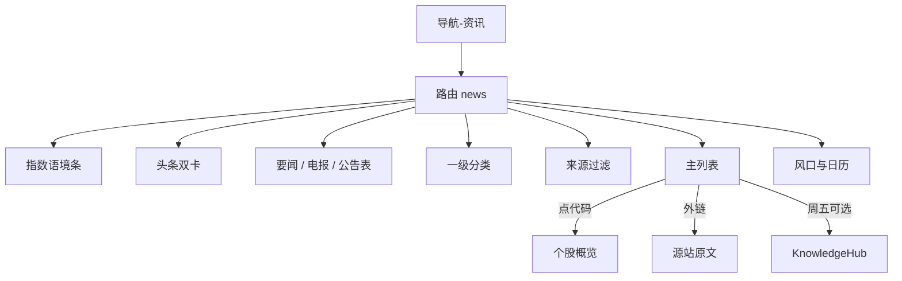
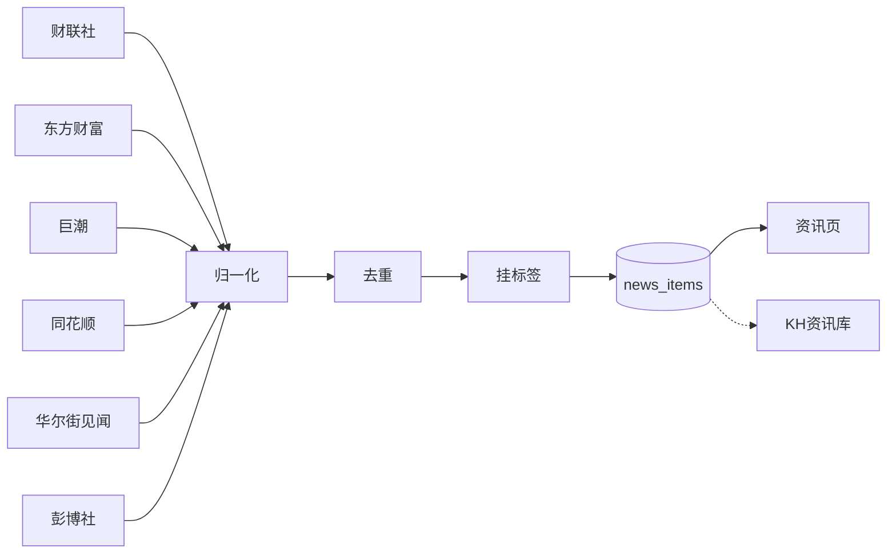

# SVQuant 资讯页设计

> 状态：**导航已挂** · **真源定时入库** · **列表/电报/公告可用** · 研报/政策 Tab 预留未接源  
> 落地位置：导航「资讯」→ `/news`  
> 代码：`frontend/src/pages/NewsPage.tsx` · `frontend/src/lib/newsApi.ts` · `backend/services/news_store.py` · `backend/services/news_ingest.py`  
> 更新日期：2026-08-04（真源 + 定时拉取；用户页去掉「拉取真源」按钮）

---

## 0. 六源官网（含彭博）

| 来源 | 官网 | 我们借鉴的点 |
|------|------|--------------|
| [财联社](https://www.cls.cn/) | cls.cn | **电报时间线**、异动标签、题材/风口、投资日历 |
| [东方财富](https://www.eastmoney.com/) | eastmoney.com | 门户分区广、个股/研报入口多；我们只取「要闻卡片 + 摘要」密度 |
| [同花顺](https://www.10jqka.com.cn/) | 10jqka.com.cn | **头条概念**、7×24 快讯、量能/异动语境 |
| [巨潮资讯](https://www.cninfo.com.cn/new/index.jsp) | cninfo.com.cn | **公告表**（代码·标题·日期），法定信披权威 |
| [华尔街见闻](https://wallstreetcn.com/) | wallstreetcn.com | 干净资讯流、宏观/全球头条、7×24 |
| **彭博社** | [bloomberg.com/asia](https://www.bloomberg.com/asia)（新闻）· [bloombergchina.com](https://www.bloombergchina.com/)（中国专业服务站） | 顶栏**市场指数条**、海外要闻双栏头条、专业冷静排版 |

> 彭博说明：公开新闻入口用 **Asia**；`bloombergchina.com` 偏终端/产品介绍，一期外链指向 Asia；正文全文受版权/付费墙约束，入库以标题+摘要+外链为主。

---

## 1. 产品定位

不做「又一个财经门户」，做 **研究侧消息面入口**：

| 原则 | 含义 |
|------|------|
| 多源 | 六源覆盖快讯 / 市场 / 公告 / 研报摘要 / 政策 / 海外 |
| 可归因 | 证券代码、行业、题材可挂 |
| 可联动 | → K 线个股；→ KnowledgeHub「资讯」库 |
| 可验证 | 公告以巨潮为准，不把股吧情绪当事实 |
| 克制 | 不抄东财整站导航树；一块屏说清「今天发生了什么」 |

**一句话：** 像财联社一样好扫快讯，像巨潮一样能查公告，像彭博一样有市场语境，最后落到 SVQuant 的研究闭环。

---

## 2. 内容结构：页面上要展示什么

### 2.1 模块总表

| 模块 | 展示内容 | 参考 | 雏形 |
|------|----------|------|------|
| A. 市场语境条 | 主要指数点位/涨跌（演示） | 彭博顶栏、东财指数 | ✅ |
| B. 页头 | 标题、一句定位、搜索 | 见闻/自研 | ✅ |
| C. 头条双卡 | 1 条主头条（深色）+ 1 条次头条 | 见闻/彭博 | ✅ |
| D. 视图模式 | 要闻流 / 电报快讯 / 公告表 | 财联社+巨潮 | ✅ |
| E. 一级分类 | 全部·快讯·市场·公告·研报·政策·**海外** | 自研 | ✅ |
| F. 来源栏 | 六源筛选 + 官网外链 | — | ✅ |
| G. 主列表 | 标题、摘要、标签、代码、原文 | 见闻卡片 | ✅ |
| H. 今日风口 | 题材名 + 涨跌% + 一句话驱动 | 财联社/同花顺 | ✅ |
| I. 投资日历 | 近日事件 | 财联社日历 | ✅ |
| J. 研究联动 | K 线 / 主题 / KH 提示 | 自研 | ✅ |

### 2.2 单条资讯字段（列表卡片）

必显：`来源 · 时间 · 一级分类 · 标题 · 摘要（1～2 行）· 题材标签 · 关联代码 · 原文`  
可选：`快讯` 角标、异动标记、重要度（二期）。

### 2.3 三种主视图分别「长什么样」

| 视图 | 形态 | 适合 |
|------|------|------|
| **要闻流** | 大卡片：标题+摘要+标签+代码 | 默认浏览 |
| **电报快讯** | 左时间右正文的密集时间线 | 盘中扫消息（财联社感） |
| **公告表** | 时间·代码·标题·来源表格 | 事件驱动（巨潮感） |

---

## 3. 层级与分类

```text
资讯 /news
│
├── 【语境】顶部指数条（全站共享语境）
├── 【焦点】头条双卡（编辑/算法置顶，二期）
│
├── 【视图】要闻流 | 电报快讯 | 公告表
│
├── 【一级】内容类型 Tab
│     全部 | 快讯 | 市场 | 公告 | 研报 | 政策 | 海外
│
├── 【二级】来源（左栏）
│     全部 | 财联社 | 东方财富 | 巨潮 | 同花顺 | 华尔街见闻 | 彭博社
│
├── 【主区】列表 / 时间线 / 表格（随视图切换）
│
└── 【辅区】今日风口 · 投资日历 · 研究联动
```

| 一级 id | 中文 | 主责源（建议） |
|---------|------|----------------|
| `flash` | 快讯 | 财联社、同花顺 7×24 |
| `market` | 市场 | 东财、同花顺题材 |
| `announce` | 公告 | 巨潮 |
| `research` | 研报 | 东财摘要级 |
| `policy` | 政策 | 见闻、财联社 |
| `global` | 海外 | 彭博、见闻 |



---

## 4. 布局与视觉

### 4.1 线框（桌面）

```text
┌──────────────────────────────────────────────────────────────┐
│ 深色指数条：上证 深成 创业板 科创50 恒生 纳指 …              │
├──────────────────────────────────────────────────────────────┤
│ 资讯 + 副文案                              [搜索]            │
│ ┌──────────── 头条深色 ────────────┐ ┌── 次头条白卡 ──┐     │
│ └──────────────────────────────────┘ └────────────────┘     │
│ [要闻流][电报快讯][公告表]    [全部][快讯]…[海外]            │
├──────────┬─────────────────────────────┬─────────────────────┤
│ 来源+外链│ 卡片 / 时间线 / 表格         │ 今日风口            │
│          │                             │ 投资日历            │
│          │                             │ 研究联动            │
└──────────┴─────────────────────────────┴─────────────────────┘
```

### 4.2 视觉规范（雏形已落地）

- 背景：暖纸色 `#f6f4f1` + 顶部淡红径向光，避免纯灰「后台感」
- 主强调：玫瑰红（对齐 SVQuant 顶栏红），涨跌：**红涨绿跌**
- 头条主卡：深 slate → 玫瑰渐变，突出「今日一条」
- 圆角：大卡片 `rounded-3xl`；分类用胶囊
- 字体：标题可用衬线强调品牌感；正文无衬线可读
- 窄屏：指数条横滑；三栏变单栏（风口沉底）

### 4.3 功能清单（交互）

| 功能 | 本期雏形 | 后续 |
|------|----------|------|
| 搜索标题/代码/题材/摘要 | ✅ 前端滤 | API |
| 分类 / 来源筛选 | ✅ | API |
| 三视图切换 | ✅ | 记住偏好 |
| 代码跳转 K 线 | ✅ | — |
| 源站外链 | ✅ | — |
| 收藏 / 进自选相关 | — | 二期 |
| 一键进 KH | — | 周五挂点 |
| 真实行情指数 | 演示数 | 接 RE/行情 |

---

## 5. 数据字段与管道

### 5.1 入库字段

| 字段 | 说明 |
|------|------|
| `title` / `summary` / `body` | 标题、摘要、正文（可空） |
| `published_at` | 时间 |
| `source` | `cls` / `eastmoney` / `cninfo` / `10jqka` / `wallstreetcn` / `bloomberg` |
| `category` | `flash` / `market` / `announce` / `research` / `policy` / `global` |
| `url` | 原文 |
| `symbols[]` / `themes[]` / `industries[]` | 关联 |
| `raw_hash` | 去重 |
| `is_flash` / `is_featured` | 视图与头条（可选） |

### 5.2 管道



拉 → 洗（去 HTML / 截断 / 时间归一 / hash 去重）→ 挂 symbols/themes → 存 Postgres → `/news` API →（可选）KH。

---

## 6. 六源定稿

| # | 来源 | id | 主责 | 官网 |
|---|------|-----|------|------|
| 1 | 财联社 | `cls` | 快讯主源 | https://www.cls.cn/ |
| 2 | 东方财富 | `eastmoney` | 个股/市场/研报摘要 | https://www.eastmoney.com/ |
| 3 | 巨潮资讯 | `cninfo` | 法定公告 | https://www.cninfo.com.cn/new/index.jsp |
| 4 | 同花顺 | `10jqka` | 题材热点 | https://www.10jqka.com.cn/ |
| 5 | 华尔街见闻 | `wallstreetcn` | 中文宏观/全球 | https://wallstreetcn.com/ |
| 6 | 彭博社 | `bloomberg` | 海外/国际 | https://www.bloomberg.com/asia |

彭博一期：标题+摘要+外链；全文与终端数据另议授权。

未选：新浪（重叠）、一财（量少）、路透（与彭博重叠，暂不叠两家海外通讯社）。

---

## 7. 周计划 / 验收

| 天 | 交付 | 状态 |
|----|------|------|
| 二～三 | 六源 + 设计 + 美观雏形 | ✅ |
| 周四 | ≥10 条真入库 + 代码/题材可挂 | ✅ C4：字典 + 标签入库 + API/UI 筛 |
| 周五 | 可筛验收；可选进 KH | 待做 |

验收最小集：顶栏进得去 · 三视图能切 · 至少一条带代码可点进个股 ·（周五）真数据 ≥10。

---

## 8. 非目标

- 复制东财/同花顺整站频道树、股吧、交易开户导流  
- 彭博/见闻付费全文爬取  
- 实时 WebSocket 强刷、独立资讯后台 SPA  
- 与下单闭环  

---

## 9. 相关文件

| 路径 | 说明 |
|------|------|
| `frontend/src/pages/NewsPage.tsx` | 列表 / 题材·行业·代码筛选 |
| `frontend/src/lib/newsApi.ts` | `listNews` + `fetchNewsDict` |
| `backend/services/news_tag_dict.py` | 题材 / 行业关键词字典 |
| `backend/services/news_ingest.py` | 入库打标 + 回填 |
| `backend/services/news_store.py` | `list_news` 含 theme/symbol/industry |
| `frontend/src/data/nav.ts` | 分类 / 六源 / 官网 URL |
| `docs/K线看板设计.md` | 代码跳转目标 |
| `E:\日报-周报\WEEK_CHECKLIST_2026-08-03.md` | C 线打勾 |
