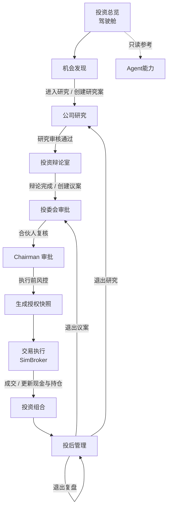
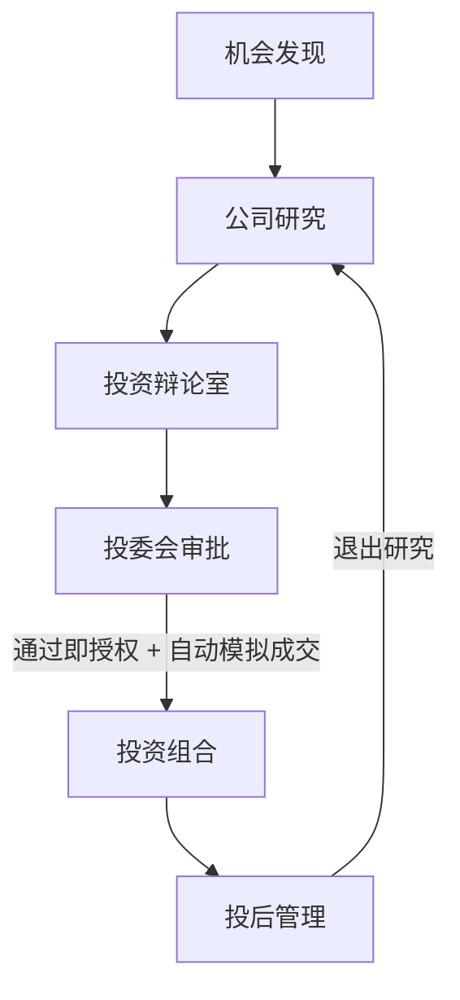
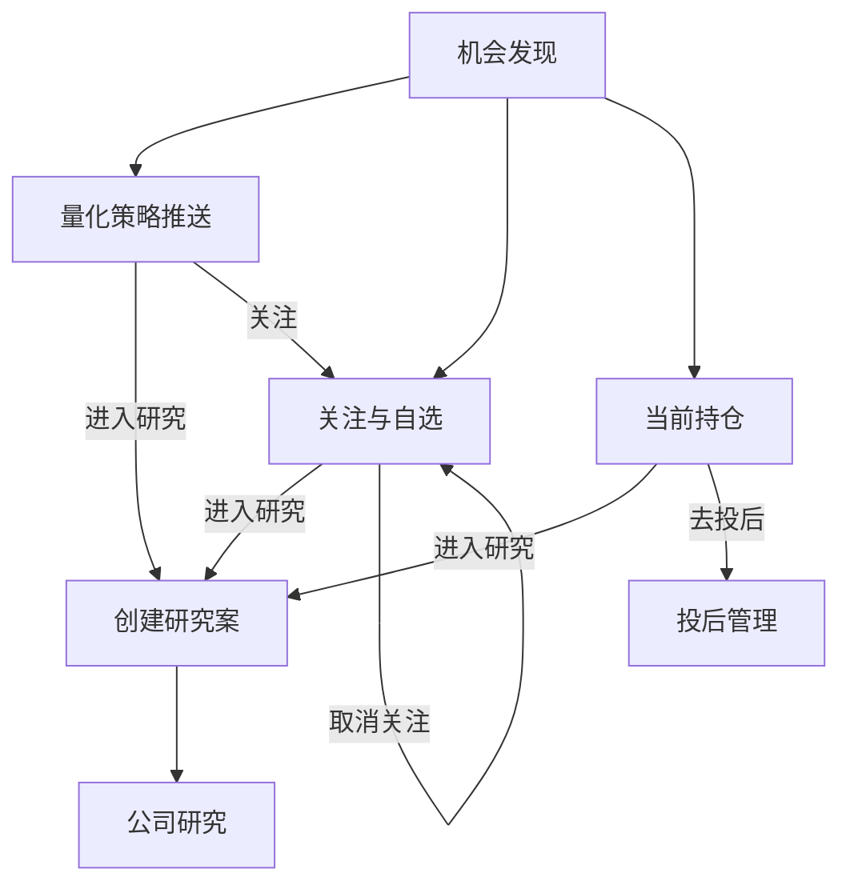
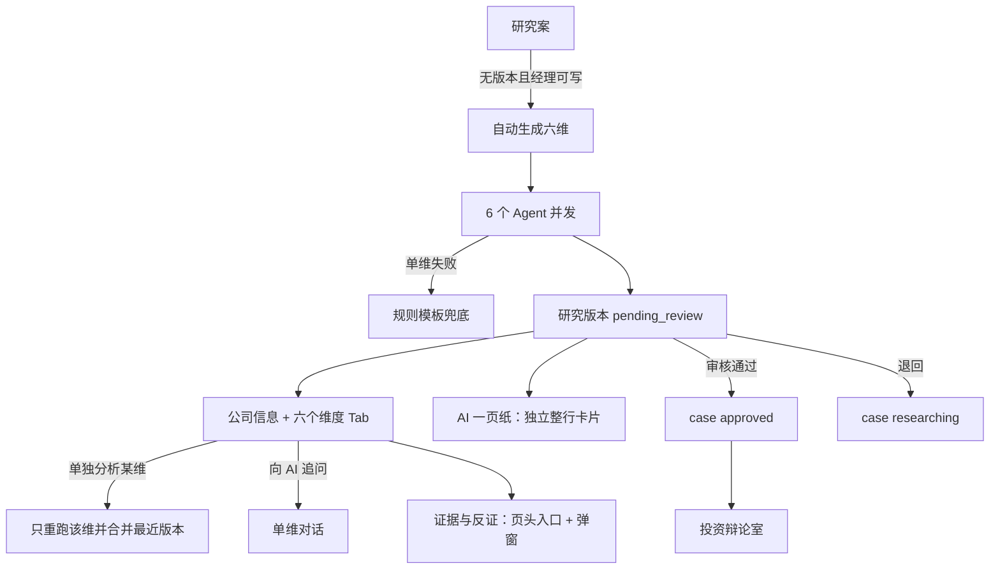
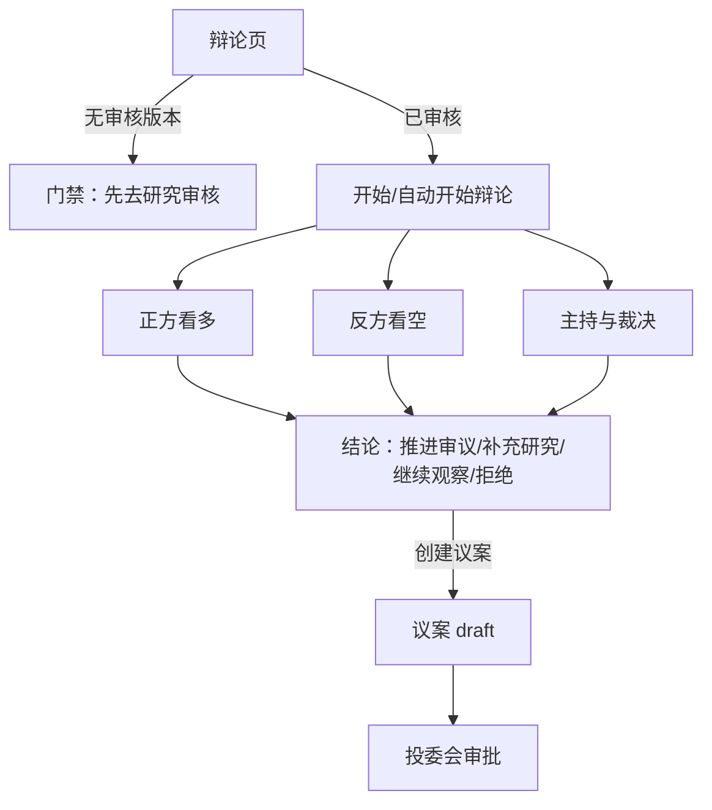
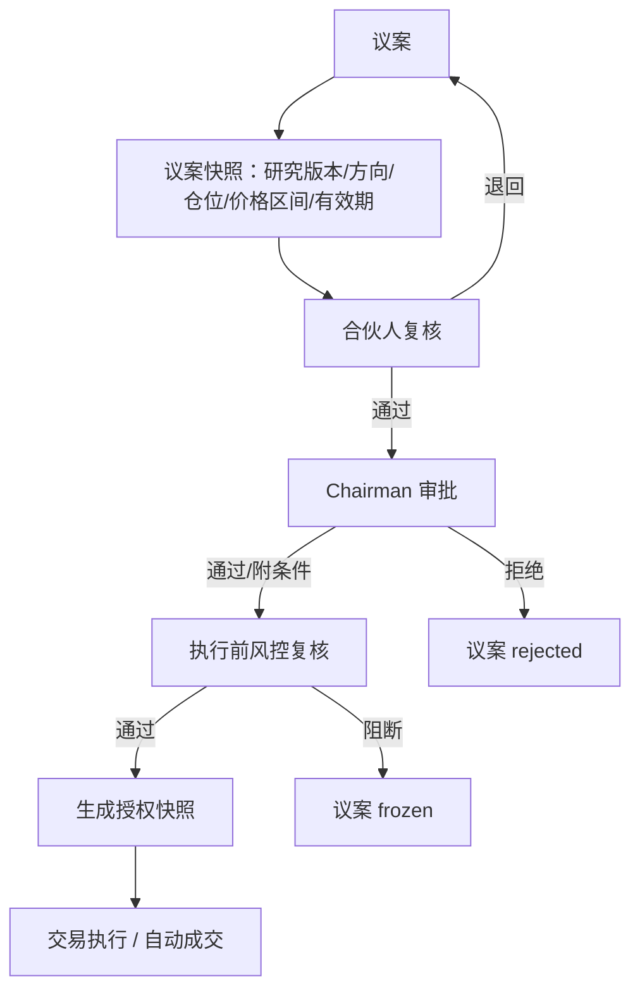
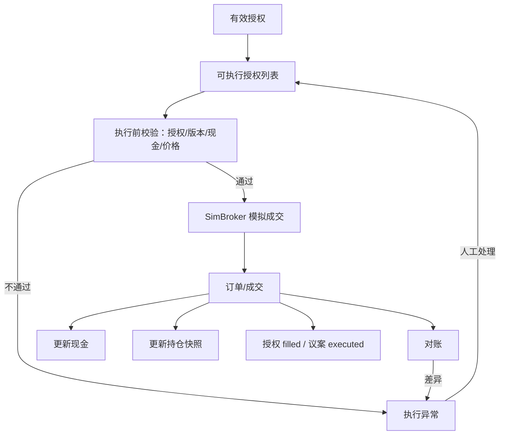
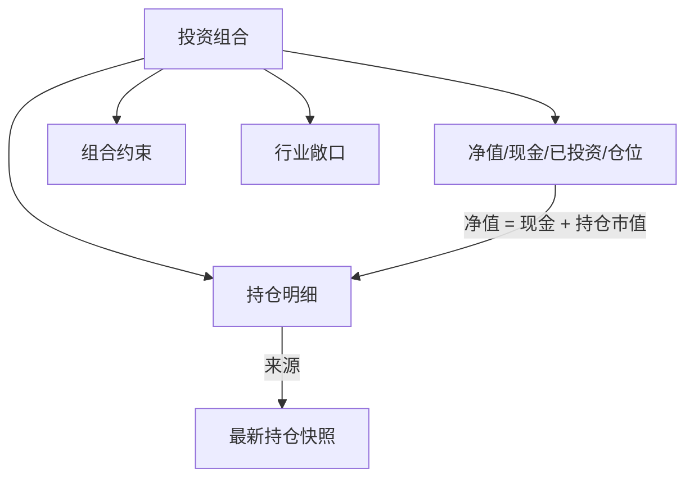
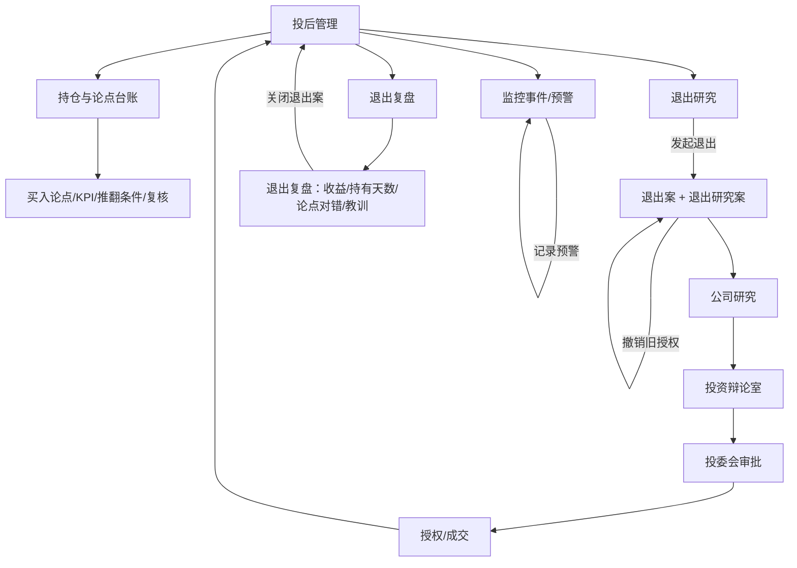
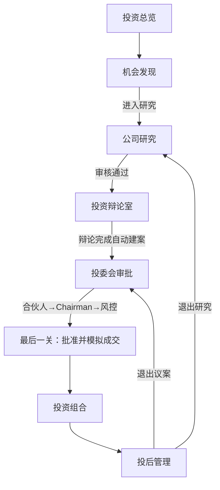

# 机构端业务流程与模块内流程

| 项 | 内容 |
|---|---|
| 日期 | 2026-11-04 |
| 范围 | 主观机构端 `/inst/*` 九个工作区 |
| 依据 | 当前 `dev-lsb` 代码（`inst_workflow.py`、`inst_service.py`、`frontend/src/pages/institution/*`） |
| 结论 | 当前不是纯线性流程；交易执行不是多余步骤，而是「授权 → 持仓」的唯一落库点。若要做线性流程，建议保留执行逻辑、去掉独立工作区，改为审批/组合页内自动模拟成交。 |

## 1. 一句话结论

- **当前主链路**：机会发现 → 公司研究 → 投资辩论 → 创建议案 → 合伙人复核 → Chairman 审批 → 执行前风控 → 生成授权 → 交易执行（SimBroker）→ 投资组合 → 投后管理。
- **交易执行是否多余**：在当前实现里**不多余**。它是唯一创建订单/成交、更新现金与持仓快照的步骤；删掉它，审批后的授权不会变成持仓，投资组合、投后、退出研究都会失去数据来源。
- **若坚持线性流程**：可以删掉「交易执行」这个**独立工作区**，但不要删执行逻辑。推荐把「授权 + 自动模拟成交」合并进审批通过动作，或放到投资组合页做「待执行 → 一键模拟成交」。
- **投资组合当前是只读结果页**，不是「组合配置」步骤。要把它变成线性流程中的一个动作，需要增加「待执行授权 / 组合确认」区域。

## 2. 当前系统主流程（实现现状）



关键点：

1. **研究审核通过后**，前端会跳到辩论页并自动开始辩论；但「创建议案」仍需人工在辩论页点击。
2. **议案不是辩论自动生成的**：辩论完成后，经理选择方向、目标仓位，调用 `POST /cases/{id}/proposals` 创建议案。
3. **审批是两段 + 风控**：合伙人复核 → Chairman 审批 → 执行前风控；任一步拒绝/阻断都不能跳级。
4. **授权是独立动作**：合伙人 + Chairman + 风控都通过后，才生成不可变授权快照。
5. **交易执行是独立动作**：执行页选择有效授权，先校验再 SimBroker 模拟成交，成交后才更新现金和持仓。
6. **投资组合只读**：只展示执行后的最新持仓快照，不负责「把批准变成持仓」。
7. **投后不是终点**：退出研究重新回到公司研究，退出议案重新走审批，形成闭环。

## 3. 你提出的线性流程（目标态）



与当前流程的差异：

| 当前 | 目标线性 | 改造点 |
|---|---|---|
| 审批 → 授权 → 交易执行 → 组合 | 审批 → 组合 | 把「授权 + 模拟成交」合并进审批通过；或组合页提供「待执行一键成交」 |
| 交易执行是独立工作区 | 不出现独立工作区 | 删除侧栏入口；执行逻辑保留为内部步骤 |
| 组合是只读结果页 | 组合是审批后的下一步 | 增加「待执行授权 / 组合确认」区域，成交后展示持仓 |
| 辩论后需手动创建议案 | 辩论后进入审批 | 辩论完成自动创建议案（或把创建议案并入辩论完成动作） |
| 研究审核通过后自动辩论 | 保持 | 保留 |
| 投后退出回到研究/审批 | 保持 | 保留闭环 |

## 4. 交易执行能不能删？

### 4.1 它现在做什么

`execute_authorization` 是当前唯一会：

- 创建 `inst_order` / `inst_fill`；
- 扣减/增加组合现金；
- 写入新的 `inst_position_snapshot`；
- 把授权标记为 `filled`、议案标记为 `executed`；
- 自动关闭执行异常、并写审计。

投资组合页、投后持仓、退出研究依赖的「持仓」，都来自这里。

### 4.2 三种方案

| 方案 | 做法 | 影响 | 建议 |
|---|---|---|---|
| A. 保留独立执行页 | 现状 | 流程多一步，但职责清晰、可做执行前校验/对账/异常 | 若产品需要「交易执行」角色独立操作，保留 |
| B. 合并进审批 | 风控通过后，点「批准并模拟成交」：生成授权 + 调用 SimBroker + 更新持仓，直接跳组合 | 侧栏少一个工作区；执行异常/对账需要挪到组合或投后 | **推荐做线性流程时采用** |
| C. 合并进组合 | 审批后授权进入组合页「待执行」，组合页一键模拟成交 | 组合页变成「组合确认」步骤；执行角色仍可在组合页操作 | 适合想保留执行确认、但不想单独页面的情况 |
| D. 直接删除执行 | 审批通过后直接改持仓，不建订单/成交 | 丢失订单、成交、对账、异常、执行审计；后续成本/收益/退出无法追溯 | **不建议** |

### 4.3 建议

如果目标是「先做简单线性流程」，建议选 **B 或 C**：

- **B（更简单）**：审批通过 = 授权 + 自动 SimBroker 成交。侧栏删除「交易执行」，订单/成交仍在数据库里可追溯；执行异常在投后或组合页以提示形式出现。
- **C（更稳妥）**：保留「执行确认」这个动作，但放在投资组合页：审批后授权出现在「待执行」，点一次「模拟成交」，再变成持仓。这样既线性，又保留人工确认。

## 5. 模块内流程

### 5.1 机会发现



- **量化策略推送**：A 股公司池，按近 2-20 个交易日动量 + PE TTM 0-100、PB 为正初筛；展示参考价、动量、PE/PB、筛选理由、标签；可进入研究或加入关注。
- **关注与自选**：`pool_status=watch` 的公司；可进入研究或取消关注。
- **当前持仓**：组合最新持仓；可进入研究或跳投后。
- 输出：一个研究案（`inst_research_case`，初始 `draft`）。

### 5.2 公司研究



- 六维：商业与产业、公司商业模式、护城河、财务质量、CEO 与治理、估值与价格。
- 每个 Agent 独立分析；失败时该维回退规则模板并标记「已回退规则」。
- 页面顶部固定公司信息（代码、市场、行业、数据状态、参考价）；研究任务列表不再单独展示。
- 页面支持单维查看、单维重新分析、单维 AI 追问；AI 一页纸作为独立整行卡片展示。
- 证据与反证不在页面内联罗列，页头入口打开弹窗，展示类型、来源、数据日期、原文摘录和解释。
- 审核：经理/合伙人可「审核通过」或「退回」；通过后进入辩论。
- 输出：已审核研究版本 + 证据；研究案进入 `approved`。

### 5.3 投资辩论室



- 辩论必须在研究审核通过后进行。
- 正方、反方、主持三栏；论点引用证据 ID；无有效证据的论点不计入裁决。
- 估值复核：五年 DCF 计算器已按用户要求暂时移除；辩论页不提供价格推算，估值讨论仍可使用研究页的估值维度与证据。
- 结论只是流程建议，不生成订单。
- 创建议案：经理选择方向（买入/卖出/退出）和目标仓位；退出研究案只能建 `sell/exit`，目标仓位默认 0（清仓）。
- 输出：议案（`inst_proposal`，初始 `draft`）。

### 5.4 投委会审批



- 合伙人复核：可批准或退回；可修改目标仓位生成新版本。
- Chairman 审批：提案人不能审批自己的议案；风控阻断后不能批准。
- 执行前风控：单股 ≤15%、交易后现金 ≥10%、版本一致、有效期、价格区间。
- 授权：只增不改；撤销写新记录。
- 输出：有效授权（`qualified`）。

### 5.5 交易执行（当前独立工作区）



- 只执行 `qualified` 授权；重复提交返回同一订单（幂等）。
- 成交价优先使用传入价，否则用最新未复权收盘价；停牌/ST/无价格会阻断并登记异常。
- 成交后组合现金、持仓快照、授权状态、议案状态同步更新。
- 执行异常：停牌/ST、无有效价格、对账差异、手工登记。

### 5.6 投资组合



- 当前是**只读结果页**：展示执行后的持仓、成本、市值、权重、行业敞口。
- 数据只随成交更新；未成交的批准不计入持仓。
- 若要变成线性流程中的「组合确认」步骤：在这里增加「待执行授权」和「一键模拟成交」，成交后刷新持仓。
- 约束：单股 ≤15%、最低现金 10%；演示政策不是监管限额。

### 5.7 投后管理



- 持仓与论点台账：每笔持仓记录买入理由、关键假设、KPI、复核时间、推翻条件。
- 监控事件：手工记录经营/估值/治理预警，进入待复核队列；不自动卖出。
- 退出研究：选择持仓、原因（论点失效/估值透支/更优配置/组合约束/其他）；系统撤销该标的仍有效的旧授权，新建退出研究案与退出案。
- 退出案状态：`draft → submitted（创建议案）→ approved（Chairman 通过）→ closed（执行成交/复盘）`；拒绝/风控阻断 → `rejected`。
- 退出复盘：记录已实现收益、持有天数、论点对错与教训；写回退出案。

### 5.8 投资总览 / Agent能力

- **投资总览**：驾驶舱，汇总净值、在研、待审批、风控阻断、监控预警、组合约束和工作流；不是业务步骤。
- **Agent能力**：角色职责边界、AI 能力、硬约束、免责声明；只读参考，不是业务步骤。

## 6. 状态机汇总

### 6.1 研究案 / 研究版本

```text
case:     draft → researching → pending_review → approved
                           ↘ changed（退回后回到 researching）
version:  pending_review → approved / changed
```

### 6.2 议案

```text
draft → partner_review → chairman_review → risk_precheck → authorized → executed
                                   ↘ rejected
                                   ↘ frozen（风控阻断）
```

### 6.3 授权

```text
qualified → filled / revoked
```

### 6.4 退出案

```text
draft → submitted → approved → closed
          ↘ rejected（Chairman 拒绝/风控阻断）
```

## 7. 建议的落地顺序

1. **先定产品边界**：机构端是「研究 + 审批 + 模拟盘」，还是「纯研究/投委会工具」。
   - 如果是前者：保留执行逻辑，隐藏独立页面（方案 B/C）。
   - 如果是后者：可以删除执行与持仓，只保留研究/辩论/审批；但投后与退出也要一并简化。
2. **把「创建议案」并入辩论完成**：减少一次手动跳转。
3. **把「授权 + 模拟成交」并入审批通过**（推荐 B）：
   - 合伙人 → Chairman → 风控通过后，按钮变为「批准并模拟成交」；
   - 后端在同一事务/连续调用中生成授权并执行 SimBroker；
   - 成功后跳转投资组合，持仓立即出现。
4. **投资组合增加「待执行」区域**（如果选 C）：
   - 审批通过但未成交的授权列在这里；
   - 一键「模拟成交」，执行角色仍可在组合页操作；
   - 成交后展示持仓、成本、权重、行业敞口。
5. **侧栏调整**：删除「交易执行」入口；保留「投资组合」「投后管理」。如果选 C，把执行确认放进投资组合页。

## 8. 需要你确认的问题

1. 机构端最终要不要「模拟持仓」？如果要，执行逻辑必须保留（可以是自动/隐藏步骤）。
2. 「投资组合」是**配置步骤**还是**结果页**？
   - 配置步骤：审批前需要组合构建/仓位建议；
   - 结果页：审批后直接看持仓（当前实现）。
3. 交易执行是否还需要「执行角色」独立确认？如果要，选 C（组合页确认）；如果不要，选 B（审批即成交）。
4. 退出流程是否保留「撤销旧授权 + 重新研究/辩论/审批」？当前是完整闭环；如果简化，需要明确退出是否也走同样审批。
5. 是否需要保留执行异常/对账？如果删除独立执行页，这些能力要挪到组合或投后，否则只能记录日志。

## 9. 代码索引

| 内容 | 位置 |
|---|---|
| 机构端路由与端点 | `backend/app/routers/inst_workflow.py` |
| 研究/辩论/议案/审批/授权/执行/组合/投后 | `backend/services/institution/inst_service.py` |
| 权限矩阵与会话 | `backend/services/institution/inst_store.py` |
| 研究页 | `frontend/src/pages/institution/InstResearchPage.tsx` |
| 机会发现 | `frontend/src/pages/institution/InstIdeasPage.tsx` |
| 辩论页 | `frontend/src/pages/institution/InstDebatePage.tsx` |
| 审批页 | `frontend/src/pages/institution/InstApprovalsPage.tsx` |
| 执行页 | `frontend/src/pages/institution/InstExecutionPage.tsx` |
| 组合页 | `frontend/src/pages/institution/InstPortfolioPage.tsx` |
| 投后页 | `frontend/src/pages/institution/InstMonitorPage.tsx` |

## 10. 落地结果（方案 B，2026-11-04）

方案 B 已实现：交易执行不再作为独立工作区，审批最后一关一次完成「授权 + 模拟成交」。



### 10.1 改动清单

| 项 | 结果 |
|---|---|
| 侧栏 | 移除「交易执行」，保留 8 个工作区：总览、机会发现、公司研究、投资辩论、投委会审批、投资组合、投后管理、Agent能力 |
| 旧入口 | `/inst/execution` 重定向到 `/inst/portfolio` |
| 审批最后一关 | Chairman/风控看到「批准并模拟成交」：生成授权 + SimBroker 成交；成交失败时授权保留，可「重试模拟成交」 |
| 执行异常 | 移到投资组合页「执行异常」卡片；人工核对后关闭 |
| 辩论完成 | 自动创建议案：普通案 buy + 5%，退出案 exit + 0；合伙人复核时可调整目标仓位 |
| 审计页 | 动作、对象、字段、角色、时间中文化；显示操作人姓名/角色 |
| 权限 | 自动成交仅允许 Chairman/风控触发；执行角色不再有独立页面，但权限矩阵保留 |

### 10.2 新的模块出口

| 模块 | 完成后进入 |
|---|---|
| 机会发现 | 公司研究（创建研究案） |
| 公司研究 | 投资辩论（审核通过自动开始辩论） |
| 投资辩论 | 投委会审批（辩论完成自动建案） |
| 投委会审批 | 投资组合（最后一关批准并模拟成交） |
| 投资组合 | 投后管理（持仓台账/预警/退出） |
| 投后管理 | 退出研究回到公司研究；退出议案回到投委会审批 |

### 10.3 测试

- `pytest tests/test_inst_*.py`：49 passed（新增 `test_inst_linear_flow.py`）
- `e2e-09` 写库：4 passed
- `e2e-10` 审计：7 passed
- `e2e-11` 线性全链路：1 passed（自动建案 → 审批 → 自动授权成交 → 持仓更新）
- `tsc --noEmit`：通过
