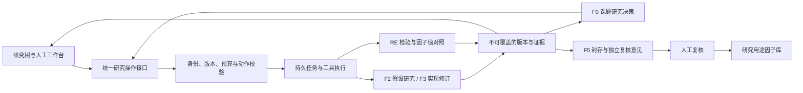

# 因子工厂 V5：关键架构、相关性算法与验收补充

日期：2026-11-09。负责人：Codex（产品、关键架构与算法、技术验收）；工程实现：Codex factor_developer；原张新迪会话仅公司联络；共享服务评审与合并：公司既有负责方。

本文基于全产品 V5 原型、因子工厂 V5 规格和当前真实系统问题，不替换原型、不另起产品。本文的明确规则作为本轮修复验收依据；标为后续的部分不纳入今天实现。开发须把涉及的规格、原型说明、接口和测试一起更新，写签收回执。设计要求不代表已经实现或验收通过。

## 1. 本轮目标与边界

交付一套可观察、可介入、可停止、证据可追溯的真实因子研究系统。研究成功与系统运行正确分开验收：合格新因子不能被保证发现，但新发现、重复、失败、依赖不可用和中断必须得到正确处理。

- 机构研究库准入不是实盘交易授权。正式资金操作不在本阶段。
- 接真实数据与既有 ResearchEngine；研究窗口、股票池、方向、政策与预算冻结。
- 所有开发写入限定 `/home/dev01/project/SVQuant-zxd/`。ResearchEngine 在其内部独立克隆，独立 Git、端口、缓存和输出；不得改共享 RE 文件、配置或重启共享服务。
- SVQuant 使用 `dev-zxd`，RE 使用独立功能分支并向 RE 仓库提交 PR。源码和行情数据不嵌入 SVQuant 提交。
- 全产品 V5 原型继续作为界面基线，真实数据缺失不能靠场景值补齐。

## 2. Agent 架构：可自主决策，执行仍有明确约束

F0 是课题内的研究决策 Agent。它根据真实证据提出下一动作，不应成为固定步骤跳转器，也不能直接写库、改权限或扩大预算。人和 Agent 使用相同的业务操作与计算工具。前端展示任务和证据，不承担后台调度。

| 单元 | 必要输入 | 输出与责任 | 不应做的事情 |
| --- | --- | --- | --- |
| F0 研究决策 | 冻结计划、真实能力、剩余额度、分支、试验摘要、明确失败类别 | 选择修订、检验、查重重试、申请封存、等待、停止或请求人工介入，给可核验理由 | 自定数值门槛、增加预算、伪造工具输出、批准自己入库 |
| F1 起点检索 | 课题假设、授权资产目录、可见历史研究 | 相关因子与既有失败/重复证据及引用 | 将复制既有因子表述成新发现 |
| F2 假设研究 | 原假设、诊断、数据能力与允许修改范围 | 新假设版本、可实现机制、相对父分支的实质变化 | 在冻结授权外换市场、换标签、偷看封存结果 |
| F3 实现修订 | 确认的假设、父实现、受支持算子及校验反馈 | 新源码、源码哈希、代码差异、静态检查结果 | 只改名称和标题冒充修订；执行任意 I/O 代码 |
| F4 检验诊断 | 冻结实现与计算配置 | 数值证据、可比性、查重证据、结构化阻断原因 | 根据模型文本编造指标或把服务错误当统计失败 |
| F5 独立意见/封存 | 授权的冻结候选、全量试验摘要、独立验证证据 | 一次性封存执行及独立意见，权限限制下提供不同详情 | 共享研究对话；向研究侧泄漏封存明细用于调参 |

F2/F3 可以有受限的内部修订循环，不要求每次模型回复都经人审批。静态失败可以自动修正；每次真实研发结果一旦被看到，就按既有 K 政策登记。内部尝试次数与模型成本也应记账，避免不计 K 的无限循环。

### 2.1 决策契约

F0 输出结构化动作提案，例如 `action / topic_id / branch_id / expected_version / evidence_refs / reason_summary / arguments`。这些是逻辑字段，开发可适配现有契约，不要求机械新增整套接口。

- `action` 必须在白名单中；原因是工作摘要，不要求记录或展示模型隐含思维过程。
- `evidence_refs` 引用具体试验/候选与检查项。程序校验对象存在且属于当前课题及机构。
- 服务端重新检查状态、输入版本和预算。模型认为“有额度”不能代替实际检查。
- 模型不得通过自由文本覆盖股票池、时间范围、方向、门槛、模型额度与封存次数。
- F3 返回的新实现与父实现相同，只能记为无实质变化，不能将改标题描述成新研究。
- 新实现即使只改变方向或窗口，只要产生了新的研发证据，也必须按规则计 K。

### 2.2 失败必须分类，后续动作才有依据

| 类别 | 实例 | 可选处理 |
| --- | --- | --- |
| 数值未达标 | 有方向的 IC 或 NW t 未过线 | 修订假设/实现、停止、人工介入 |
| 定义重复 | 与已有源码/内置引用同一因子 | 换有经济解释的假设、正交化或停止；不能靠改名通过 |
| 数值相关重复 | 完整或已发现明确超线的对照 | 修订或停止，保留最相关对照与数值 |
| 数据/比较不完整 | 有效日期、样本配对或必要参考不足 | 等待补数据或能力，不能显示“低相关通过” |
| 服务不可用 | 查重 404、超时、数据版本不一致 | 保留已完成数值结果，恢复后只重试缺失阶段 |
| 静态实现错误 | 不支持的算子、语法或潜在未来引用 | F3 在限额内修正，超限交人工 |
| 预算或授权不足 | 额度耗尽、越过授权数据范围 | 停止/等待授权，不擅自扩额 |
| 任务中断 | 服务重启、运行结果暂时不可取 | 先核实已有外部任务，再安全恢复或明确中断 |

当前 T9 E1 的四项数值检查全通过，实际因定义重复被拒绝。报告与 F0 必须显示并消费这一真实原因；不能让 F0 猜测是最大回撤没过。

建议证据摘要拆为 `numerical_status / novelty_status / validation_status / blocking_reasons / allowed_next_actions`。历史整体 `passed=false` 保留，页面根据历史证据解释，不修改历史计算结果。

## 3. 预算、分支和恢复机制

### 3.1 原子额度预留

仅检查已经入账的 K 不够。发出计算前，在课题范围的事务/锁中检查：

`可新增检验 = max_trials - K - 已预留但未落账的不同检验`

1. 以冻结的实现、数据、参数及计算语义构成幂等身份，先查已有结果或在途任务。
2. 对同一幂等身份返回既有运行；不能再发一次计算。确定性重算依现有政策引用原证据。
3. 只有新的、获准的检验才能原子预留。候选创建、重试、F0 与人工入口使用同一逻辑。
4. 成功取得任何研发指标后，将预留原子转换为台账 K；失败且已见指标也计入。
5. 未产生指标且确知外部任务不再运行，才释放预留。网络超时不等于任务没启动。
6. 新任务不得因重启丢失预留。历史超预算不删账、不调大上限，显示真实异常并停止新增检验。

试验台账条数、有效 K、在途预留和上限分别显示。T9 有 5 条记录，其中 1 条 rerun，K=4、上限3；不能在不同页面把“预算使用”分别显示为4和5。

### 3.2 冻结分支归属

计算提交时固定 topic、branch、假设/实现版本、输入哈希。结果入账只能用固定归属，不能读取此时页面或项目的“当前活动分支”。人工切换 H1 与 Agent 创建 H2 可以并存，不能导致 H2 的结果落到 H1。

报告与研究树须可追溯到实际执行源码。标题声称“取反”而源码未取反，应标修订未生效，而不是继续记为新方法。

### 3.3 异步任务恢复

使用持久状态表达 `待提交 / 已提交 / 运行中 / 结果待落账 / 已完成 / 中断待处理`，存外部运行 ID、幂等键与最后确认时间。名称可以沿用现有枚举。

- 重启先按外部 run_id 查询。任务仍在跑就继续跟踪；已成功就幂等落账；结果已丢失才明确标中断。
- 提交请求超时、未取得 run_id 时，先按可用幂等身份或任务记录核实，不能盲目重发。
- 不承诺跨服务绝对“只执行一次”；以可恢复记录、幂等请求和幂等入账避免重复效果，剩余不确定状态交人工。
- 封存检验更严格：已经获得封存结果的候选不得重新测。只有能证明先前未产生/未泄露结果的技术失败，才按既有一次性约束处理恢复。
- “重启全部置错误”是最低限度可见性，不能等同 AC-11 的完整恢复通过。

## 4. R4 相关性算法

### 4.1 算什么

沿用现有契约 `daily_abs_spearman`：逐日横截面因子值 Spearman 相关，先逐日取绝对值，再在有效日期上等权平均。不是收益曲线相关，不是把全部日期股票拼成一长列相关，也不是先平均带符号相关再取绝对值。

对候选 x、参考因子 y_j，在研发日 t：

1. 在冻结的股票池与同一股票编码上对齐。
2. 取两者值均为有限数的共同股票集合 S(t,j)。正负无穷视为缺失；缺失不补0、不用未来值填充。
3. 共同股票不足 `min_pairs`，该日无有效相关系数。
4. 在共同股票内分别重新排名；并列取平均秩。不能先在各自全样本排名后再删缺失。
5. 任意一侧常量则该日相关未定义，记原因，不设为0。
6. 对两组秩计算 Pearson 相关，即该日 Spearman rho(t,j)。
7. q(j) = mean_t(abs(rho(t,j)))，对不同参考因子各算一组。
8. 对全部有效参考取 q_max；同时返回最相关的前三项、有效日期数、配对数、覆盖与逐项失败原因。

相反符号和正比例缩放的相同排序都应得到 q=1，不能当作新发现。时间上正负相关抵消也不能绕过查重。

### 4.2 固定政策与边界

- 新发现按已签收规格：`q >= 0.70` 为重复/不通过，只有 `q < 0.70` 且必要比较完整才通过。不得用 `>` 放过恰好0.70。
- 这是本产品预登记筛选规则，不是科研界通用最优阈值，也不能证明全球原创或组合增量。
- 先按未舍入数值比较，再格式化显示；不要让四舍五入后的0.70决定结果。
- 保留旧计划真实的0.8参数与版本，不能修改历史结果掩盖此前偏差。新建计划落实0.70。
- 当前 `minDays=60 / minPairs=30 / minCoverage=0.8` 沿用现有冻结政策；这些值不是新发现因子的收益保证。
- 有任一完整、可信对照明确超线，可以判“已发现重复，其他比较未完成”；只有全部必要对照都充分才允许“查重通过”。

### 4.3 覆盖率：把分母写清楚

现有接口覆盖率为：有效相关日期上的共同股票日数，除以这些日期上的候选有效股票日数。这是**条件于有效日期的股票覆盖率**，不是完整研发区间覆盖率。

保持既有字段含义，另返回清楚的诊断：

- `candidate_eligible_days`：候选足够配对股票的研发日期数；
- `valid_days`：实际可计算相关的日期数；
- `date_coverage = valid_days / candidate_eligible_days`；
- 共同股票日数、对应分母、逐日最低配对数和无效日期原因。

例如候选有720个可比较日、参考只在60日有值，则原股票覆盖率可能为1，日期覆盖仅约8.3%，不能在页面统称“覆盖100%”。本轮先如实展示与记录；若将日期覆盖加入硬门槛，须发布新的明确政策版本并用于新计划，不偷偷改变旧候选的冻结规则。

### 4.4 预热和计算一致性

候选面板必须与原研发计算同一数据快照、源码、窗口、股票池、预处理和筛选语义。不能仅声明源码相同就当作同一结果。

参考因子的预热日期用于计算滚动值，不进入评分日期。接口传入的预热数量必须真正影响数据和算子计算；仅把更长面板传入、随后又被按 `spec.start` 裁掉，不算实现预热。

- 用明确的最小预热需求与请求值决定所需历史，记录请求值、实际可用值、实际预热起点。
- 数据不足明确报原因；不要未经说明缩短窗口。
- 窗口取交易日数量；节假日不能用自然日数直接冒充交易日数。
- 递归滤波的历史依赖需要明确策略；默认252日不能宣称适用于全部指标。
- 通过相同请求重算候选与已保存研发面板的抽样一致性，验证预处理/股票池/裁剪没有分叉。

### 4.5 不可比因子和对照清单

BFF 按机构权限形成冻结清单，包含共享库、允许使用的导入项及本机构应纳入的待审候选。RE 只计算显式清单，不查询他人私有库。

逐项记录：成功、常量、配对不足、日期不足、缺数据字段、不支持算子、代码错误、资源限制等。不能把7个不可比因子统一记成“不相关”，也不能看到结果后删掉难算的参考以换取通过。

当前规则需要完整必要对照。若机构要排除事先就不适用的参考，必须预登记比较范围、理由和政策版本，保留数量，不能当成本轮临时放行手段。

### 4.6 身份、缓存与接口

请求/结果至少绑定：数据视图与release、候选backtest spec hash、候选源码hash、参考清单hash、每个参考源码hash、实际计算参数、算法版本和请求hash。

- 新增候选 `expected_candidate_spec_hash` 与服务计算出的真实规格核对；保留 BFF 返回结果时的二次检查。不要直接把请求值原样回填冒充核验。
- 规范化序列化须一致（默认字段处理、键排序、数字/日期表示），BFF 与 RE 有契约测试，防止 `exclude_unset` 差异导致合法请求被拒绝。
- 缓存按完整语义身份命中，换数据、预热、代码、窗口、预处理或算法版本必须失效。
- POST/GET/取消复用现有异步任务基础设施；任务状态与业务“重复/完整/通过”分开。
- 逐参考更新进度并支持协作取消；明确取消不会立即打断一个正在计算的因子。
- 自定义源码静态限制不能宣称等价于系统级沙箱。继续沿用现有可信工具和资源限制。

## 5. 独立验算与必要测试

先锁定正确性，再做向量化优化。测试期用 `scipy.stats.spearmanr` 对每个有效截面独立复核；生产实现可复用现有 pandas/NumPy，不必引入第二套引擎。

| 测试 | 必须得到的结果 |
| --- | --- |
| x=y、y=2x+5、y=-x | q均为1；取反不能规避重复 |
| 一天rho=+1、一天rho=-1 | q=1，不是0 |
| 并列排名、双方不同位置缺失 | 共同子集重新排名，与独立Spearman一致 |
| 常量、全缺失、Inf、配对不足 | 未定义/不足有原因，相关系数不能填0 |
| 打乱日期、股票列顺序 | 对齐后结果一致；重复日期/股票轴明确拒绝 |
| q=0.70及两侧微小差异 | 等于和超过拒绝，严格小于且完整才能通过 |
| 参考只覆盖60/720日 | 股票覆盖与日期覆盖分别显示，无“全期100%”误导 |
| 一个同机构待审因子与候选相同 | 被纳入并识别；跨机构私有定义不得泄漏 |
| 预热252与更长、超过一年窗口 | 实际读取/计算历史相应变化；评分区间不变 |
| 数据版本、候选spec/source、参考hash不匹配 | 失败关闭并保留研发报告 |
| 部分参考失败 | 逐项归因；整体不能绿色通过 |
| 取消、超时、重启、重复请求 | 可追溯、幂等，不能重新消费同一计算或重复入账 |
| 同一课题两个入口竞争最后一个额度 | 最多一个新检验获准；在途恢复仍占用其预留 |
| Agent算H2时人切到H1 | H2结果仍挂H2 |
| 全部数值通过但定义重复 | 报告与F0明确“重复”，不得归因为数值失败 |
| 修改未来日期数据 | 先前日期的因子输出不应变化；静态检查之外的时序泄漏测试 |

三层验收分开记录：纯算法/替身测试、隔离RE真实行情计算、机构BFF与浏览器真实操作。小样本相关正确，不代表331项完整对照或机构准入已经通过。

## 6. 审查与页面验收补充

2026-11-09 实机核查，T7待审页面缺少原型中的完整假设/表达式、封存指标详情和查重证据；台账的“计入K”列显示passed，分支仍是内部ID。勾选已读并填草稿后“研究依据基本充分”可点击。产品经理没有提交决定，是否后台可绕过仍待开发测试，不能据此声称已经越权入库。

验收要求：

- 原型的候选标识、T/H/E编号、冻结假设与实现、研发/封存证据、查重、全部试验、独立意见、局限、复核决定各区块保留。
- 缺项标具体原因；复核角色能看授权的封存详情，研究角色仍按既有隔离要求读取。
- “计入K”显示是/否与原因，不使用passed代替。
- 复现可不受新发现阈值直接否决，但按规格10.1-23需要查重证据；缺证不能批准研究库准入。
- 仅给研究反馈、允许研究用途入库、正式投资准入是不同动作，按钮与后端行为要一致。
- 新建表单的自然语言验收说明不能伪装为实际执行门槛。实际政策只读展示，可编辑补充说明明确“不改变执行门槛”。
- 不支持的主持有期不能允许选择后又静默按1日计算。已接通的支持范围须以真实请求/响应验证。

## 7. 技术依据与设计判断

- [SciPy spearmanr 官方文档](https://docs.scipy.org/doc/scipy/reference/generated/scipy.stats.spearmanr.html)：用于独立验证秩相关计算；常量输入的相关未定义，不能填成零。
- [pandas DataFrame.corr 官方文档](https://pandas.pydata.org/pandas-docs/stable/reference/api/pandas.DataFrame.corr.html)：相关计算使用成对有效观测。本项目还须显式固定日期、股票轴及有效集合。
- `mean(abs(daily rho))`、0.70门槛、机构待审对照范围、覆盖政策和任务治理是本项目的既有约定及本轮明确设计，不由上述库文档证明其投资有效性。

## 8. 开发交付材料

开发签收后交付：实现与测试提交、原型/规格同步位置、真实测试输入身份与结果、未解决事项、独立RE副本/端口、RE PR链接和评审状态。产品经理按上表抽查源码、独立验算、API和页面。未满足的条目保留未通过，不靠修改文案消除问题。
