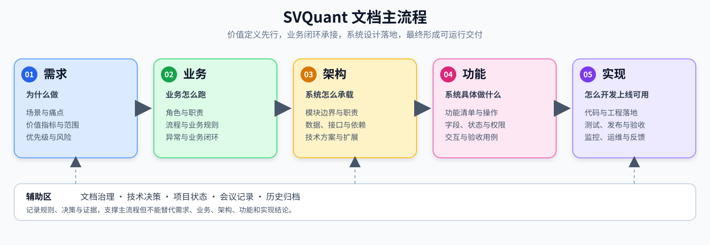

# 需求到交付工作流

## 1. 总原则

SVQuant 的交付主链路固定为：

```text
需求 → 业务 → 架构 → 功能 → 实现
```

五层依次回答：

1. **为什么做**：确认问题、价值、目标和边界。
2. **业务怎么跑**：确认角色、流程、规则、异常和业务闭环。
3. **系统怎么承载业务**：确认系统骨架、模块边界、数据、接口和技术约束。
4. **系统具体做什么**：把架构和业务规则拆成用户可操作、可验收的功能。
5. **怎么开发上线可用**：完成编码、测试、发布、验收、运维和反馈闭环。



这条链路是**结论的关卡顺序，不是文件的目录结构**。它约束“下游开工前上游结论必须存在”；实现中的技术发现可以触发上游文档修订，但不能用代码、接口或页面反向代替尚未完成的需求和业务定义。五层结论分别落在哪些文档，见 [文档中心](../README.md) 的落点表。

## 2. 分级投入

| 级别 | 适用 | 要求 |
|------|------|------|
| 平台级 | P0、跨模块、改变产品边界或公共契约 | 必要时先立 Initiative，走完整五层关卡，重大选择记 ADR |
| 普通 FEAT | 单模块内的新能力 | 轻量 DoR + 单 README 功能包 |
| 小改动 | Bug 修复、重构、不改公共行为的改动 | 无文档要求；代码 + 测试即可 |

判断标准是**决策的不可逆性和影响面**，不是任务大小；拿不准时按上一级处理。

## 3. 平台级：五层关卡

| 关卡 | 进入条件 | 通过标准 | 产出与落点 |
|------|----------|----------|------|
| R0 需求立项 | 有真实场景或明确业务问题 | 价值、目标、范围、优先级和风险清楚 | Initiative README / `产品与需求/` |
| B1 业务确认 | 需求层通过 | 角色、流程、规则、异常和业务验收闭环 | Initiative `domain-design.md` 或 PRD 业务章节 |
| A1 架构确认 | 业务层通过 | 边界、数据、接口、依赖、风险和扩展方案清楚 | `架构与技术/`、`数据设计/`、`接口设计/`；重大选择记 [ADR](../技术决策/) |
| F1 功能确认 | 架构层通过 | 功能、字段、权限、交互和验收覆盖业务场景 | FEAT 功能包（README + requirements） |
| I1 实现准入 | 功能层通过 | 任务、测试、发布、回滚、负责人和依赖可执行 | 完整 [Definition of Ready](Definition-of-Ready.md) |
| I2 交付完成 | 实现已完成 | 验收证据、回归结果、发布记录和遗留项齐全 | [Definition of Done](Definition-of-Done.md) |

任一关卡未通过时，工作只能停留在当前层或补齐上游文档；不得以“先写代码再补文档”作为平台级能力的默认流程。实现阶段发现上游结论不成立时，应回退修订对应文档，并记录影响范围。

各层落点与自检要点：

- **需求层**：场景与痛点、量化目标、边界与约束、优先级与风险、明确不做项。自检：不做是否可行？解决哪个具体痛点？指标是否可验证？→ 落 `产品与需求/` 与 FEAT 包 README。
- **业务层**：业务全景流程、角色分工、业务规则、异常处理、业务闭环与验收。自检：脱离系统能否独立跑通？正常/分支/异常是否都有责任人和闭环？→ 落 Initiative `domain-design.md` 或 PRD 业务章节。
- **架构层**：模块拆分与职责、数据架构与口径、接口拓扑、技术选型与约束、兼容/回滚。自检：能否完整承载业务流程？边界是否清楚？是否避免过度设计？→ 落 `架构与技术/` 与 ADR。
- **功能层**：功能清单、字段与状态、权限与交互、异常提示、可测试验收标准。自检：所有场景和异常是否都有功能覆盖？验收能否独立执行？→ 落 FEAT 功能包。
- **实现层**：详细技术设计、代码与配置、全流程测试、发布与回滚、验收与运维、交付证据。自检：功能可用、数据准确、业务闭环、线上稳定？→ 落 FEAT 包验收证据与 `项目管理/`。

## 4. 普通 FEAT：轻量流程

1. 在 [项目组合需求池](../产品与需求/组合/portfolio-backlog.md) 登记，新建 `docs/功能包/FEAT-XXX-名称/`。
2. 按轻量 [Definition of Ready](Definition-of-Ready.md) 在包 README 中写清六件事：
   - 价值一句话：解决谁的什么痛点，不做会怎样。
   - 范围冻结：本次做什么、明确不做什么。
   - 影响面：涉及哪些模块、接口、数据；一旦跨模块，升级为平台级。
   - 业务规则：关键规则、异常与兜底。
   - 验收标准：可测试的通过条件。
   - 风险与依赖：技术风险、外部依赖、回退方式。
3. 编码、测试，验收证据写入包 README「验收与证据」。
4. 状态回写需求池与包 README。

## 5. FEAT 功能包规范

- 位置：`docs/功能包/FEAT-XXX-名称/`；ResearchEngine 模块专属实现和验收证据放在[独立仓库](https://gitee.com/yanggu-yuanqi-intelligence/research-engine)，边界见 [文档中心](../README.md)。
- 默认单文件 `README.md`（模板见 [FEAT功能包模板](文档模板/FEAT功能包模板.md)）。
- 内容量大时才拆 `requirements.md`、`technical-design.md`、`verification.md` 或专项参考文档；禁止为凑层写空壳文件。
- 包 README 必须标明：状态、所属 Initiative、上下游文档链接。
- 规模较大的跨模块能力先建立 Initiative（模板见 [initiative-proposal](文档模板/initiative-proposal.md)），再拆分多个 Feature。

## 6. 目录责任

- 根目录按 `产品与需求/`、`架构与技术/`、`模块设计/`、`功能包/`、`数据设计/`、`接口设计/`、`测试设计/`、`测试报告/`、`部署与运维/`、`用户指南/` 分类；`技术决策/` 与 `项目管理/` 保存决策和交付跟踪材料，旧版进 `归档/`。
- ResearchEngine 独立仓库保存模块级架构、功能包、实现证据、API 契约和专属决策；产品价值与跨模块业务回到根目录。
- SVQuant 的产品帮助文档统一放在 `docs/用户指南/`；ResearchEngine 不在本仓库复制内部文档。
- `治理`、`项目管理`（项目状态、会议记录）与 `归档` 是治理与追踪区，不改变主链。

## 7. 状态与回写

统一状态为：`待分析 → 待决策 → 已批准 → 待开发 → 开发中 → 待验收 → 已完成`。

补充终止状态：`已暂缓`、`已拒绝`、`已取消`。

会议或实现阶段产生的新结论，必须在一个工作周期内回写到对应文档；状态变化同时更新项目组合需求池和 Feature README。回写规则详见 [文档更新规则](文档更新规则.md)。


