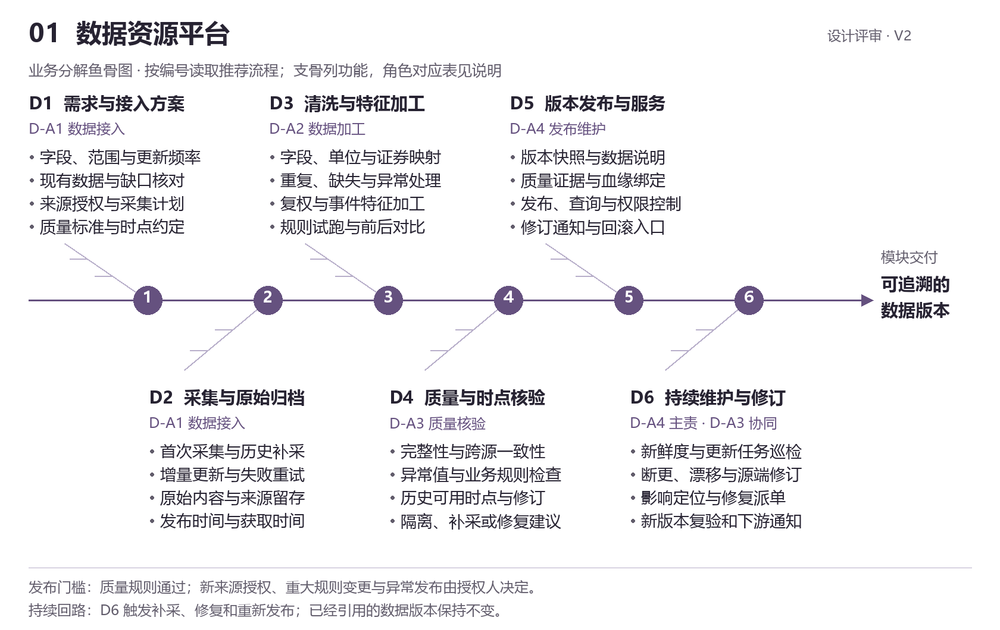
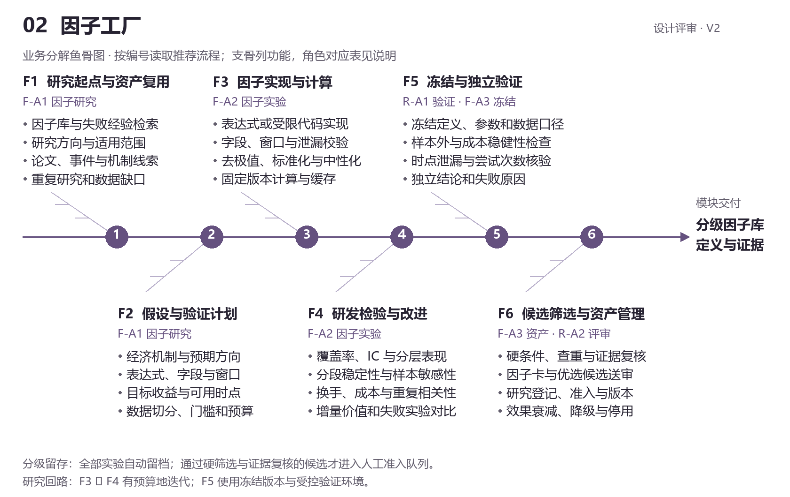
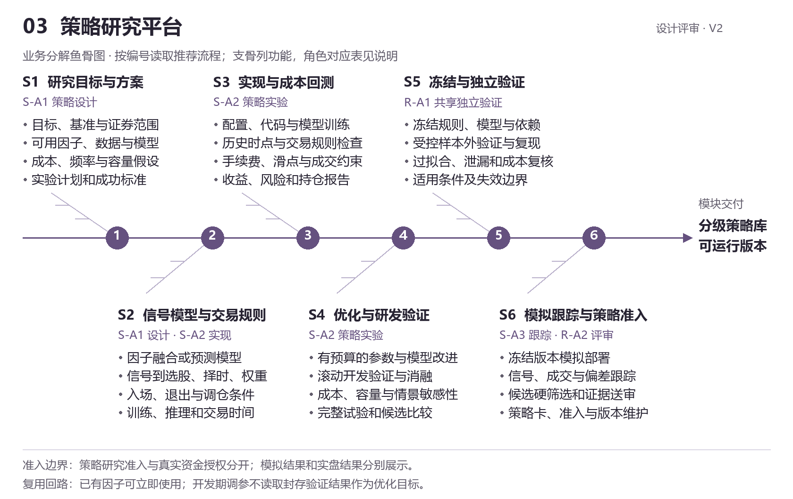
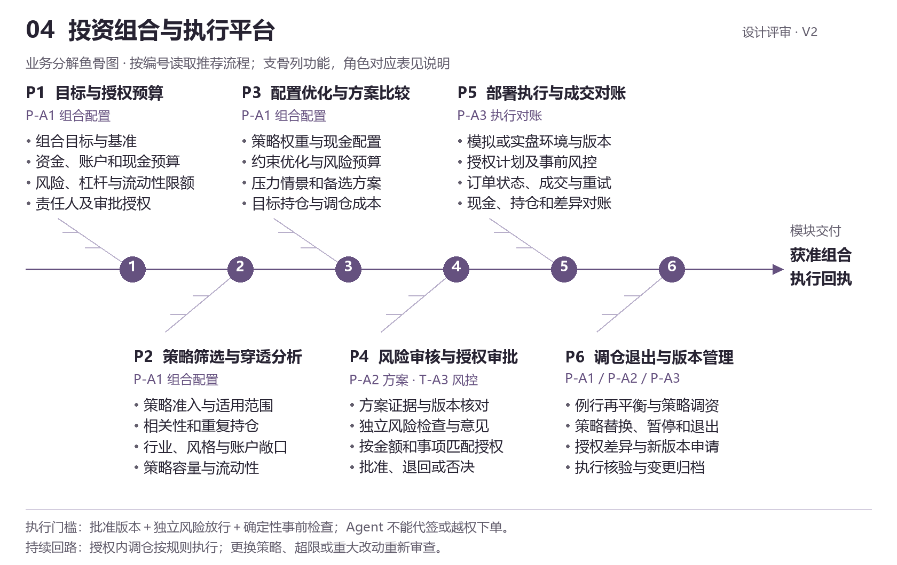
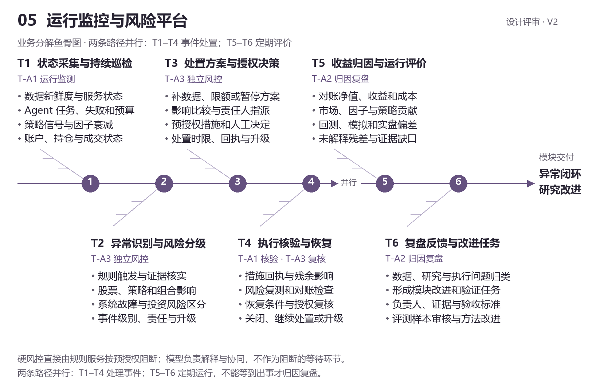
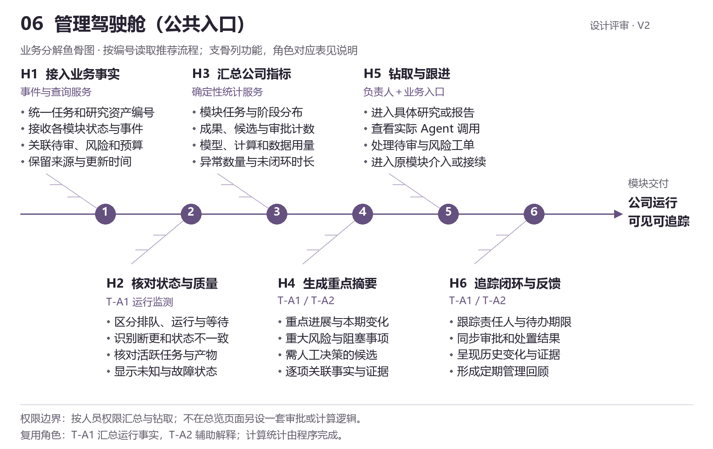
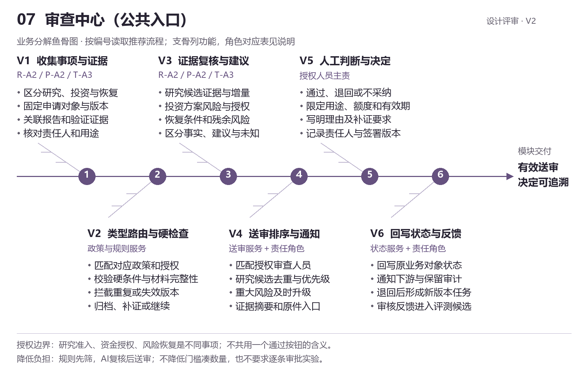
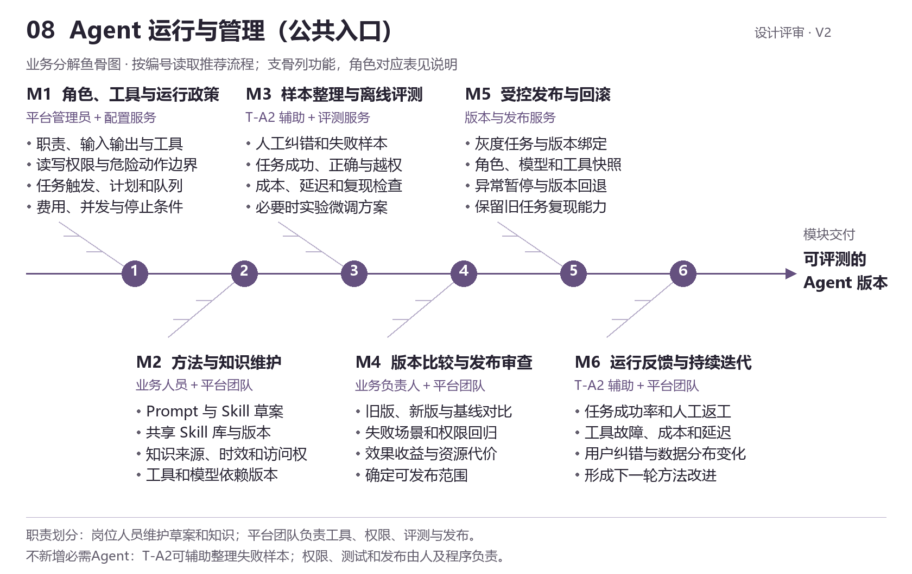

# SVQuant 机构版 · 业务流程与 Agent 职责拆解

设计评审 V2 · 2026-11-04。**目标设计，尚未按本稿改造运行系统。**

适用范围：本聊天维护的机构量化流程方案版。价值投资属于同事独立产品；本稿不修改另一聊天的自主研究版。

## 阅读方法与设计边界

这里采用“业务分解鱼骨图”：主骨按编号呈现推荐进展，支骨展开功能和责任角色，鱼头表示模块交付。它用于产品与工程拆解，不是因果诊断图，也不表示全公司只能串行工作。每张图附有输入、人工工具、AI职责、输出和检查条件。

- 五个核心业务模块、30个业务步骤；另附三个公共入口的分解，避免遗漏管理能力。
- 建议18类逻辑职责：16类模块职责、2类共享研究验证/评审职责。它们不是18个必需进程、18个模型或18个人类岗位；需要隔离权限或验证数据的职责必须有实际隔离。
- 每个业务工具先具备可操作、可测试的输入输出；人和Agent调用同一服务。表单是工具参数的呈现，Agent通过工具接口工作，不靠模拟鼠标填写网页。
- 数值计算、权限检查、状态机、定时任务、硬风控由确定性程序执行；Agent承担理解、计划、工具选择、诊断、解释和有限迭代。
- 流程允许复用、并行和返工，合法的准入/资金/风险关口不能通过跳转页面绕过。
- 本稿的工具均为所需能力目录；是否已接SVQuant API、是否已真实验证，须后续逐项核对，不能把设计表当作已实现接口。

## 一、整体模块和责任分配

| 模块 | 主要职责 | 模块角色 | 共享协作 | 主要交付 |
| --- | --- | --- | --- | --- |
| 数据资源平台 | 提供来源、口径、质量、历史可用时点和版本都明确的数据。 | D-A1 数据接入、D-A2 数据加工、D-A3 质量核验、D-A4 发布维护 | — | 固定数据版本、查询服务、质量报告、原始/加工血缘、维护记录。 |
| 因子工厂 | 将研究想法转成可计算、可复现、有适用范围和证据的因子资产。 | F-A1 因子研究、F-A2 因子实验、F-A3 因子资产 | R-A1 独立验证、R-A2 候选评审 | 因子定义与值、研发/独立验证报告、因子卡、带用途与状态的因子库。 |
| 策略研究平台 | 形成可运行的信号与交易规则，并验证其在约束和成本下的研究表现。 | S-A1 策略设计、S-A2 策略实验、S-A3 跟踪准入 | R-A1 独立验证、R-A2 候选评审 | 可运行策略或模型管线、冻结版本、回测/独立验证/模拟记录、策略库。 |
| 投资组合与执行平台 | 把可用策略配置到明确的资金、账户和约束中，执行获准方案并对账。 | P-A1 组合配置、P-A2 方案协同、P-A3 执行对账 | T-A3 独立风控 | 投资方案、批准快照、目标持仓、部署记录、执行回执和对账结果。 |
| 运行监控与风险平台 | 掌握系统和投资运行状态，处置异常，并将事实反馈到研究和方法改进。 | T-A1 运行监测、T-A3 独立风控、T-A2 归因复盘 | — | 运行看板、风险与处置记录、归因/复盘报告、研究改进和方法评测任务。 |

数据版本、因子库、策略库是共享资产。策略研究可直接使用存量因子或数据/模型，组合可直接使用存量策略；不等待上游本轮产出。不要求所有策略都通过新因子挖掘起步。

因子描述可计算的特征，信号是策略使用这些特征或模型作出的预测/排序/触发判断，策略还要定义信号如何变成持仓和交易规则；组合则进一步在策略与账户之间分配资金。

## 2、数据资源平台（核心业务模块）

提供来源、口径、质量、历史可用时点和版本都明确的数据。

[可编辑矢量图](figures/01-data.svg)

**推荐流程：** D1 需求与接入方案 → D2 采集与归档 → D3 清洗与加工 → D4 质量与时点核验 → D5 版本发布；D6 持续维护在发布后循环运行。

**输入：** 研究数据需求、已授权来源、现有目录、更新计划、历史异常与修订事件。

**交付：** 固定数据版本、查询服务、质量报告、原始/加工血缘、维护记录。

**任务入口：** 已有合格版本可直接供研究使用；新字段、新来源、定时更新或质量事件触发新任务。

**回退与循环：** 缺失回到 D2 补采，规则/映射问题回到 D3；修订生成新版本，并通知受影响研究。

### 流程、功能、Agent与交付

| 步骤 | 输入 | 人工功能与工具 | Agent角色及工作 | 输出 | 检查／人工介入 |
| --- | --- | --- | --- | --- | --- |
| D1 需求与接入方案 | 研究需求、目录、已授权来源。 | 需求表、来源目录、字段与频率选择、连接测试、采集计划编辑。 | D-A1：检索可复用版本，识别缺口，推荐来源、字段和增量计划并解释选择。 | 数据需求单、接入方案、质量与更新标准。 | 新来源、付费和凭证由有权限的人配置；缺少授权就停止该来源接入。 |
| D2 采集与原始归档 | 已确认采集计划、连接与配额。 | 手动/定时采集、历史补采、任务进度、重试与取消、原始批次查询。 | D-A1：提交采集任务，判断失败类型，按预算重试或切换已授权来源。 | 不可覆盖的原始批次、时间戳、采集日志。 | 超配额或持续失败转异常；不通过静默补零或编造数据伪装成功。 |
| D3 清洗与特征加工 | 原始批次、加工规范、规则版本。 | 映射编辑、清洗规则、异常样本对比、文本/事件标注、试运行与重算。 | D-A2：提出规则或提取文本特征，调用加工工具，定位差异并修正草案。 | 标准数据/事件特征、加工版本、原文引用与差异报告。 | 保留原值；重大规则变更人工复核；特征加工保留历史可用时间。 |
| D4 质量与时点核验 | 加工批次、质量标准、来源与时间证据。 | 执行规则检查、抽样比对、跨源核对、异常工单与隔离处理。 | D-A3：解释检查失败，定位源头和下游影响，建议补采或修复。 | 质量报告、异常清单、批次放行检查结果。 | 规则引擎决定硬条件是否通过；Agent 无权修改结果或降低阈值。 |
| D5 版本发布与服务 | 通过检查的批次、发布政策、数据访问权限。 | 版本预览、发布/切换、查询验证、目录权限和变更说明。 | D-A4：补齐元数据，核对证据，调用授权发布流程并验证查询可用性。 | 可查询固定版本、数据说明、发布与通知记录。 | 常规更新可按既定政策自动发布；重大修订或异常放行由人决定。 |
| D6 持续维护与修订 | 更新计划、服务状态、源端修订、质量告警。 | 更新日历、维护工单、影响追踪、补采/重算、版本回滚与恢复。 | D-A4、D-A3、D-A1、D-A2：发现变化，分派接入或加工任务，跟踪复验和下游通知。 | 修订版本、维护工单、恢复与影响记录。 | 持续任务，不是每次研究的前置关卡；已发布历史快照不被改写。 |

### 角色与步骤对应

| 角色 | 本模块覆盖步骤 | 职责 |
| --- | --- | --- |
| D-A1 数据接入 Agent | D1、D2、D6 | 把研究需求转成可执行的取数计划，选择已授权来源并处理采集异常。 |
| D-A2 数据加工 Agent | D3、D6 | 生成并试运行清洗、标准化和文本抽取规则，检查加工前后差异。 |
| D-A3 数据质量 Agent | D4、D6 | 解释独立质量检查结果，定位质量与历史可用时点问题，提出隔离或补采建议。 |
| D-A4 数据发布与维护 Agent | D5、D6 | 组织数据版本发布、服务检查和更新维护，跟踪修订影响。 |

发布门槛：质量规则通过；新来源授权、重大规则变更与异常发布由授权人决定。

持续回路：D6 触发补采、修复和重新发布；已经引用的数据版本保持不变。

## 3、因子工厂（核心业务模块）

将研究想法转成可计算、可复现、有适用范围和证据的因子资产。

[可编辑矢量图](figures/02-factor.svg)

**推荐流程：** F1 研究起点与复用 → F2 假设与验证计划 → F3 实现与计算 → F4 研发检验与改进 → F5 候选冻结与独立验证 → F6 筛选与资产管理。

**输入：** 已发布数据、已有因子及失败实验、研究方向、用途、预算和预设检验规则。

**交付：** 因子定义与值、研发/独立验证报告、因子卡、带用途与状态的因子库。

**任务入口：** 可从已有定义、论文假设、事件特征或研究任务进入；复现已有版本可直接进入 F3/F4。

**回退与循环：** F3 校验失败回修实现；F4 在预算内回 F2/F3；F5 失败归档或形成新研究版本，不无限查询同一封存区。

### 流程、功能、Agent与交付

| 步骤 | 输入 | 人工功能与工具 | Agent角色及工作 | 输出 | 检查／人工介入 |
| --- | --- | --- | --- | --- | --- |
| F1 研究起点与资产复用 | 研究委托、因子库、实验记录、可用数据。 | 检索/导入定义、查看报告、复现已有因子、选择研究方向和数据范围。 | F-A1：检索相关与失败研究，判断复用价值，提出可开展的研究任务。 | 研究任务、复用/新建依据、所需数据清单。 | 数据缺口发给数据模块；不要求等新因子批次才能开展已有资产研究。 |
| F2 假设与验证计划 | 研究任务、字段说明、预设研究政策。 | 假设表、表达式草案、预测目标/持有期、样本切分、接受标准和预算设置。 | F-A1：把想法转成候选定义与可检验计划，指出数据、时间或逻辑冲突。 | 假设卡、候选定义、预先记录的实验计划。 | 明确研发区与封存区；研究中变更目标或门槛须留新版本和原因。 |
| F3 因子实现与计算 | 候选定义、数据版本、预处理与计算参数。 | 表达式/代码编辑、语法与字段校验、预处理配置、计算、因子值预览与导出。 | F-A2：实现草案，调用校验与计算，根据报错修复并记录版本。 | 固定定义、因子值、计算日志与血缘。 | 实现与时点校验失败就返回修复；计算完成不表示因子有效。 |
| F4 研发检验与改进 | 因子值、研发数据、预设指标口径、全部尝试记录。 | 检验参数、IC/分层/分段分析、成本和相关性检查、实验比较、候选修改。 | F-A2：读取真实报告，解释薄弱环节，安排有限补证与改进，保留失败记录。 | 研发报告、候选排序、修订/归档决定与理由。 | 差结果可自动归档；不能只保存最优试验或用研发表现替代独立验证。 |
| F5 冻结与独立验证 | 冻结候选、研发证据、预设标准、受控验证数据。 | 选择冻结版本、提交验证、查看独立报告与失败原因、决定归档或新版本研究。 | R-A1、F-A3：F-A3 整理快照；R-A1 调用独立验证工具并解释通过、失败或证据不足。 | 冻结快照、独立验证报告、限制与适用条件。 | 研究侧不能任意查询封存样本；验证独立性靠权限、数据和任务隔离落实。 |
| F6 候选筛选与资产管理 | 全部实验、独立证据、相似资产、准入政策。 | 因子卡编辑、候选比较、审查/退回、用途授权、版本与停用管理。 | F-A3、R-A2：自动留档；筛出符合条件且有增量价值的候选，组织证据送审并跟踪反馈。 | 研究资产/准入候选/获准版本、因子报告和生命周期记录。 | 留档不需逐条审批；正式准入按用途和授权决定，Agent 不代签。 |

### 角色与步骤对应

| 角色 | 本模块覆盖步骤 | 职责 |
| --- | --- | --- |
| F-A1 因子研究 Agent | F1、F2 | 检索已有研究，提出可检验的因子假设、候选定义与实验计划。 |
| F-A2 因子实验 Agent | F3、F4 | 实现、计算和检验因子，依据研发数据中的反馈进行有预算的修正。 |
| F-A3 因子资产 Agent | F5、F6 | 整理冻结候选、因子卡和证据包，管理复用、准入状态、衰减与停用。 |
| R-A1 独立验证 Agent（共享） | F5 | 针对冻结候选组织可复现、受控的独立验证并出具证据报告。 |
| R-A2 候选评审与送审 Agent（共享） | F6 | 在硬条件检查之后复核证据、去重排序，把值得关注的候选整理给人。 |

分级留存：全部实验自动留档；通过硬筛选与证据复核的候选才进入人工准入队列。

研究回路：F3 ↔ F4 有预算地迭代；F5 使用冻结版本与受控验证环境。

## 4、策略研究平台（核心业务模块）

形成可运行的信号与交易规则，并验证其在约束和成本下的研究表现。

[可编辑矢量图](figures/03-strategy.svg)

**推荐流程：** S1 研究目标与设计 → S2 信号、模型与交易规则 → S3 实现与回测 → S4 优化与研发验证 → S5 冻结与独立验证 → S6 模拟跟踪与策略准入。

**输入：** 投资研究目标、已发布数据、现有因子/模型/策略、交易约束与研究预算。

**交付：** 可运行策略或模型管线、冻结版本、回测/独立验证/模拟记录、策略库。

**任务入口：** 直接使用已有因子库，或使用数据/模型构建策略；因子并非所有策略的唯一入口。

**回退与循环：** S3/S4 在预算内返回 S2；S5 失败归档或重开版本；S6 的执行偏差回研究或执行模块。

### 流程、功能、Agent与交付

| 步骤 | 输入 | 人工功能与工具 | Agent角色及工作 | 输出 | 检查／人工介入 |
| --- | --- | --- | --- | --- | --- |
| S1 研究目标与方案 | 研究目标、数据/因子/策略库、市场与交易约束。 | 目标与基准表、资产选择、证券池、成本/频率/预算和验证计划。 | S-A1：检索已有资产，提出研究方案，检查目标和可用输入是否匹配。 | 策略研究方案、输入版本清单、实验计划。 | 引用未准入资产可用于探索，但必须保留用途标签，不能自动升级为部署资格。 |
| S2 信号模型与交易规则 | 研究方案、数据特征、因子或模型候选。 | 信号/模型配置、规则编辑、持仓与调仓约束、训练与推理方案。 | S-A1、S-A2：提出实现方案，说明因子如何变成信号，以及信号如何决定交易规则。 | 明确的策略规格、规则配置或实现草案。 | 因子值、预测信号和目标持仓不是同一对象；规则须可复现。 |
| S3 实现与成本回测 | 策略规格、固定数据、训练/回测区间、成本和成交模型。 | 编辑/校验代码或配置、提交训练、回测运行、交易账本与报告查看。 | S-A2：实现并运行策略，诊断报错、异常交易或口径冲突，调用工具重算。 | 策略版本、模型产物、回测报告、交易与实验记录。 | 停牌、涨跌停、复权、可成交性等按适用市场配置；回测不等于实盘。 |
| S4 优化与研发验证 | 研发回测、实验预算、改动范围与历史尝试。 | 参数搜索、模型对比、滚动验证、消融/压力测试、失败记录和候选比较。 | S-A2：定位薄弱环节，选择有理由的有限改动，组织补证而非无限追逐最高收益。 | 优化记录、候选版本、稳健性与差异报告。 | 滚动开发验证与最终独立验证分开；所有尝试记录，阈值变更留痕。 |
| S5 冻结与独立验证 | 冻结代码/配置/模型、输入版本、全部研究尝试与标准。 | 冻结与提交、复现检查、独立报告查阅、失败归档或新版本研究。 | R-A1：独立读取冻结证据，调用受控验证，报告通过/失败/证据不足。 | 独立验证报告、冻结可运行包、适用与限制说明。 | 不能同一上下文既生成候选又给自己发验证通行证。 |
| S6 模拟跟踪与策略准入 | 通过验证的版本、模拟授权、持续信号及模拟执行记录。 | 启动模拟、观察期限与标准、偏差报告、策略卡、候选审查与准入决定。 | S-A3、R-A2：复用部署执行服务跟踪模拟；解释偏差、补证或送审，并登记策略版本。 | 模拟记录、策略卡、分级策略库与配置条件。 | 不设固定通用模拟天数；按策略频率和风险事先约定；真实资金另由组合模块授权。 |

### 角色与步骤对应

| 角色 | 本模块覆盖步骤 | 职责 |
| --- | --- | --- |
| S-A1 策略设计 Agent | S1、S2 | 把研究目标转成信号、模型、持仓和交易规则，选择已有数据及因子。 |
| S-A2 策略开发与实验 Agent | S2、S3、S4 | 实现策略或训练管线，运行回测、诊断问题并进行有限优化。 |
| S-A3 策略跟踪与准入 Agent | S6 | 跟踪冻结版本的模拟运行，核对回测偏差，组织策略准入和版本维护。 |
| R-A1 独立验证 Agent（共享） | S5 | 针对冻结候选组织可复现、受控的独立验证并出具证据报告。 |
| R-A2 候选评审与送审 Agent（共享） | S6 | 在硬条件检查之后复核证据、去重排序，把值得关注的候选整理给人。 |

准入边界：策略研究准入与真实资金授权分开；模拟结果和实盘结果分别展示。

复用回路：已有因子可立即使用；开发期调参不读取封存验证结果作为优化目标。

## 5、投资组合与执行平台（核心业务模块）

把可用策略配置到明确的资金、账户和约束中，执行获准方案并对账。

[可编辑矢量图](figures/04-portfolio.svg)

**推荐流程：** P1 目标与授权预算 → P2 策略选择与穿透分析 → P3 配置优化与方案比较 → P4 风险审核与授权审批 → P5 部署执行与对账 → P6 调仓、退出与版本管理。

**输入：** 策略库、资金与账户、持仓/现金、组合目标、风险限额及授权矩阵。

**交付：** 投资方案、批准快照、目标持仓、部署记录、执行回执和对账结果。

**任务入口：** 直接使用已有策略库；新资金、定期再平衡、策略状态变化或风险事件可触发任务。

**回退与循环：** 风险/授权不通过回 P2/P3；执行差异交 P5 与监控模块处置；超出既有授权的调仓重新走 P4。

### 流程、功能、Agent与交付

| 步骤 | 输入 | 人工功能与工具 | Agent角色及工作 | 输出 | 检查／人工介入 |
| --- | --- | --- | --- | --- | --- |
| P1 目标与授权预算 | 公司投资要求、账户状态、授权和限制。 | 组合创建、基准、资金/风险预算、账户限制和责任人配置。 | P-A1：检查信息完整性和约束冲突，提出配置研究需要的参数草案。 | 经确认的组合约束、预算与授权版本。 | 资金和权限由授权人设定；Agent 只能建议，不能自行增加预算。 |
| P2 策略筛选与穿透分析 | 约束、策略库、策略持仓/净值和账户数据。 | 策略筛选、穿透持仓、相关性、集中度、暴露和容量分析。 | P-A1：比较候选，识别重复暴露与容量瓶颈，说明纳入或排除理由。 | 候选策略清单、穿透风险与容量报告。 | 受限账户不能假定互相净额；已停用或不适用策略不得默认纳入。 |
| P3 配置优化与方案比较 | 候选策略、风险模型、预算、成本与当前持仓。 | 手动权重、优化器、压力测试、方案比较、目标持仓和调仓预览。 | P-A1：提出候选权重，调用计算与优化工具，对照约束解释方案差异。 | 候选投资方案、目标持仓、情景和成本报告。 | 权重、资金、风险与容量由计算工具检验；优化失败须报告约束冲突。 |
| P4 风险审核与授权审批 | 候选方案、风险证据、授权矩阵。 | 方案预览、独立风控、负责人审查、重大事项升级、退回与否决。 | P-A2、T-A3：汇总证据、提示冲突、流转审批与跟踪退回；不作人工签署。 | 与方案版本绑定的批准/否决记录、执行交接单。 | 普通事项不必层层签；按授权走责任链，硬风控否决不能被随意绕过。 |
| P5 部署执行与成交对账 | 获准方案、账户授权、固定策略/模型/数据依赖。 | 部署预览、环境选择、启动/暂停、订单/成交查询、对账与异常处理。 | P-A3：核对版本与授权，提交既定计划给执行服务，解释异常并跟踪回执。 | 部署与执行记录、成交回执、对账结果和异常工单。 | 执行服务负责权限、幂等与事前风控；状态不明先查单，不能盲目重发。 |
| P6 调仓退出与版本管理 | 运行反馈、目标偏离、策略状态、新方案和现有授权。 | 再平衡预览、调资/退出方案、差异核对、重新审批、恢复与归档。 | P-A1、P-A2、P-A3：分析是否触发调整，形成新方案并判断是否超出已有授权，跟踪实施。 | 新配置/部署版本、调整依据、审批与执行记录。 | 规则内例行执行与重大变更区分；解除暂停需相应复核，不能由 Agent 自行恢复。 |

### 角色与步骤对应

| 角色 | 本模块覆盖步骤 | 职责 |
| --- | --- | --- |
| P-A1 组合配置 Agent | P1、P2、P3、P6 | 在已确认的目标和预算内选择策略，分析穿透敞口并比较配置方案。 |
| P-A2 投资方案与审批协同 Agent | P4、P6 | 整理配置方案、风险意见和授权材料，跟踪审批、退回与变更。 |
| P-A3 部署执行与对账 Agent | P5、P6 | 把已获授权的版本与计划交给部署/执行服务，核对运行和成交回报。 |
| T-A3 独立风险与处置 Agent | P4 | 解释风险规则和事件证据，评估影响、提出处置建议并跟踪升级。 |

执行门槛：批准版本＋独立风险放行＋确定性事前检查；Agent 不能代签或越权下单。

持续回路：授权内调仓按规则执行；更换策略、超限或重大改动重新审查。

## 6、运行监控与风险平台（核心业务模块）

掌握系统和投资运行状态，处置异常，并将事实反馈到研究和方法改进。

[可编辑矢量图](figures/05-monitor.svg)

**推荐流程：** 事件路径：T1 持续巡检 → T2 识别分级 → T3 处置与授权 → T4 核验恢复；定期路径：T5 归因评价 → T6 复盘改进。两条路径共享记录、并行运行。

**输入：** 数据/任务状态、因子/策略表现、持仓/现金/成交、公告事件、风险规则与历史报告。

**交付：** 运行看板、风险与处置记录、归因/复盘报告、研究改进和方法评测任务。

**任务入口：** 定时巡检、行情/持仓事件、任务失败、数据断更、阈值触发、日终或周度计划。

**回退与循环：** T4 未解决继续处置或升级；T6 分派到数据/因子/策略/组合模块，验收后关闭改进任务。

### 流程、功能、Agent与交付

| 步骤 | 输入 | 人工功能与工具 | Agent角色及工作 | 输出 | 检查／人工介入 |
| --- | --- | --- | --- | --- | --- |
| T1 状态采集与持续巡检 | 状态接口、任务/数据/策略版本、持仓与事件流。 | 运行总览、检查规则、巡检计划、任务/信号/账户明细、异常确认。 | T-A1：聚合重复异常，关联对象与证据，指出信息缺口和影响范围。 | 真实运行状态、异常事件、巡检记录。 | 任务成功、策略有效、账户安全分别判断；无数据不能显示成零风险。 |
| T2 异常识别与风险分级 | 异常事件、风险规则、穿透敞口、原始公告等证据。 | 规则结果、证据核验、事件合并、级别与责任人指派。 | T-A3：解释触发原因、关联暴露、区分事实和推测并提出分级意见。 | 风险工单、影响分析、级别与升级记录。 | 硬阻断由规则服务及时执行；不能为了等待模型分析而继续越限操作。 |
| T3 处置方案与授权决策 | 风险工单、可用处置工具、预授权规则与责任链。 | 方案比较、暂停/限额申请、人工决定、处置派单与超时升级。 | T-A3：提出措施与影响，核对授权、整理决策证据，跟踪指令交接。 | 获准或预授权的处置计划、执行工单。 | 重大投资动作由有权限的人决定；既定保护规则可自动执行，不能擅自放宽。 |
| T4 执行核验与恢复 | 处置计划、执行回报、复测结果、恢复标准。 | 回执核对、风险复测、恢复审批、结单或再次升级。 | T-A1、T-A3：核对措施是否实际生效，提示残余风险和缺失证据，组织恢复申请。 | 处置核验、恢复决定、完整事件档案。 | 已读不等于已解决；解除暂停由适当权限复核，不能直接自动恢复。 |
| T5 收益归因与运行评价 | 完成对账的净值、持仓/成交、成本和研究基线。 | 归因工具、区间/基准选择、成本分解、三类表现对照和报告复核。 | T-A2：调用归因工具，解释贡献与差异，列出残差和需要进一步核验的假设。 | 归因、偏差与运行评价报告。 | 定期执行，无需等待风险事件；没有实盘数据就不生成所谓实盘业绩。 |
| T6 复盘反馈与改进任务 | 归因报告、事件闭环、研究实验、人工纠错。 | 复盘编辑、改进任务、责任/期限、验收记录、评测样本审核。 | T-A2：汇总可追溯事实，提出改进任务和验证标准，整理待核验方法评测样本。 | 定期复盘、跨模块改进任务、评测候选样本。 | 不直接在线自我微调或把模型解释当真值；方法版本经评测后再发布。 |

### 角色与步骤对应

| 角色 | 本模块覆盖步骤 | 职责 |
| --- | --- | --- |
| T-A1 运行监测 Agent | T1、T4 | 持续汇总数据、Agent任务、策略、账户和执行状态，核对处置是否生效。 |
| T-A3 独立风险与处置 Agent | T2、T3、T4 | 解释风险规则和事件证据，评估影响、提出处置建议并跟踪升级。 |
| T-A2 归因复盘 Agent | T5、T6 | 解释经核算的收益和运行偏差，形成复盘、改进任务与经审核的评测样本。 |

硬风控直接由规则服务按预授权阻断；模型负责解释与协同，不作为阻断的等待环节。

两条路径并行：T1–T4 处理事件；T5–T6 定期运行，不能等到出事才归因复盘。

## 7、管理驾驶舱（公共入口）（公共管理入口）

汇聚已有业务事实，帮助负责人定位进展、异常和待处理事项；不另外生产研究结果。

[可编辑矢量图](figures/06-overview.svg)

**推荐流程：** H1 接入事实 → H2 核对状态 → H3 汇总指标 → H4 重点摘要 → H5 钻取跟进 → H6 追踪闭环。

**输入：** 五个业务模块的任务、产物、风险、待审、预算和实际运行事件。

**交付：** 公司总览、重点摘要、可追溯的事项与跟进记录。

**任务入口：** 随业务事件更新，负责人按需查看；驾驶舱关闭不影响后台工作。

**回退与循环：** 所有操作回到所属业务模块，驾驶舱只聚合事实和处理入口。

### 流程、功能、Agent与交付

| 步骤 | 功能 | 承担者／AI工作 | 输出 |
| --- | --- | --- | --- |
| H1 接入业务事实 | 配置可见范围、查看来源。 | 事件与查询服务：无需模型搬运数据；由事件和查询服务汇集。 | 可关联的事件与状态。 |
| H2 核对状态与质量 | 查看状态来源与异常。 | T-A1 运行监测：关联不一致状态并解释缺口，状态仍以实际服务为准。 | 经核对的运行视图。 |
| H3 汇总公司指标 | 筛选时间与模块，查看统计口径。 | 确定性统计服务：无需模型算计数；AI只能读取核算结果。 | 口径明确的公司指标。 |
| H4 生成重点摘要 | 查看或修改管理摘要。 | T-A1 / T-A2：解释已有事实，列出需要关注的事项，不补造进展。 | 带证据链接的重点摘要。 |
| H5 钻取与跟进 | 进入工作台、审查或异常处理。 | 负责人＋业务入口：引用原任务上下文提供解释；实际操作沿用原模块权限。 | 回到原业务对象的操作。 |
| H6 追踪闭环与反馈 | 跟进待办、复核完成与历史记录。 | T-A1 / T-A2：汇总未完成事项与变化，复用现有工单和复盘能力。 | 可追踪的管理闭环。 |

### 角色与步骤对应

| 角色 | 本模块覆盖步骤 | 职责 |
| --- | --- | --- |
| T-A1 运行监测 Agent | H2、H4、H6 | 持续汇总数据、Agent任务、策略、账户和执行状态，核对处置是否生效。 |
| T-A2 归因复盘 Agent | H4、H6 | 解释经核算的收益和运行偏差，形成复盘、改进任务与经审核的评测样本。 |

权限边界：按人员权限汇总与钻取；不在总览页面另设一套审批或计算逻辑。

复用角色：T-A1 汇总运行事实，T-A2 辅助解释；计算统计由程序完成。

## 8、审查中心（公共入口）（公共管理入口）

将不同类型事项路由到各自的检查规则和授权人，减少无效送审。

[可编辑矢量图](figures/07-review.svg)

**推荐流程：** V1 收集事项与证据 → V2 类型路由与硬检查 → V3 AI证据复核 → V4 送审与优先级 → V5 人工决定 → V6 状态回写与反馈。

**输入：** 研究候选、投资方案、风险恢复申请及其固定版本、证据、适用政策。

**交付：** 归档/补证/送审/人工决定、用途状态和完整审查记录。

**任务入口：** 业务模块提交正式候选、投资计划或风险恢复申请；普通实验仍自动留档。

**回退与循环：** 不达标归档，缺证据回到原模块补证；被退回的改版须与原决定关联。

### 流程、功能、Agent与交付

| 步骤 | 功能 | 承担者／AI工作 | 输出 |
| --- | --- | --- | --- |
| V1 收集事项与证据 | 查看原对象、版本与材料。 | R-A2 / P-A2 / T-A3：按事项整理材料；已有独立验证报告原样引用，不能自行重写结论。 | 类型明确的审查申请。 |
| V2 类型路由与硬检查 | 维护获授权规则，查看检查失败原因。 | 政策与规则服务：可解释失败；不得覆盖规则结果。 | 硬检查结果和路由。 |
| V3 证据复核与建议 | 逐项比对原始证据。 | R-A2 / P-A2 / T-A3：研究用R-A2，方案用P-A2协同独立T-A3，恢复用T-A3；不让研究评审替代资金风控。 | 类型对应的复核意见。 |
| V4 送审排序与通知 | 筛选、认领、查看待审事项。 | 送审服务＋责任角色：给研究候选排序并说明理由；重大风险不得被候选数量上限延误。 | 有优先级的人工队列。 |
| V5 人工判断与决定 | 授权人员作决定、附加条件或退回。 | 授权人员主责：只回答问题与整理证据，不签署、不冒用人工身份。 | 有权限、有理由的决定。 |
| V6 回写状态与反馈 | 查看处理结果、接续修改。 | 状态服务＋责任角色：解释结果与整理改进任务；历史决定不可改写。 | 一致的业务状态与历史记录。 |

### 角色与步骤对应

| 角色 | 本模块覆盖步骤 | 职责 |
| --- | --- | --- |
| R-A2 候选评审与送审 Agent（共享） | V1、V3、V4、V6 | 在硬条件检查之后复核证据、去重排序，把值得关注的候选整理给人。 |
| R-A1 独立验证 Agent（共享） | 提供已有独立证据，不重复生成 | 针对冻结候选组织可复现、受控的独立验证并出具证据报告。 |
| P-A2 投资方案与审批协同 Agent | V1、V3、V4、V6 | 整理配置方案、风险意见和授权材料，跟踪审批、退回与变更。 |
| T-A3 独立风险与处置 Agent | V1、V3、V4、V6 | 解释风险规则和事件证据，评估影响、提出处置建议并跟踪升级。 |

授权边界：研究准入、资金授权、风险恢复是不同事项；不共用一个通过按钮的含义。

降低负担：规则先筛，AI复核后送审；不降低门槛凑数量，也不要求逐条审批实验。

## 9、Agent 运行与管理（公共入口）（公共管理入口）

维护角色、工具、方法和运行政策，通过评测改进能力；不是由Agent自行给自己扩权。

[可编辑矢量图](figures/08-agent-management.svg)

**推荐流程：** M1 角色与工具权限 → M2 方法与知识维护 → M3 样本与离线评测 → M4 版本比较与审查 → M5 受控发布与回滚 → M6 运行反馈与迭代。

**输入：** 业务职责、已接工具、Prompt/Skill/知识、历史任务、人工纠错、运行预算和权限。

**交付：** 受版本控制的角色与方法、评测结果、发布/回滚记录、运行政策。

**任务入口：** 业务人员改进建议、重复失败、工具升级或模型/方法变更；运行计划也在此管理。

**回退与循环：** 在线反馈进入经审核的评测集；新版本通过评测和授权发布后才能替换线上方法。

### 流程、功能、Agent与交付

| 步骤 | 功能 | 承担者／AI工作 | 输出 |
| --- | --- | --- | --- |
| M1 角色、工具与运行政策 | 配置角色、工具白名单、计划、预算、并发、暂停和停止。 | 平台管理员＋配置服务：可解释配置，不自行扩权或提高预算。 | 角色配置、工具权限、运行政策。 |
| M2 方法与知识维护 | 编辑、试用、分享、提交改进；维护知识来源和权限。 | 业务人员＋平台团队：通用助手可辅助写草案；发布权限与使用权限分开。 | 可审查的方法/知识候选版本。 |
| M3 样本整理与离线评测 | 标注/审核样本，配置评测，发起离线测试；必要时开展独立训练实验。 | T-A2 辅助＋评测服务：T-A2整理已有失败证据；标准答案需审核，测试和训练数据隔离。 | 审核后的评测样本与结果。 |
| M4 版本比较与发布审查 | 比较评测、审查工具/权限变化，决定发布或退回。 | 业务负责人＋平台团队：可整理报告，不决定自己的上线资格。 | 发布决定、限定范围和回退条件。 |
| M5 受控发布与回滚 | 授权发布、灰度观察、回滚；确认正在运行任务如何处理。 | 版本与发布服务：仅调用已经授权的操作，不能隐式替换运行中任务的方法。 | 发布、灰度、回滚和依赖记录。 |
| M6 运行反馈与持续迭代 | 查看运行统计，选改进方向，审核反馈与方法建议。 | T-A2 辅助＋平台团队：聚合失败模式和改进建议，不把线上回答自动写成训练真值。 | 方法改进任务、监测记录与新评测候选。 |

### 角色与步骤对应

| 角色 | 本模块覆盖步骤 | 职责 |
| --- | --- | --- |
| T-A2 归因复盘 Agent | M3、M6 | 解释经核算的收益和运行偏差，形成复盘、改进任务与经审核的评测样本。 |

职责划分：岗位人员维护草案和知识；平台团队负责工具、权限、评测与发布。

不新增必需Agent：T-A2可辅助整理失败样本；权限、测试和发布由人及程序负责。

## 十、Agent职责卡：工具、交付、权限与评测

这些职责可分别维护Prompt、Skill、知识和评测集，但不要为每个按钮再增加一个Agent。一个研究Agent可以覆盖多个步骤；单次任务也可以调用共享的独立验证角色。

### D-A1 · 数据接入 Agent

| 项目 | 设计 |
| --- | --- |
| 对应业务步骤 | D1、D2、D6 |
| 核心任务 | 把研究需求转成可执行的取数计划，选择已授权来源并处理采集异常。 |
| 工具能力 | 数据目录、来源授权查询、连接测试、采集/补采、任务状态、原始批次登记 |
| 交付物 | 需求与采集计划、原始批次、异常记录 |
| 权限边界 | 不能自行购买数据、配置凭证或扩大来源授权；按配额重试。 |
| 评测关注 | 需求字段覆盖、采集成功率、重复批次率、异常定位与恢复成本 |

### D-A2 · 数据加工 Agent

| 项目 | 设计 |
| --- | --- |
| 对应业务步骤 | D3、D6 |
| 核心任务 | 生成并试运行清洗、标准化和文本抽取规则，检查加工前后差异。 |
| 工具能力 | 字段映射、规则编辑/试跑、单位转换、去重、实体匹配、文档与事件抽取、差异预览 |
| 交付物 | 标准数据、结构化事件、加工规则版本、证据引用 |
| 权限边界 | 原始数据不可覆盖；缺失数值不得凭空补造；大范围规则变更须复核。 |
| 评测关注 | 字段转换准确率、实体/事件抽取准确率、时点错误率、人工纠错率 |

### D-A3 · 数据质量 Agent

| 项目 | 设计 |
| --- | --- |
| 对应业务步骤 | D4、D6 |
| 核心任务 | 解释独立质量检查结果，定位质量与历史可用时点问题，提出隔离或补采建议。 |
| 工具能力 | 质量规则引擎、跨源对照、时间戳核验、异常样本查询、影响分析 |
| 交付物 | 质量报告、异常清单、发布检查结论 |
| 权限边界 | 不能为放行修改检查结果或擅自降低阈值；与加工任务隔离写权限。 |
| 评测关注 | 异常检出与误报率、时间穿越问题发现率、报告与原始检查一致性 |

### D-A4 · 数据发布与维护 Agent

| 项目 | 设计 |
| --- | --- |
| 对应业务步骤 | D5、D6 |
| 核心任务 | 组织数据版本发布、服务检查和更新维护，跟踪修订影响。 |
| 工具能力 | 版本登记/发布、血缘查询、更新监测、修复工单、版本切换与回滚申请 |
| 交付物 | 可查询版本、数据说明、更新与修订记录 |
| 权限边界 | 只发布通过规则且满足授权的数据；历史版本不可静默改写。 |
| 评测关注 | 发布可复现性、更新及时性、血缘完整度、修订通知与恢复时效 |

### F-A1 · 因子研究 Agent

| 项目 | 设计 |
| --- | --- |
| 对应业务步骤 | F1、F2 |
| 核心任务 | 检索已有研究，提出可检验的因子假设、候选定义与实验计划。 |
| 工具能力 | 因子库/失败实验检索、授权文献与知识检索、字段目录、假设与计划编辑 |
| 交付物 | 复用建议、假设卡、候选表达式、验证计划 |
| 权限边界 | 不能把相关性说成因果证明；不能读取封存验证区来指导选题。 |
| 评测关注 | 假设可检验性、资产复用率、无效重复率、后续实验与假设一致性 |

### F-A2 · 因子实验 Agent

| 项目 | 设计 |
| --- | --- |
| 对应业务步骤 | F3、F4 |
| 核心任务 | 实现、计算和检验因子，依据研发数据中的反馈进行有预算的修正。 |
| 工具能力 | 表达式/代码校验、受限执行环境、因子计算、预处理、IC/分层/分段检验、成本与相关性分析、实验对比 |
| 交付物 | 版本化定义、因子值、研发检验报告、全部尝试记录 |
| 权限边界 | 只使用获准数据和工具；不能自行更改验收门槛、封存区或无限试参。 |
| 评测关注 | 实现正确率、复现率、错误修复率、单位有效实验成本、证据完整度 |

### F-A3 · 因子资产 Agent

| 项目 | 设计 |
| --- | --- |
| 对应业务步骤 | F5、F6 |
| 核心任务 | 整理冻结候选、因子卡和证据包，管理复用、准入状态、衰减与停用。 |
| 工具能力 | 候选冻结、血缘与证据核验、相似性检索、因子登记、送审、状态与版本管理 |
| 交付物 | 因子卡、冻结候选、分级因子库、生命周期记录 |
| 权限边界 | 不能把研究留档改成正式准入；不可替代独立验证或人工签署。 |
| 评测关注 | 资产元数据完整度、重复候选拦截率、证据关联准确率、状态流转正确率 |

### S-A1 · 策略设计 Agent

| 项目 | 设计 |
| --- | --- |
| 对应业务步骤 | S1、S2 |
| 核心任务 | 把研究目标转成信号、模型、持仓和交易规则，选择已有数据及因子。 |
| 工具能力 | 数据/因子/策略库检索、研究计划、规则编辑器、模型方案与基准配置 |
| 交付物 | 研究方案、策略规格、信号与规则草案 |
| 权限边界 | 因子、预测信号与持仓规则须分别说明；不能承诺收益或忽略交易约束。 |
| 评测关注 | 规格完整度、规则可执行性、约束遗漏率、目标与验证方案一致性 |

### S-A2 · 策略开发与实验 Agent

| 项目 | 设计 |
| --- | --- |
| 对应业务步骤 | S2、S3、S4 |
| 核心任务 | 实现策略或训练管线，运行回测、诊断问题并进行有限优化。 |
| 工具能力 | 策略配置/受限代码、训练任务、回测、成交/成本模型、滚动开发验证、参数试验、报告对比 |
| 交付物 | 可运行策略版本、模型产物、回测与优化记录 |
| 权限边界 | 不能访问封存验证数据进行调参；训练、信号和交易时间必须一致。 |
| 评测关注 | 执行正确率、复现率、时间泄漏检出、错误修复质量、实验资源效率 |

### S-A3 · 策略跟踪与准入 Agent

| 项目 | 设计 |
| --- | --- |
| 对应业务步骤 | S6 |
| 核心任务 | 跟踪冻结版本的模拟运行，核对回测偏差，组织策略准入和版本维护。 |
| 工具能力 | 模拟部署申请、信号/模拟成交账本、偏差对比、策略卡、证据核对、送审与状态管理 |
| 交付物 | 模拟跟踪报告、策略卡、准入申请、策略库版本 |
| 权限边界 | 模拟不等于实盘；策略研究准入不等于获准使用账户资金。 |
| 评测关注 | 偏差解释与证据一致性、运行故障检出、策略卡完整度、准入记录正确性 |

### P-A1 · 组合配置 Agent

| 项目 | 设计 |
| --- | --- |
| 对应业务步骤 | P1、P2、P3、P6 |
| 核心任务 | 在已确认的目标和预算内选择策略，分析穿透敞口并比较配置方案。 |
| 工具能力 | 策略筛选、持仓穿透、相关性/集中度、风险与容量计算、约束优化、压力情景、方案比较 |
| 交付物 | 候选策略、组合权重、风险与情景报告、再平衡建议 |
| 权限边界 | 不可扩大资金授权、抬高风险限额或把不同策略名称当作分散证明。 |
| 评测关注 | 约束满足率、暴露计算一致性、方案复现性、解释与优化结果一致性 |

### P-A2 · 投资方案与审批协同 Agent

| 项目 | 设计 |
| --- | --- |
| 对应业务步骤 | P4、P6 |
| 核心任务 | 整理配置方案、风险意见和授权材料，跟踪审批、退回与变更。 |
| 工具能力 | 投资方案编辑、授权矩阵查询、风险检查申请、审批流转、版本差异与证据包 |
| 交付物 | 待审方案、审批快照、部署或变更交接单 |
| 权限边界 | 只能组织和流转，不能代签、绕过否决或把旧批准用于已变更方案。 |
| 评测关注 | 材料完整度、授权匹配正确率、批准版本一致性、退回闭环时效 |

### P-A3 · 部署执行与对账 Agent

| 项目 | 设计 |
| --- | --- |
| 对应业务步骤 | P5、P6 |
| 核心任务 | 把已获授权的版本与计划交给部署/执行服务，核对运行和成交回报。 |
| 工具能力 | 模拟/实盘部署接口、授权计划校验、执行状态查询、成交与持仓对账、暂停申请 |
| 交付物 | 部署记录、执行回执、对账差异、异常工单 |
| 权限边界 | 不持有可绕过执行服务的交易权限；不能自行加仓、改方向或重复提交未决订单。 |
| 评测关注 | 版本与授权一致性、重复执行拦截、回报完整度、对账差异发现与闭环率 |

### T-A1 · 运行监测 Agent

| 项目 | 设计 |
| --- | --- |
| 对应业务步骤 | T1、T4 |
| 核心任务 | 持续汇总数据、Agent任务、策略、账户和执行状态，核对处置是否生效。 |
| 工具能力 | 任务与服务状态、数据新鲜度、信号/持仓/成交查询、异常聚合、工单与执行回执 |
| 交付物 | 运行视图、异常事件、处置核验记录 |
| 权限边界 | 不能把数据缺失当成零风险；不以模型解释代替真实运行状态。 |
| 评测关注 | 覆盖率、告警延迟、误报率、执行核验准确率、未闭环事件遗漏率 |

### T-A2 · 归因复盘 Agent

| 项目 | 设计 |
| --- | --- |
| 对应业务步骤 | T5、T6 |
| 核心任务 | 解释经核算的收益和运行偏差，形成复盘、改进任务与经审核的评测样本。 |
| 工具能力 | 对账净值、收益/成本归因、回测-模拟-实盘对比、实验检索、复盘与任务管理 |
| 交付物 | 归因报告、定期复盘、改进任务、待核验评测样本 |
| 权限边界 | 模拟和实盘分别核算；区分事实、推测和残差；不把未经核验结论作为训练真值。 |
| 评测关注 | 数值与核算一致性、解释可追溯性、归因残差披露、改进任务可验证性 |

### T-A3 · 独立风险与处置 Agent

| 项目 | 设计 |
| --- | --- |
| 对应业务步骤 | P4、T2、T3、T4 |
| 核心任务 | 解释风险规则和事件证据，评估影响、提出处置建议并跟踪升级。 |
| 工具能力 | 独立风险规则、暴露与压力工具、公告证据、事件分级、授权与处置工单、恢复检查 |
| 交付物 | 独立风险意见、事件级别、处置与恢复建议 |
| 权限边界 | 硬阻断由确定性服务按授权执行，不等待模型；不能修改阈值或自行解除暂停。 |
| 评测关注 | 风险漏报/误报、分级准确性、处置建议约束符合率、升级时效 |

### R-A1 · 独立验证 Agent（共享）

| 项目 | 设计 |
| --- | --- |
| 对应业务步骤 | F5、S5 |
| 核心任务 | 针对冻结候选组织可复现、受控的独立验证并出具证据报告。 |
| 工具能力 | 冻结快照、独立验证计算、封存数据访问服务、泄漏/成本/稳健性检查、尝试登记 |
| 交付物 | 独立验证报告、通过/失败/证据不足结论 |
| 权限边界 | 与提出候选的任务隔离；研究侧不可直接查询封存区；重复验证有次数与反馈限制。 |
| 评测关注 | 独立性、复现率、泄漏与失效检出、结论与预设标准一致性 |

### R-A2 · 候选评审与送审 Agent（共享）

| 项目 | 设计 |
| --- | --- |
| 对应业务步骤 | F6、S6 |
| 核心任务 | 在硬条件检查之后复核证据、去重排序，把值得关注的候选整理给人。 |
| 工具能力 | 版本化门槛、证据一致性检查、相似性/增量对比、候选队列、送审与补证 |
| 交付物 | 不达标归档、补证任务、优选候选、人工审查材料 |
| 权限边界 | AI意见不能覆盖硬条件；不能降低阈值凑候选、伪造证据或代替人工批准。 |
| 评测关注 | 硬门槛遵循率、重复送审率、证据遗漏率、人工采纳与退回原因 |

## 十一、人工、规则与Agent如何协作

| 事项 | 默认处理 | 何时需要人工 |
| --- | --- | --- |
| 保存定义、计算、普通实验留档 | 程序自动保存，Agent可按授权执行 | 主动研究、纠错或异常处理时介入，不逐条签字 |
| 差候选、重复候选、证据不全 | 硬条件拦截；AI整理理由、去重或提出补证 | 有争议或需要修改政策时介入，不为凑产出降低门槛 |
| 正式因子/策略准入 | 冻结证据＋独立验证＋候选评审后送审 | 按用途与权限决定正式准入；研究留档与准入分开 |
| 资金、账户与重大方案变更 | 独立风险检查＋授权匹配＋方案流转 | 有权限的人批准资金方案，批准绑定准确版本 |
| 已获批策略的例行运行 | 预授权规则内自动执行和监测 | 超范围、异常或风险升级时介入，无需逐条信号签字 |
| 硬风险触发 | 规则服务按预授权立即阻断或限制，并通知人员 | 负责处置、复核与必要的恢复决定；不等待模型给意见 |
| Agent方法与工具更新 | 草案、离线评测、版本比较、受控发布 | 业务人员审核知识/方法；平台团队管理工具、权限、发布与回滚 |

默认允许实验和草案资产被后续探索复用，但保留来源、验证状态和用途限制。正式部署不得把“研究可用”自动升级为“获准配置资金”。因子对某个具体策略是否有价值，仍由策略实验验证，不能用单因子门槛作普适结论。

## 十二、持续运行与Agent实况

人工一次性设定研究范围、预算、运行计划和筛选政策后，系统可由定时计划、新数据发布、资产变更或风险反馈持续触发任务，不必每次手填研究目标。调度服务负责触发、队列、依赖、并发、预算和停机；Agent在任务权限与预算内选择工具、补证、迭代、结束或报告等待。

没有可用数据、缺少授权、预算不足、任务重复或没有值得推进的候选时，应显示明确原因，不用重复调用模型假装忙碌。一个候选等人工审查不应锁住全部研究。

每个步骤页面采用同一个工作对象：输入/参数与工具、产物与报告、Agent运行实况。人可以手动执行、委托本步骤、委托一段任务、取消并接续；中途改输入需要新版本或明确确认，不能覆盖正在执行的快照。

运行实况展示：目标与输入版本；简短执行计划与当前动作；实际工具参数、起止时间、状态与返回值；错误、重试与改动依据；可点击的产物与证据；用量、等待原因与人工介入记录。展示的是实际事件与可解释摘要，不伪造进度，也不要求披露模型私有推理。

## 十三、独立验证与第一轮开发边界

独立验证不是换一个提示词再评论一遍。需要冻结候选及输入、独立工具权限、受控验证数据、明确的预设标准和完整尝试记录。研究方不能用验证结果无限调参；重复查询须有额度、反馈粒度和版本政策。统计、回测与硬条件由工具给出，Agent组织检查并解释证据。

工具优先复用已经核对的SVQuant、ResearchEngine和数据服务接口。不存在的能力要单独开发；完整数据采集维护、封存验证、持续调度、模拟/实盘执行不能只画按钮或用大模型回复冒充实现。

本轮只交付设计与图，没有修改应用、重启服务、触发研究、调用付费模型或交易。当前可复用能力依据既有验收包括部分数据查询、表达式与因子检验、策略回测、组合研究、实验档案与送审；本稿扩展能力仍需逐项接线、测试和验收。

建议下一步先确认因子工厂F1—F6的业务边界，再把每步细化成页面字段、工具输入输出、Agent提示/Skill、权限和验收用例；不要先一次性重做全平台页面。

与2026-11-03旧角色文档的关系：这是在新确认的五模块范围上形成的V2目标设计。组合模块补足执行，对P-A2/P-A3职责重新划分，组合独立风险复用T-A3；任务协调与方法管理先由公共服务/人员承担，未强设U类Agent。旧文档保留，角色编号是设计编号，不直接替换现有接口。

## 文件与复现

- `design.json`：五模块、30步骤、18类角色的编辑源。
- `public.json`：三个公共入口及18个支撑步骤。
- `figures/`：八张PNG预览及对应可编辑SVG。
- `build.py`：离线生成与结构/版面检查；使用相对路径，不读取密钥或业务数据库。
- `验证记录.md`：本轮图文检查与范围记录。

修改JSON后运行同目录的`build.py`重新生成。需要Python、Pillow和中文字体；可通过FISHBONE_FONT/FISHBONE_BOLD_FONT指定字体。
