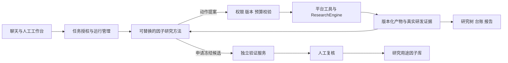

# 机构量化 V5 研究方法模块化与界面契约

版本：1.0 · 变更：CR-080 · 2026-11-09 · 产品与架构：Codex · 实现：张新迪开发会话。

状态：用户已确认设计方向；本文是实施与验收依据，不代表功能已完成。产品仍为机构量化 V5，先完成因子模块真实链路，再实施方法适配层。现有统计政策不在本变更中改写。

## 1. 产品承诺和变更边界

平台让机构授权研究、观察研究、人工介入、核验证据并管理研究成果。稳定的对象是课题、假设、实现、试验、候选、复核与资产；Agent 的数量、职责拆分和执行次序属于可升级的研究方法。

外层交付：授权 → 自主研究及迭代 → 独立验证 → 人工复核 → 研究库。研究过程内部可以分支、回退、等待、调用不同工具或停止。入库只授予研究用途。

本变更把四个职责边界固定下来，把 F0–F6 解释为当前方法与平台能力的映射，不规定未来每种方法必须保留同名 Agent。不增加一组与现有模块平行的产品，不以聊天框取代研究工具和证据页。

| 变更项 | 原设计/实现风险 | 本次决定 |
| --- | --- | --- |
| 方法边界 | F0 直接读项目配置、调用 F2/F3、轮询计算 | 方法提出研究动作；平台控制工具执行、预算、证据与权限 |
| Agent 角色 | F 编号容易被当成永久页面与角色结构 | 四项业务职责稳定；F 编号保留为现有方法的能力标识 |
| 界面 | Agent 组成变化可能被误解为页面重做 | 业务页按对象渲染，执行详情按运行事件渲染 |
| 版本 | 提示词版本不等于完整方法版本 | 每次运行固定方法、配置与工具契约；新版本先评测 |
| 验收 | 新方法会调用模型便称升级成功 | 先过契约和回归，再在同口径预算下比较实际研究效果 |

保留：V5 左侧导航、五个因子页签、研究树虚线与业务编号、人工工具、报告、审查、因子库。未开发模块不删除。唯一局部界面增量是研究方法标识与可展开的执行详情，见第 7 节。

## 2. 四个稳定职责边界

| 职责 | 输入与输出 | 权限及实现 |
| --- | --- | --- |
| 任务与运行管理 | 授权计划 → 有限预算的运行、暂停/恢复/等待与结束记录 | 主要为程序；管理排队、幂等、版本、资源与授权，不替 Agent 编造研究结论 |
| 因子研究子系统 | 研究上下文与研发证据 → 假设、实现、试验请求、候选建议 | 方法适配器；内部可单 Agent、多 Agent、树搜索或其他组合。能提出扩大范围请求，不能自行扩权 |
| 计算与证据服务 | 冻结的输入 → RE 计算、校验、相关性、台账和报告 | 复用平台 API/RE。模型不能直接上传绩效数字当作平台结果 |
| 独立验证与成果准入 | 冻结候选与全量记录 → 独立验证、复核意见、人类决定与资产登记 | 研发侧无封存明细权限。复核 Agent 不能代替人批准；计算与资格检查由程序执行 |

F0、F1、F2、F3 与 F4 的诊断解释属于当前研究方法；F4 的计算属于平台服务；F5 的封存执行、独立意见与人类决定分开；F6 的证据整理优先复用模板与服务。独立验证的方法可以独立升级，但不能由被验证的研究方法改写其判定条件。

## 3. 最小方法接口

先做 Python 进程内的薄适配层，不新增微服务、通用插件市场、拖拽编排器或第二套回测引擎。下面是逻辑接口；开发可映射现有数据结构，须给映射表，避免重复建立课题/台账。

### 3.1 MethodSpec

固定字段：`method_id`、`method_version`、`contract_version`、`code_revision`、`config_digest`、模型配置引用与提示词/Skill 版本、`required_capabilities`、`artifact_kinds`、`state_schema_version`、评测记录引用与状态。

- 描述整个研究方法，不要求每个内部角色都注册为产品级模块。
- 密钥不进入清单；配置引用须受权限管理。外部模型别名可能更新，记录实际返回模型标识和可获得的版本，不保证逐 Token 重现。
- `required_capabilities` 对照锁定数据视图与实际计算服务；缺能力在执行前解释并阻断对应动作。
- 方法不得根据自身意见降低政策门槛；配置和方法版本与政策版本分别记录。

### 3.2 ResearchContext

输入至少包括：机构与获授权对象、topic/plan 的固定版本、问题与目标、研发区间、可用字段和算子、政策版本、预算快照、已授权的分支与试验摘要、证据引用、用户意见、暂停/停止状态、方法自己的持久状态。

上下文摘要必须来自绑定的证据，不拼接不同候选的“最新结果”。按需取详情的工具仍做机构、对象和研发区间检查。摘要过长可以检索与压缩，但不能把课题目标、所选父分支和主要失败证据丢掉。

### 3.3 方法步进与动作提案

逻辑签名：`advance(context, method_state) -> proposal + next_state + trace`。一次步进可以包含受控模型/子 Agent 调用；这些调用也走平台预算与记录，不在私有循环中无限调用。

`proposal` 必须包含：action、目标对象及版本、parent_artifact_ref（涉及修订时）、evidence_refs、arguments、简洁的研究理由、幂等标识。服务端重算预算并校验前置条件，方法不能自报“已通过”。

首期动作复用现有能力：读取研发资料、提出/保存假设、生成/校验实现、申请研发检验、读取研发报告、建立子分支、申请冻结、等待、请求人工处理、停止。尚未支持的工具不能在界面出现为可执行操作。

批次/并行方法可以提出多项动作，平台按每个不同候选独立预留和记账；预算不足返回允许执行的明确子集或拒绝整批，策略须预先声明。首期继续串行，不为适配器先做并行调度。

### 3.4 标准产物

| 产物 | 必需内容 |
| --- | --- |
| HypothesisArtifact | 可证伪假设、方向与机制、父版本、变化说明、数据依赖 |
| FactorArtifact | 受支持的表达式/受限代码或内置引用、定义与源码哈希、输入字段、时间可用性、预热需求、校验结果 |
| ExperimentRequest | 冻结产物、数据、股票池、参数、政策、分支、幂等身份 |
| ExperimentEvidence | 平台外部运行 ID、真实指标/缺失原因、输入哈希、计算版本、完整报告引用 |
| CandidateBundle | 冻结假设/实现/试验/政策、全量台账引用、适用范围、限制与候选状态 |

未知产物类型不可静默当公式因子入库；在能力检查处说明需扩展。训练模型等新业务产物需要新契约及相应界面，不承诺任意算法无改动接入。

### 3.5 研究关系与执行事件分开

研究关系描述假设和产物如何演变；执行关系描述某次运行中的 Agent/工具调用。一个 H 节点可以由多个参与者协作，一个参与者也可处理多个 H 节点。不能把每条模型消息自动画成一个 H 节点。

执行事件：`event_id / run_id / sequence / occurred_at / method_ref / actor_ref / parent_activity_id / activity_id / topic_ref / branch_ref / kind / state / summary / evidence_refs / usage / visibility`。

- kind 使用有限公共类别，例如 research_proposal、implementation、tool_run、evaluation、human_input、wait、error、stop；内部参与者名称作为数据，不用于前端 switch(F0/F1...)。
- Agent 发出的观察/解释与服务端计算结果标明来源。事件文字不是权威指标。
- 后端按可见性过滤封存明细、密钥与机构私有信息，不依靠前端隐藏。
- 序号用于重连去重与缺段检测，时间戳不能代替事件身份。原始事件不可删除以美化运行；修正追加事件。
- 只保存可核验工作摘要，不要求或展示模型私有思维链。
- 未知可读事件采用安全通用行显示；不渲染方法输出的任意 HTML。不支持的执行命令拒绝，不靠通用渲染器执行。

## 4. 人工介入和运行可靠性

聊天、表单与 Agent 经同一业务操作接口。聊天内容先成为结构化意图，绑定当前课题与版本；有歧义的对象或新增费用/授权按既有规则确认。聊天不能另开一套不计账的研究路径。

“给研究意见”只提供下一次决策的输入，不改变门槛；从分支接手派生人工版本；已被执行使用的版本只读。批准影响未来动作，不回写已冻结候选。

平台持久化已接受动作、预算预留、外部运行 ID 与结果落账状态；方法私有 checkpoint 只管理自身搜索状态，不能成为预算和审批的唯一真相。崩溃恢复先查询已提交任务，再续跑，不能因方法恢复重发已执行工具。

暂停阻止领取新动作。在途计算按当前取消能力完成或协作取消并留痕；页面不能显示已经撤回实际仍在跑的任务。研究库准入与实盘授权继续分开。

### 4.1 当前 AC-14 授权澄清（阶段 A 即执行）

这是因子详规第 7 章和 AC-14 的实现澄清，不等待方法适配层，不新增审批层级。

- 授权人：本机构 `can_manage` 研究负责人；研究员/Agent 可申请但不能审批，独立复核员的入库权限不等于研究范围授权权。本期不增加风控会签；这里没有资金或实盘授权。
- 可申请：受支持的股票池、已有可用数据/频率、研发区间和课题试验/Token预算。预算批准仍受机构总额及既有费用授权约束，不能自动提高空间总额。当前能力未实现或数据未发布，批准意愿也不能变成可执行能力，应明确“数据/工具待接入”。
- 不可申请放宽：硬门槛、显著性规则、独立复核、数据权限、封存隔离。更换封存窗口、已曝光数据混入研发等转为单独研究政策评审，不用普通扩权按钮实现。
- 请求绑定机构、课题、当前计划版本、提出分支、变更前后差异、理由/证据和费用影响。课题进入等待授权，不再领取新研究动作；已有计算继续按原版本记账。
- 批准：检查请求未过期、权限/数据/工具/预算仍满足；新建不可变 plan_version，旧产物/试验继续绑定旧版本。待旧在途动作完成或受控结束后，基于新版本创建后续运行段。范围改变后的结论必须重新计算，不能复用旧分数充作通过。
- 拒绝：记录理由，将拒绝与原范围传回研究方法；课题在原授权和剩余预算内继续。若能力或预算仍不足，则等待/停止并说明，不反复提交同一申请。
- 版本切换不重置课题K、累计消耗、在途预留或封存曝光历史。审批接口要求预期版本与幂等键，重复提交只产生同一决定；过期请求不得覆盖新的授权。
- 界面沿用原型已有授权待办/负责人处理入口，展示请求差异、原因和批准/拒绝。不能删掉原控件，也不能用普通研究意见暗中代替授权。若已有入口无法表达上述差异，先给局部界面补丁再接入。

最小验收：研究员申请但不能批准；负责人拒绝后按原范围恢复；负责人批准受支持变更后产生新计划版本；旧证据/K/额度保留；缺分钟数据时明确等待且不调用日频冒充；重复和过期审批被正确处理。实际加额度仍须按产品已有权限操作，本说明不是对任意任务额度提升的执行授权。

## 5. 方法版本与发布

1. 初次接入把当前实现注册为一个明确版本；用 legacy 标记无法完整补齐版本身份的旧运行，不伪造历史配置。
2. 运行开始固定完整 MethodSpec 及配置摘要。新增代码、提示词、模型配置、Skill 或工具契约变化生成新版本；发布不改变旧运行。
3. 方法下线可禁止新运行；旧运行能否继续由兼容部署与权限决定。不兼容则暂停并说明原因，不自动使用最新方法。
4. 需要中途切换时，先停止新增动作、核清在途任务，再创建明确的新运行并记录迁移关系。保留同一课题台账、预算与封存曝光记录，不通过换方法重置统计历史。
5. 回退只改变之后的默认方法。历史证据、已消费预算、封存记录不回退。
6. 发布前验证契约、回归、权限、预算和恢复，再评估研究效果。不是谁能编辑Skill，谁就能直接修改机构默认方法。

首期只要求版本固定与代码登记；可视化发布、灰度管理与管理员编辑放后续。研究员能看方法和申请建议，不默认拥有发布权限。

## 6. 方法效果评测

先用当前方法作为基线，再接小预算的第二种适配器验证替换能力。契约测试可用明确标识的替身方法，不把替身成功说成新算法真实有效。

真实比较冻结相同数据、任务集合、允许工具、研究政策，并同时设试验数、Token/费用与墙钟上限。记录模型配置、失败尝试和人工投入。按多课题与多次运行报告分布，不能用一次幸运成功选方法。

指标：可执行产物率、实质修订率、无效/重复试验比例、停止与恢复正确率、证据完整率、独立期表现、候选多样性、每项有效成果成本与人工耗时。F0 与专家下一步一致率仅作诊断，不作为唯一最优判断。

研发反馈和最终方法评测分开。反复用同一封存区间选择方法会造成泄漏；当前按K提高门槛不构成自适应过拟合已解决的证明。研究家族/封存曝光治理另列政策评审，不在本变更中修改历史门槛。

## 7. 前端规则与原型增量

[CR-080 交互增量](../factor-methods.html) 是局部设计附件，沿用 V5 外壳和样式。它演示两个不同方法的**独立样例运行**如何进入同一研究视图，不是在线切换现有运行的方法。场景数据不接真实模型、数据库或审批。

| 位置 | 本次规则 | 保留内容 |
| --- | --- | --- |
| 研究运行 | 当前动作/等待原因来自后端；方法名称和版本只读；展开执行详情看真实参与者 | V5 课题看板、研究树、T/H/E 编号与虚线 |
| 分支详情 | 显示固定产物、变化说明、试验及证据；点击保持选中，不被最新事件抢走 | 人工接手、意见、台账与报告入口 |
| 执行详情 | 通用事件按实际参与者与工具渲染，能跳到相关研究对象 | 与研究树分开展示；不强制新增一种Agent就新增页面 |
| 人工研究 | 以假设、实现、检验等业务工具分类；编辑和Agent共享产物契约 | 原工具页签、右侧助手和原权限 |
| 审查/因子库 | 同一标准证据包，标来源方法版本，不按方法重新设计审核 | 固定候选版本、完整试验、独立复核与资产状态 |
| 能力与评测 | 方法列表 → 组成、依赖、版本、评测；F编号是当前方法内部条目 | 当前原型能力表可作为现有方法详情，不删除历史记录 |

实际接入先增加只读方法身份和可展开执行事件，其他页面只追加来源引用。前端不假定七个Agent、不把完成Agent数当总进度，也不从页面打开情况触发研究。没有事件时显示暂无运行记录；等待/失败明确责任与下一动作。未来新增模型训练产物时按R1同步新产物详情设计。

## 8. 开发分期与映射

| 阶段 | 交付 | 开工与验收 |
| --- | --- | --- |
| A 当前收口 | 继续074—079的真实因子链路、R4、预算/分支/失败/恢复与复核 | 不因本变更中断；不以写完接口设计替代真实验收 |
| B 最小适配 | 当前方法封装、冻结MethodSpec、统一动作/证据、执行事件映射、只读方法展示 | A具备可回归基线后，在dev-zxd实现；复用已有表/路由，新增迁移先报业务方 |
| C 替换能力验证 | 第二个受控适配器通过同一契约，原业务页面无需改写 | 替身证明契约；真实方法另做固定预算研究比较 |
| D 后续能力 | 多方法发布界面、并行搜索、训练与微调、跨模块因子模型联合优化 | 独立任务，依据评测及资源安排，不提前堆入本次交付 |

现有 `decision_engine.run_steps` 可继续担任受控步进器；`f0_agent` 封装为当前方法，不要求一次搬空文件。`service/ledger/novelty/sealed/review` 保留平台职责。`agent_jobs` 可复用工具事件和模型用量；把所有内部模型调用的费用汇总至本次运行。策略以后复用契约形状，但使用独立产物类型、政策和预算，不因共用代码自动变更策略行为。

开发交付文件到责任单元映射、差异说明和最小迁移计划。所有开发写入仅限 `/home/dev01/project/SVQuant-zxd/`；RE按现有隔离副本与PR流程处理。

## 9. 验收矩阵

| 编号 | 场景 | 通过标准 |
| --- | --- | --- |
| MC-01 | 更换内部参与者/从单Agent改协作 | 同一业务渲染器展示产物与事件；无需新增参与者专属页面 |
| MC-02 | 选择历史H1而当前配置在H2 | 新版本基于明确父产物，结果与证据挂正确分支 |
| MC-03 | 方法申请超预算/越机构/读取封存明细 | 所有入口由平台拒绝，保留原因；子Agent也不能绕过 |
| MC-04 | 发布方法v2时v1在运行 | v1保持原方法身份，v2仅用于获准新运行；不静默热切换 |
| MC-05 | 暂停、重启、重复动作 | 不领取新动作；已发任务被核对；不重复计费或入账 |
| MC-06 | 方法回退/切换 | 课题K、预算预留、封存曝光和历史证据保留 |
| MC-07 | 聊天/表单/Agent执行同一操作 | 对象、权限、预算、结果归属与台账语义一致 |
| MC-08 | 服务错误、重复、数值失败 | 结论分类正确，方法看到实际阻断，不能统一伪装研究失败 |
| MC-09 | 换算法但输出同类FactorArtifact | 原报告、复核与因子库正常使用；来源方法可追溯 |
| MC-10 | 不支持的产物或能力 | 执行前明确拒绝；未知可读事件安全展示，不导致整页崩溃 |
| MC-11 | 事件重连/乱序/新增事件 | 按ID去重与序号整理，保留用户选中分支，不泄漏受限证据 |
| MC-12 | 新方法有效性 | 契约、替身、真实模型/数据、浏览器分别验收；同预算评测有原始记录 |

原型验证：1366与1024宽度无整页横向溢出；切换独立样例运行只更新内容而不改导航结构；H节点可选、事件可追到证据；展开运行详情能看到不同的内部参与者；原型意见/暂停明确标样例操作，不向运行系统发请求。

## 10. 依据与适用范围

- [RD-Agent(Q)](https://arxiv.org/html/2505.15155v2)：借鉴研究、实现、验证、反馈的接口与闭环；继续用本平台RE，不移植整套运行环境。
- [AIDE](https://arxiv.org/html/2502.13138v1)：借鉴候选解树、选父节点及draft/debug/improve；含固定调度启发式，不以有无固定步骤判断研究质量。
- [AlphaAgent](https://arxiv.org/html/2502.16789v2)：后续可增加复杂度、表达式结构和假设实现一致性诊断，不能替代实际相关性计算。
- [AlphaDiverse](https://arxiv.org/html/2609.29014v1)：借鉴规划/实现节点替换、多样化轨迹与独立时间区间评测；后训练属于后续实验，不是本轮交付。
- [LangGraph持久化](https://docs.langchain.com/oss/python/langgraph/persistence)：参考检查点与跨运行存储的职责区分；当前不引入该依赖。

本文的四职责边界、接口和发布规则是本产品设计判断，不是文献证明的唯一最优结构。

## 11. 被替代条款与交接

因子规格4.1和全产品PRD11中列举的F0–F6作为现有方法/服务映射，不再要求未来每种方法保留同样内部角色。其他现行预算、统计、封存、审批规则保持；与078关键算法补充共同生效。因子原型完整页面继续为基线，本附件只定义上述局部增量，不允许开发重画其余页面。

开发需在CX-20261109-080回执中签收本文版本、原型文件及哈希、A/B分期、最小接口映射和现有未完成项。实现完提交MC矩阵证据，再由产品经理实机验收。需求、原型交付完成与功能实现完成分别报告。
